# AegisOps — Architecture and Execution Flow

**Audit Phase**: Phase 2  
**Auditor**: Senior Python Engineer / ML Researcher / SRE / Security Reviewer  
**Scope**: Complete Call-Graph & Runtime Path Analysis (`c:\DL_PROJECT`)

---

## 1. End-to-End Runtime Lifecycle

The AegisOps application is structured around a real-time reactive loop hosted in Streamlit (`app.py` -> `live_monitoring.py`) and an optional asynchronous background collection worker (`collectors/worker.py`).

```mermaid
flowchart TD
    subgraph UI_Lifecycle ["1. Dashboard Startup & Reactive Loop"]
        A["app.py: render_live_monitoring()"] --> B["live_monitoring.py: live_panel()"]
        B -- "@st.fragment(run_every='5s')" --> C{"st.checkbox('Collect live metrics')?"}
    end

    subgraph Telemetry_Pipeline ["2. Telemetry Ingestion & Storage"]
        C -- "Yes" --> D["collect_live_sample()"]
        W["collectors.worker: main() [Optional Headless]"] --> D
        D --> D1["psutil.cpu_percent(), virtual_memory(), disk_usage()"]
        D --> D2["requests.get(service_url + '/probe')"]
        D1 & D2 --> D3["TelemetryStore.add_sample()"]
        D3 --> DB1[("SQLite: telemetry_samples")]
    end

    subgraph Anomaly_Detection ["3. Anomaly Scoring & Gatekeeping"]
        DB1 --> E["_analyze_latest(store, samples)"]
        E --> F{"models/live_lstm_autoencoder.pt exists AND samples >= 24?"}
        F -- "No" --> G["_bootstrap_analysis() [Static Rules: CPU>=90, Latency>=1000ms]"]
        F -- "Yes" --> H["load_live_detector().detect(window)"]
        H --> I["LSTM Autoencoder Reconstruction MSE Score"]
        I & G --> J{"Guardrail Triggered? (HTTP != 200, Latency >= 1000ms)"}
        J -- "Yes (OR Gate)" --> K["Flagged as Anomaly: is_anomaly = True"]
        J -- "No" --> L["Normal Telemetry"]
    end

    subgraph Agent_Response ["4. Multi-Agent Investigation & Diagnosis"]
        K --> M["Operator clicks 'Run agents on latest live evidence'"]
        M --> N["_build_live_incident()"]
        N --> O["IncidentAgents.manager_step()"]
        O --> P["IncidentAgents.investigation_step()"]
        P --> Q["IncidentAgents.diagnosis_step()"]
        Q --> R["store.log_event('live_agent_investigation')"]
        R --> DB2[("SQLite: incident_events")]
    end

    subgraph Approval_Gating ["5. Approval Ticket State Machine"]
        Q --> S["Operator clicks 'Request recovery approval'"]
        S --> T["ApprovalStore.request('clear_demo_service_fault')"]
        T --> DB3[("SQLite: recovery_approvals [status: pending]")]
        DB3 --> U["Operator inputs phrase: 'APPROVE clear_demo_service_fault'"]
        U --> V["ApprovalStore.approve() -> status: approved"]
        V --> W1["store.log_event('recovery_approval_granted')"]
    end

    subgraph Remediation_Verification ["6. Execution & Closed-Loop Verification"]
        W1 --> X["Operator clicks 'Execute approved recovery and verify'"]
        X --> Y["ApprovalStore.consume() [Atomic consumption]"]
        Y --> Z["_resolve_local_test_fault()"]
        Z --> Z1["Safety Check: _is_loopback_target() AND validate_local_service_url()"]
        Z1 --> Z2["requests.post(service_url + '/admin/fault', json={'mode': 'normal'})"]
        Z2 --> Z3["Independent Probe: requests.get(service_url + '/probe')"]
        Z3 --> Z4{"status == 200 AND latency < 1000ms?"}
        Z4 -- "Yes" --> AA["IncidentAgents.verification_step() -> verified: True"]
        Z4 -- "No" --> AB["Verification Failed"]
        AA --> AC["store.log_event('recovery_execution_finished')"]
        AC --> DB2
    end
```

---

## 2. Granular Stage-by-Stage Function Trace

### Stage 1: Application Startup & Target Configuration
- **Caller**: `app.py:25` (`render_live_monitoring()`).
- **Callee**: `live_monitoring.py:615` (`render_live_monitoring`).
- **Logic**:
  1. Configures target service URL from `DEFAULT_SERVICE_URL` (`os.getenv("AEGISOPS_SERVICE_URL", "http://127.0.0.1:8765")`).
  2. Validates target using `validate_monitoring_target_url(service_url)`.
  3. Registers `@st.fragment(run_every="5s") def live_panel()`.

### Stage 2: Telemetry Collection
- **Caller**: `live_monitoring.py:665` (Streamlit fragment) or `collectors/worker.py:42` (headless collector).
- **Callee**: `collectors/system_metrics.py:65` (`collect_live_sample`).
- **Callee Internal Operations**:
  - `psutil.cpu_percent(interval=0.15)` (`system_metrics.py:78`): Host CPU utilization.
  - `psutil.virtual_memory().percent` (`system_metrics.py:79`): Host RAM utilization.
  - `_disk_usage_percent()` (`system_metrics.py:80`): Host drive utilization.
  - `requests.get(probe_url, timeout=3.0, allow_redirects=False)` (`system_metrics.py:87-93`): Measures elapsed round-trip time (`time.perf_counter()`) and HTTP status code.
  - Calculates rolling probe error rate over the previous 19 stored samples + current sample (`system_metrics.py:122-124`).

### Stage 3: Storage & Persistence
- **Caller**: `collectors/system_metrics.py:138` (`store.add_sample(sample)`).
- **Callee**: `storage/telemetry_store.py:63` (`TelemetryStore.add_sample`).
- **Logic**: Executes parameterized SQL insert into `telemetry_samples`. Returns autoincrement integer `id`.

### Stage 4: Anomaly Detection & Guardrail Integration
- **Caller**: `live_monitoring.py:687` (`_analyze_latest(store, rows)`).
- **Branching Decision**:
  - **Path A (Live DL Available)**: If `models/live_lstm_autoencoder.pt` exists and `len(samples) >= 24`:
    - Calls `load_live_detector()` (`dl/live_training.py:109`).
    - Constructs 2D float32 array of shape `(24, 5)` from the last 24 observations.
    - Calls `detector.detect(window)` (`dl/anomaly_detector.py:150`):
      1. Scales `(window - mean) / std`.
      2. Feeds through `LSTMAutoencoder(x)` to get `reconstructed`.
      3. Computes MSE reconstruction score `squared_errors.mean()`.
      4. Compares `score > self.threshold`.
    - **OR-Gate Guardrails** (`live_monitoring.py:165-204`): Overrides prediction to `is_anomaly = True` if:
      - `status_code != 200`
      - `latency_ms >= 1000`
      - `cpu_pct >= 90`
      - `memory_pct >= 95`
      - `disk_pct >= 95`
  - **Path B (Bootstrap Fallback)**: If no live model checkpoint exists:
    - Calls `_bootstrap_analysis(latest)` (`live_monitoring.py:75`): Pure rule-based threshold evaluation.
- **Persistence**: Annotates the sample in SQLite via `store.annotate_sample(sample_id, score, is_anomaly, mode)` (`storage/telemetry_store.py:104`).

### Stage 5: Incident Creation & Multi-Agent Investigation
- **Caller**: Operator triggers "Run agents on latest live evidence" button (`live_monitoring.py:904`).
- **Callee**: `live_monitoring.py:427` (`_run_agent_investigation`).
- **Orchestration**:
  1. `_build_live_incident()` (`live_monitoring.py:300`): Builds a standardized incident dictionary combining live metrics, recent service logs (`_service_logs()`), and detector results.
  2. `agents = IncidentAgents()` (`agents.py:208`).
  3. `manager = agents.manager_step(incident)`: Produces investigation tasks and priority.
  4. `investigation = agents.investigation_step(incident, manager, analysis)`: Extracts log signals and combines with DL analysis.
  5. `diagnosis = agents.diagnosis_step(incident, investigation, analysis)`: Synthesizes candidate causes into a concise root cause statement.
  6. `store.log_event("live_agent_investigation", trace)`: Appends full audit trace to `incident_events`.

### Stage 6: Approval Request, Validation & One-Time Consumption
- **Caller**: Operator triggers "Request recovery approval" (`live_monitoring.py:1055`).
- **Callee**: `approval.ApprovalStore.request()` (`approval.py:57`):
  - Generates UUID v4 `ticket_id`.
  - Sets `expires_at = now + ttl_seconds` (default 300s).
  - Inserts ticket with status `pending`.
- **Approval Granting**:
  - Operator types exact phrase `APPROVE clear_demo_service_fault` and approver label.
  - Calls `approval.ApprovalStore.approve()` (`approval.py:80`).
  - Verifies exact phrase, non-expired status, and exact scope matching (`action_id, target, incident_id`).
  - Updates ticket status to `approved`.
- **Atomic Consumption**:
  - Operator clicks "Execute approved recovery and verify".
  - Calls `approval.ApprovalStore.consume()` (`approval.py:109`).
  - Runs in `BEGIN IMMEDIATE` transaction: updates status from `approved` to `consumed`. If `rowcount != 1`, raises `ApprovalError` (preventing double-spend/replay).

### Stage 7: Remediation Execution & Closed-Loop Verification
- **Caller**: `live_monitoring.py:1195` (`_resolve_local_test_fault(trace, service_url, store)`).
- **Execution Path**:
  1. Validates local loopback safety: `validate_local_service_url()` (`collectors/system_metrics.py:21`). Rejects remote targets.
  2. Checks pre-flight health: `_get_service_health()` (`live_monitoring.py:484`). Confirms service is reachable and has active fault.
  3. Generates resolution payload: `agents.resolution_step(incident, diagnosis)` (`agents.py:244`).
  4. Forces allowed action: Hardcoded override line 514: `"action_id": "clear_demo_service_fault"`.
  5. Sends HTTP POST: `requests.post(f"{service_url}/admin/fault", json={"mode": "normal", "delay_ms": 1200})`.
  6. Executes post-remediation verification:
     - Calls `_get_service_health(service_url)`: Verifies `status == 'ok'` and `fault_mode == 'normal'`.
     - Calls `requests.get(f"{service_url}/probe")`: Verifies HTTP status 200 and latency < 1000ms.
  7. Calls `agents.verification_step(incident, diagnosis, action_id, action_result)` (`agents.py:258`): Produces agent verification confirmation (`verified: True`).
  8. Appends audit log: `store.log_event("live_local_remediation", outcome)`.

---

## 3. Critical Architectural Realities & Code Path Separation

### A. Is the dashboard responsible for running the collector?
**Yes, by default.** In the standard single-process workflow (`app.py`), the UI fragment `@st.fragment(run_every="5s")` calls `collect_live_sample(store, service_url)` on every tick. If the user closes the browser or stops the Streamlit server, collection immediately ceases.

### B. Does monitoring continue when the dashboard stops?
**Only if `collectors.worker` is manually launched in a separate terminal/process.** If the operator executes `python -m collectors.worker`, sampling continues in a headless loop. However, running both the worker and the dashboard simultaneously leads to duplicate sampling because there is no cross-process locking or singleton guard on the database.

### C. Does the live workflow accidentally call synthetic/demo code?
**Verified: No direct call to synthetic simulation, but heuristic coupling exists.**
- The live workflow does **NOT** call `simulator.execute_action()` or `simulator.get_incidents()`.
- The live workflow does **NOT** load `models/lstm_autoencoder.pt` (it requires `models/live_lstm_autoencoder.pt`).
- **Coupling Gotcha**: When agents operate in offline mode (`agents.GROQ_API_KEY == ""`), `GroqAgent._run_local` uses hardcoded keyword heuristics (`_local_root_cause`) derived from the synthetic demo scenarios (`pool exhausted`, `customer-db`, `worker process`).
