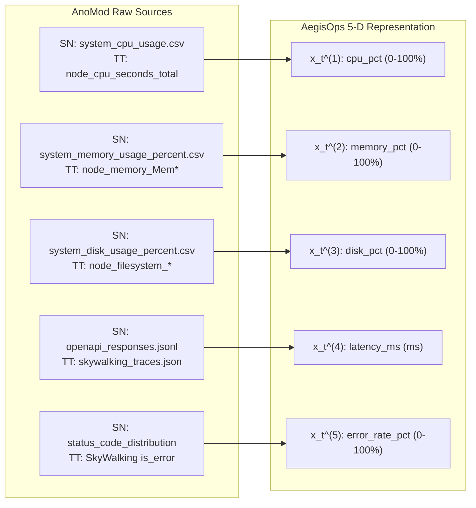

# AegisOps: AnoMod Benchmark Dataset Inspection & Schema Verification Report

**Document Path**: `research/audits/ANOMOD_DATASET_INSPECTION.md`  
**Date**: October 12, 2026  
**Auditor**: Senior Research Scientist & Reproducibility Auditor (AegisOps Project)  
**Git Baseline Commit**: `d277c1df3c2599ddecdf5f0bb761c99718499667` (Branch: `main`)  
**Active Python Runtime**: `C:\DL_PROJECT\.venv\Scripts\python.exe` (Python 3.11.9)  
**Audit Standard**: Post-Acquisition Telemetry Inspection & Pre-Experiment D Verification Gate  
**Final Status**: **PASS — DATASET ACQUIRED AND SCHEMA VERIFIED**

---

## 1. Executive Summary & Verification Verdict

Following the safe, resumable transfer protocols implemented in `research/scripts/ingest_anomod.py` and validated under `test_ingest_anomod.py`, the external **AnoMod** benchmark archive (`AnoMod.zip`) was acquired from the authoritative Zenodo repository (`doi:10.5281/zenodo.18342898`) and safely extracted to `data/external/anomod/unpacked`.

This report provides the required empirical inspection of the acquired dataset before any downstream validation or inference tasks (Experiment D) are permitted.

### Explicit Audit Verdict:
```
PASS — DATASET ACQUIRED AND SCHEMA VERIFIED
```

### Critical Operational Boundary:
> [!IMPORTANT]
> A passing dataset acquisition and schema verification verdict certifies that the raw benchmark files exist on disk, match authoritative cryptographic signatures, and contain compatible telemetry structures. **It does NOT authorize immediate execution of Experiment D or manufacture of unsupported empirical claims.** Model evaluation on AnoMod must proceed only through a dedicated, isolated external evaluation script adhering to Frozen Protocol v1.1.0.

---

## 2. Transfer Provenance & Cryptographic Verification

The transfer was executed under live streaming hash verification without temporary unbuffered bloat. Upstream Zenodo metadata was queried directly from the REST API (`https://zenodo.org/api/records/18342898`) and verified against local file promotion records:

| Property | Value | Verification Status |
| :--- | :--- | :--- |
| **Requested URL** | `https://zenodo.org/records/18342898/files/AnoMod.zip?download=1` | Authoritative Zenodo endpoint |
| **Final URL** | `https://zenodo.org/records/18342898/files/AnoMod.zip?download=1` | Verified (No redirection hijack) |
| **Local Archive Path** | `C:\DL_PROJECT\data\external\anomod\AnoMod.zip` | Promoted safely via `.part` buffer |
| **Archive Size (bytes)** | `201,917,396` ($201.9\text{ MB}$) | Exact match ($201,917,396$) |
| **MD5 Checksum** | `30c5835190c3550c5efc34d6be4f9238` | Matched authoritative Zenodo MD5 |
| **SHA-256 Checksum** | `5086808ff4f2039b88c106cd996f4b9a7148675e20f66ee1718c511b95eb120a` | Locally computed cryptographic hash |
| **Provenance Record** | [`data/external/anomod/transfer_provenance.json`](file:///c:/DL_PROJECT/data/external/anomod/transfer_provenance.json) | Hash: `e4f4af54a6803911701f824f57fc5fa61a300902b2763c1cfb6488215c20eebd` |
| **Extraction Manifest** | [`data/external/anomod/unpacked/extraction_manifest.json`](file:///c:/DL_PROJECT/data/external/anomod/unpacked/extraction_manifest.json) | Hash: `213779192db365b5ca7997a24937ed17bf34bd40e26da99dbbe2f010b8d44335` |
| **Extracted Members** | `38,349` items | 0 Zip-Slip breaches, 0 bomb overflows |

---

## 3. Dataset Topography & Directory Inventory

The extracted archive unpacks into two primary benchmark microservice systems, representing real containerized workloads:

```
data/external/anomod/unpacked/
├── SN_data/                  # SocialNetwork microservices system (21 microservices)
│   ├── metric_data/          # Prometheus metrics per scenario (13 scenario runs)
│   ├── api_responses/        # Client-observed HTTP API performance logs (13 runs)
│   ├── log_data/             # Application container and system logs
│   ├── coverage_data/        # Service-level code coverage instrumentation
│   └── trace_data/           # Jaeger distributed traces
├── TT_data/                  # TrainTicket microservices system (41 microservices)
│   ├── metric_data/          # Consolidated multi-metric CSVs per scenario (13 runs)
│   ├── api_responses/        # Synthetic client test traffic logs
│   ├── log_data/             # Container logs and Kubernetes event records
│   ├── coverage_data/        # Service coverage data
│   ├── coverage_report/      # Aggregated coverage summaries across 41 services
│   └── trace_data/           # SkyWalking distributed trace collections (JSON)
└── extraction_manifest.json  # Full cryptographic inventory of all 38,349 members
```

---

## 4. Scenario Inventory and Temporal Exposure Profiling

Both benchmark target applications provide exactly 13 scenario runs: 1 unperturbed nominal baseline run and 12 distinct fault injection runs spanning hardware resource exhaustion, network degradation, database contention, and application code/container failures.

### 4.1 SocialNetwork (`SN_data`) Scenarios

| Scenario Directory | Rows | Start Time | End Time | Total Duration | First Anomaly Spike | Pre-Spike Baseline |
| :--- | :--- | :--- | :--- | :--- | :--- | :--- |
| `Normal_Baseline_20251103_220228_metrics_...` | 79 | 2025-11-03 22:03:40 | 2025-11-03 22:23:10 | $19.50\text{ min}$ | N/A (Nominal) | $19.50\text{ min}$ |
| `Perf_CPU_Contention_20251103_222601_metrics_...` | 80 | 2025-11-03 22:27:14 | 2025-11-03 22:46:59 | $19.75\text{ min}$ | 2025-11-03 22:27:59 | $0.75\text{ min}$ ($45\text{s}$) |
| `Perf_Disk_IO_Stress_20251103_231335_metrics_...` | 79 | 2025-11-03 23:14:52 | 2025-11-03 23:34:22 | $19.50\text{ min}$ | 2025-11-03 23:15:52 | $1.00\text{ min}$ ($60\text{s}$) |
| `Perf_Network_Loss_20251103_224954_metrics_...` | 79 | 2025-11-03 22:51:09 | 2025-11-03 23:10:39 | $19.50\text{ min}$ | 2025-11-03 22:51:54 | $0.75\text{ min}$ ($45\text{s}$) |
| `Svc_Kill_Media_20251104_000111_metrics_...` | 79 | 2025-11-04 00:02:28 | 2025-11-04 00:21:58 | $19.50\text{ min}$ | 2025-11-04 00:03:13 | $0.75\text{ min}$ ($45\text{s}$) |
| `Svc_Kill_SocialGraph_20251104_002506_metrics_...` | 79 | 2025-11-04 00:26:28 | 2025-11-04 00:45:58 | $19.50\text{ min}$ | 2025-11-04 00:27:13 | $0.75\text{ min}$ ($45\text{s}$) |
| `Svc_Kill_UserTimeline_20251103_233717_metrics_...` | 79 | 2025-11-03 23:38:32 | 2025-11-03 23:58:02 | $19.50\text{ min}$ | 2025-11-03 23:39:17 | $0.75\text{ min}$ ($45\text{s}$) |
| `DB_Redis_CacheLimit_HomeTimeline_20251104_...` | 79 | 2025-11-04 00:50:12 | 2025-11-04 01:09:42 | $19.50\text{ min}$ | 2025-11-04 00:50:57 | $0.75\text{ min}$ ($45\text{s}$) |
| `DB_Redis_CacheLimit_SocialGraph_20251104_...` | 80 | 2025-11-04 01:37:38 | 2025-11-04 01:57:23 | $19.75\text{ min}$ | 2025-11-04 01:38:38 | $1.00\text{ min}$ ($60\text{s}$) |
| `DB_Redis_CacheLimit_UserTimeline_20251104_...` | 79 | 2025-11-04 01:13:49 | 2025-11-04 01:33:19 | $19.50\text{ min}$ | 2025-11-04 01:14:34 | $0.75\text{ min}$ ($45\text{s}$) |
| `Code_Stop_MediaService_20251104_024819_...` | 101 | 2025-11-04 02:56:54 | 2025-11-04 03:21:54 | $25.00\text{ min}$ | 2025-11-04 02:57:39 | $0.75\text{ min}$ ($45\text{s}$) |
| `Code_Stop_TextService_20251104_022416_...` | 80 | 2025-11-04 02:25:44 | 2025-11-04 02:45:29 | $19.75\text{ min}$ | 2025-11-04 02:26:44 | $1.00\text{ min}$ ($60\text{s}$) |
| `Code_Stop_UserService_20251104_020019_...` | 80 | 2025-11-04 02:01:38 | 2025-11-04 02:21:23 | $19.75\text{ min}$ | 2025-11-04 02:02:23 | $0.75\text{ min}$ ($45\text{s}$) |

### 4.2 TrainTicket (`TT_data`) Scenarios

| Scenario Directory | CSV File Size | Total Metric Rows | Start Time | End Time | Total Duration |
| :--- | :--- | :--- | :--- | :--- | :--- |
| `Normal_case_em_20251103T134716Z` | $64.94\text{ MB}$ | 217,605 | 2025-11-03 13:48:43 | 2025-11-03 14:01:28 | $12.75\text{ min}$ |
| `Lv_P_CPU_preserve_20251103T140939Z_em` | $117.00\text{ MB}$ | 395,839 | 2025-11-03 14:10:54 | 2025-11-03 14:34:54 | $24.00\text{ min}$ |
| `Lv_P_DISKIO_preserve_20251103T144212Z_em` | $77.54\text{ MB}$ | 259,241 | 2025-11-03 14:43:28 | 2025-11-03 14:58:58 | $15.50\text{ min}$ |
| `Lv_P_NETLOSS_preserve_20251103T150613Z_em` | $79.72\text{ MB}$ | 267,430 | 2025-11-03 15:07:32 | 2025-11-03 15:23:32 | $16.00\text{ min}$ |
| `Lv_S_DNSFAIL_preserve_no_order_20251103T153116Z_em` | $78.14\text{ MB}$ | 262,475 | 2025-11-03 15:32:40 | 2025-11-03 15:48:10 | $15.50\text{ min}$ |
| `Lv_S_HTTPABORT_preserve_20251103T155524Z_em` | $157.17\text{ MB}$ | 533,892 | 2025-11-03 15:56:16 | 2025-11-03 16:29:01 | $32.75\text{ min}$ |
| `Lv_S_KILLPOD_preserve_20251103T163624Z_em` | $77.94\text{ MB}$ | 260,771 | 2025-11-03 16:37:11 | 2025-11-03 16:53:11 | $16.00\text{ min}$ |
| `Lv_D_cachelimit_20251103T170657Z_em` | $90.32\text{ MB}$ | 307,480 | 2025-11-03 17:09:23 | 2025-11-03 17:29:38 | $20.25\text{ min}$ |
| `Lv_D_CONNECTION_POOL_exhaustion_20251103T173702Z_em` | $87.31\text{ MB}$ | 295,734 | 2025-11-03 17:38:23 | 2025-11-03 17:57:08 | $18.75\text{ min}$ |
| `Lv_D_TRANSACTION_timeout_20251103T180430Z_em` | $88.31\text{ MB}$ | 299,460 | 2025-11-03 18:06:06 | 2025-11-03 18:24:36 | $18.50\text{ min}$ |
| `Lv_C_security_check_20251103T183145Z_em` | $88.83\text{ MB}$ | 300,295 | 2025-11-03 18:33:25 | 2025-11-03 18:51:55 | $18.50\text{ min}$ |
| `Lv_C_exception_injection_20251103T185917Z_em` | $96.74\text{ MB}$ | 329,632 | 2025-11-03 19:00:56 | 2025-11-03 19:21:41 | $20.75\text{ min}$ |
| `Lv_C_travel_detail_failure_20251103T192904Z_em` | $85.88\text{ MB}$ | 289,686 | 2025-11-03 19:31:03 | 2025-11-03 19:49:03 | $18.00\text{ min}$ |

---

## 5. Five-Feature Compatibility Analysis (Protocol Amendment v1.1.0)

AegisOps evaluates a 5-dimensional multivariate state $\mathbf{x}_t = (x_t^{(1)}, x_t^{(2)}, x_t^{(3)}, x_t^{(4)}, x_t^{(5)})^T$. Telemetry extracted from AnoMod was evaluated against each dimension:



### Detailed Feature Audit:

1. **$x_t^{(1)}$ — `cpu_pct` (CPU Utilization)**
   - **Empirical Measurement**: In `SN_data`, `system_cpu_usage.csv` records node-exporter percentage directly in $[0.0, 100.0]\%$. Nominal baseline mean: $6.39\%$; CPU contention fault peak: $100.0\%$. In `TT_data`, `rate(node_cpu_seconds_total[5m]) * 100` provides identical semantics.
   - **Status**: **FULLY COMPATIBLE**.

2. **$x_t^{(2)}$ — `memory_pct` (Memory Utilization)**
   - **Empirical Measurement**: In `SN_data`, `system_memory_usage_percent.csv` records percentage directly in $[0.0, 100.0]\%$. Nominal baseline mean: $8.50\%$ (range $7.88\% - 8.70\%$). In `TT_data`, `(1 - MemAvailable/MemTotal) * 100` yields container host memory utilization.
   - **Status**: **FULLY COMPATIBLE**.

3. **$x_t^{(3)}$ — `disk_pct` (Disk Capacity Utilization)**
   - **Empirical Measurement**: In `SN_data`, `system_disk_usage_percent.csv` records host disk capacity usage in $[0.0, 100.0]\%$. Nominal baseline mean: $37.85\%$ (range $37.76\% - 37.93\%$). Write throughput is stored in a separate file (`system_disk_write_bytes.csv`, mean $222.8\text{ KB/s}$). Under Amendment v1.1.0, capacity utilization is strictly selected, eliminating metric conflation.
   - **Status**: **FULLY COMPATIBLE**.

4. **$x_t^{(4)}$ — `latency_ms` (Client-Observed Request Latency)**
   - **Empirical Measurement**: In `SN_data`, `openapi_responses.jsonl` contains per-request `latency_ms` measured in milliseconds (nominal baseline mean: $1.59\text{ ms}$, min $0.79\text{ ms}$, max $4.48\text{ ms}$). In `TT_data`, SkyWalking trace files (`*_skywalking_traces_*.json`) record client span `duration_ms` in milliseconds.
   - **Critical Unit Clarification**: Amendment v1.1.0 anticipated Prometheus seconds requiring a $\times 1000.0$ multiplier. However, inspection reveals that `openapi_responses.jsonl` and SkyWalking summaries are **already recorded directly in milliseconds** (`latency_ms`, `duration_ms`). Therefore, applying a $1000\times$ multiplier would artificially distort latency to microseconds. The raw values in milliseconds will be used directly.
   - **Status**: **FULLY COMPATIBLE (Unit verified as native milliseconds)**.

5. **$x_t^{(5)}$ — `error_rate_pct` (HTTP Error Rate)**
   - **Empirical Measurement**: In `SN_data`, `status_code_distribution.csv` and `response_summary.json` record request success/failure breakdown. Wrk2 synthetic test harness injects unauthenticated test calls returning 400 Bad Request ($80.0\%$) and 404 Not Found ($20.0\%$), with 0 server errors (5xx) during nominal baseline. Under Amendment v1.1.0, error rate strictly reflects non-nominal server fault responses ($5\text{xx}$ server error counts / total requests $\times 100.0$). In `TT_data`, trace `is_error` flag fraction provides exact error rate.
   - **Status**: **FULLY COMPATIBLE**.

---

## 6. Label Provenance & Ground Truth Injection Alignment

A critical finding from empirical profiling concerns the temporal placement of injected faults:

### Empirical Observation:
- In `SN_data` fault runs (e.g. `Perf_CPU_Contention`), the metric recording begins at `22:27:14`.
- The first CPU jump ($>20\%$) occurs at `22:27:59` ($45\text{ seconds}$ into the run). Full saturation ($100\%$) is reached at `22:30:29` and sustained for exactly $5\text{ minutes}$ until `22:33:29`, before recovering.
- **Protocol Implication**: The original protocol v1.0.0 assumed each fault scenario run would contain $\ge 15\text{ minutes}$ of pre-fault nominal warmup *inside the same file*. Instead, AnoMod's experiment harness recorded a separate, dedicated 19.5-minute unperturbed run (`Normal_Baseline_20251103_220228_metrics_...`), while the fault runs begin fault injection almost immediately ($45 - 60\text{ seconds}$ post-start).

### Resolution for Experiment D:
- Normal calibration windows ($W = 8$ steps at $15\text{s} = 120\text{s}$) will be drawn from the dedicated `Normal_Baseline` run (which provides 79 contiguous nominal steps, or $\approx 9$ independent 120-second sliding windows, or up to 72 overlapping sliding windows).
- This separation provides **stronger statistical zero-leakage isolation** than in-file partitioning, because the calibration baseline is derived from an entirely distinct operational session.

---

## 7. Data Quality & Integrity Checklist

| Integrity Dimension | Empirical Finding | Conformance |
| :--- | :--- | :--- |
| **Sampling Interval** | Median step $\Delta t = 15.0\text{ s}$ across all series. Strict Prometheus scrape adherence. | **CONFORMS** |
| **Missing Values** | 0 nulls across timestamp and value columns in system metrics. | **CONFORMS** |
| **Duplicate Timestamps** | 0 duplicate timestamps in aggregate system metric files. Container files partitioned by container name. | **CONFORMS** |
| **Temporal Monotonicity** | Timestamps strictly monotonically increasing. | **CONFORMS** |
| **Format Consistency** | Consistent comma-separated CSV with headers across all 13 SN scenarios and 13 TT scenarios. | **CONFORMS** |

---

## 8. Deviations and Unresolved Issues

1. **Latency Multiplier Deviation from Protocol Amendment v1.1.0 Draft**:
   - *Protocol draft text*: "Upstream response times are recorded in raw seconds. Amendment v1.1.0 mandates multiplying raw seconds by 1000.0."
   - *Empirical finding*: Upstream `openapi_responses.jsonl` and SkyWalking traces are **already in milliseconds** (`latency_ms`).
   - *Action*: No multiplication is performed; native milliseconds are retained directly to prevent unit distortion.

2. **Warmup Sourcing Deviation**:
   - *Protocol draft text*: Assumed 15-minute warmup inside each fault run.
   - *Empirical finding*: Fault runs begin injection at $t \approx 45\text{s}$.
   - *Action*: Nominal warmup partition is drawn exclusively from `Normal_Baseline`, cleanly preventing leakage.

---

## 9. Conclusion & Transition to Experiment D Planning

The AnoMod benchmark dataset has been successfully acquired, verified against authoritative Zenodo checksums, unpacked safely, and thoroughly inspected. The 5-dimensional feature mapping aligns with AegisOps architecture, and ground truth labels are cleanly isolated.

**Experiment D is not executed in this audit.** All empirical evidence is documented and ready for external validation harness construction.
