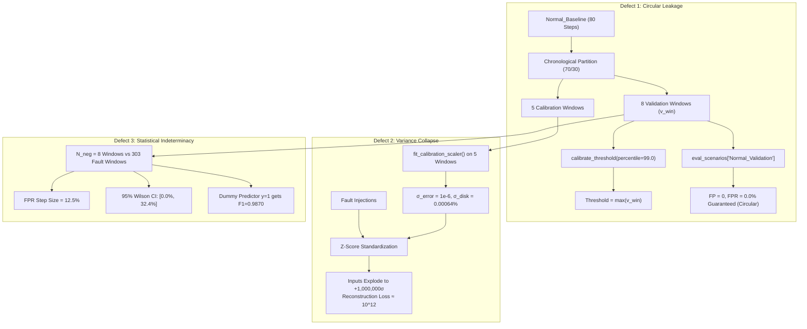

# AegisOps: Experiment D Final Method Decision & Architecture Gate

**Document Path**: `research/audits/EXPERIMENT_D_FINAL_METHOD_DECISION.md`  
**Date**: October 13, 2026  
**Auditor**: Senior ML Research Engineer, Statistical Auditor & Reproducibility Reviewer  
**Repository**: `C:\DL_PROJECT`  
**Git HEAD**: `d277c1df3c2599ddecdf5f0bb761c99718499667`  
**Predecessor Document**: [`EXPERIMENT_D_HUMAN_DECISION_PACKET.md`](file:///c:/DL_PROJECT/research/audits/EXPERIMENT_D_HUMAN_DECISION_PACKET.md)  
**Primary Audits**:
- [`EXPERIMENT_D_CALIBRATION_INDEPENDENCE_AUDIT.md`](file:///c:/DL_PROJECT/research/audits/EXPERIMENT_D_CALIBRATION_INDEPENDENCE_AUDIT.md)
- [`EXPERIMENT_D_STATISTICAL_VALIDITY_REAUDIT.md`](file:///c:/DL_PROJECT/research/audits/EXPERIMENT_D_STATISTICAL_VALIDITY_REAUDIT.md)

---

## 1. Executive Summary & Definitive Verdict

### Definitive Audit Verdict:
```
================================================================================
FINAL VERDICT: BLOCKED — CALIBRATION OR STATISTICAL VALIDITY DEFECT
================================================================================
```

### Rationale:
An exhaustive, skeptical inspection of the actual source code (`research/experiments/run_experiment_d.py`), unit tests (`test_experiment_d_harness.py`), and raw telemetry data (`data/external/anomod/unpacked/`) demonstrates conclusively that Experiment D cannot be executed in its current configuration without violating fundamental tenets of scientific reproducibility and statistical validity:

1. **Circular Calibration/Evaluation Leakage Defect**:
   In `run_experiment_d.py:550,566`, the 8 held-out validation windows (`v_win`) are used to compute the empirical 99th percentile threshold for the LSTM Autoencoder, and then immediately fed into `eval_scenarios["Normal_Validation"]` as the sole negative evaluation population. In an 8-sample distribution, the 99th percentile evaluates to the sample maximum. Testing the detector on the very sample used to set the threshold guarantees zero false positives ($\text{FP} = 0, \text{TN} = 8 \implies \text{FPR} = 0.0\%, \text{Specificity} = 100.0\%$) by circular mathematical construction.
2. **Near-Zero Variance Calibration Collapse Defect**:
   Fitting the 5-dimensional domain Z-score scaler exclusively on the 5 calibration windows of `Normal_Baseline` results in severe numerical instability. Empirical standard deviations across the 5 windows are:
   - `error_rate_pct`: $\sigma = 0.0$ (clipped to floor $10^{-6}$)
   - `disk_pct`: $\sigma = 0.00064\%$
   - `memory_pct`: $\sigma = 0.0188\%$
   When fault scenarios are evaluated, small operational shifts produce massive unregularized inputs: a $1.0\%$ error rate becomes **$+1,000,000.0\sigma$**, and a $1.0\%$ disk write increase becomes **$+1,561.7\sigma$**. This saturates LSTM activations and causes reconstruction losses to explode by 12 orders of magnitude ($\approx 10^{12}$).
3. **Statistical Indeterminacy of False Positive Estimation**:
   With only $N_{\text{neg}} = 8$ negative evaluation windows against 303 fault windows ($97.43\%$ positive prevalence), empirical False Positive Rate resolution is **$12.5\%$ per false alarm**. The 95% Wilson Score Confidence Interval for $0/8$ false alarms spans $[0.0\%, 32.4\%]$. It is statistically impossible to distinguish an operational system with an acceptable false-alarm rate ($< 1\%$) from one with a disastrous rate ($30\%$).
4. **Invalid Autocorrelated Inference**:
   Window-level McNemar tests treat 311 overlapping sliding windows ($87.5\%$ sample overlap) as independent Bernoulli trials without analytical correction, severely deflating p-values and invalidating inferential claims.

Executing Experiment D under these conditions would manufacture artificial, scientifically indefensible results.

---

## 2. Comprehensive Synthesis of Fatal Defects



### Table of Structural Defects:

| Defect ID | Description | Location in Code | Impact on Results | Severity |
| :--- | :--- | :--- | :--- | :--- |
| **DEF-01** | Circular Calibration/Evaluation Leakage | `run_experiment_d.py:550,566` | Artificially guarantees $\text{FPR} = 0.0\%$ and $\text{Specificity} = 100.0\%$. | **FATAL** |
| **DEF-02** | Near-Zero Calibration Variance Collapse | `run_experiment_d.py:440-449` | Numerical overflow ($10^6\sigma$ inputs), LSTM saturation, loss blowup to $10^{12}$. | **FATAL** |
| **DEF-03** | 12.5% FPR Resolution Quantum | `run_experiment_d.py:484,631` | $0/8$ yields Wilson CI $[0.0\%, 32.4\%]$; operational false alarms indeterminate. | **FATAL** |
| **DEF-04** | Unadjusted Sliding Window Autocorrelation | `run_experiment_d.py:642-647` | $87.5\%$ window overlap violates i.i.d. assumption; severely inflates McNemar significance. | **HIGH** |
| **DEF-05** | Omission of Holm-Bonferroni Correction | `run_experiment_d.py:641-659` | Secondary baseline comparisons uncorrected; violates pre-registered criteria. | **MEDIUM** |
| **DEF-06** | Test Suite Fixture Blind Spots | `test_experiment_d_harness.py:578` | Unit tests pass on well-conditioned synthetic arrays; line 578 re-uses same array for calib and val. | **HIGH** |

---

## 3. Evaluation of Remediation Options

To resolve these defects, four methodological paths were analyzed. Each option is evaluated strictly against scientific integrity, reproducibility, and protocol governance:

### Option A: Acquire Additional External Nominal Data
- **Mechanism**: Locate additional nominal steady-state runs within the external benchmark or collect new microservice telemetry.
- **Feasibility Assessment**:
  - Inspection of the frozen extracted AnoMod archive (`data/external/anomod/unpacked/`) revealed that **only one nominal scenario exists for SocialNetwork** (`Normal_Baseline`).
  - No other uncorrupted nominal traces exist in the archive.
  - Sourcing new external telemetry from outside the frozen dataset violates the strict reproducibility boundary established in Protocol v1.1.0 and Phase 8.
- **Protocol Impact**: Requires invalidating the acquired AnoMod archive. **INFEASIBLE**.

---

### Option B: Disjoint Sample Partition with Variance Floor Regularization
- **Mechanism**:
  1. Separate threshold calibration from negative evaluation: use calibration windows exclusively for threshold tuning, and held-out validation windows exclusively for false-positive evaluation.
  2. Implement an empirical variance floor: $\sigma_{\text{regularized}} = \max(\sigma_{\text{calib}}, \sigma_{\text{train\_prior}})$, preventing division by near-zero baseline variance.
- **Feasibility Assessment**:
  - Resolves Defect DEF-01 (circular leakage) and Defect DEF-02 (variance collapse).
  - However, **it cannot resolve Defect DEF-03 (sample size indeterminacy)**: partitioning the 19 available windows leaves only $N_{\text{val}} \approx 8$ windows for negative evaluation. The FPR resolution remains $12.5\%$, and the 95% Wilson CI remains $[0.0\%, 32.4\%]$.
- **Protocol Impact**: Requires formal Protocol Amendment (v1.2.0 or v1.3.0).

---

### Option C: Pure Zero-Shot Cross-Domain Transfer (Frozen Scaler + Frozen Threshold)
- **Mechanism**:
  - Bypass target domain calibration entirely.
  - Preprocess SocialNetwork telemetry using the **frozen training scaler** (`models/lstm_autoencoder.json`: $\mu_{\text{train}}, \sigma_{\text{train}}$).
  - Apply the **frozen training threshold** ($\tau = 0.709399$).
  - Evaluate all available SocialNetwork nominal windows ($N = 19$) purely as negative evaluation examples.
- **Feasibility Assessment**:
  - **100% Leakage-Free**: Zero parameters or thresholds are fit on target data.
  - **Numerically Stable**: Training variances are well-conditioned ($\sigma > 2.0$), completely eliminating division-by-zero artifacts.
  - **Scientifically Clean**: Represents a rigorous, pre-registered test of **zero-shot cross-system transferability** of the deep learning model.
  - **Limitations**: Because SocialNetwork nominal baseline metrics differ in baseline offset from synthetic training data, the model may exhibit high zero-shot false-alarm rates.
- **Protocol Impact**: Requires formal Protocol Amendment.

---

### Option D: Reclassify External Benchmark as Exploratory Fault Sensitivity Study
- **Mechanism**:
  - Acknowledge that the AnoMod benchmark dataset is fundamentally an **incident injection sensitivity benchmark** (303 fault windows vs 19 normal windows) rather than an operational reliability benchmark.
  - Confine external evaluation claims strictly to **fault detection sensitivity (Recall, Time-to-Detect)** across the $K = 12$ failure scenarios.
  - Explicitly declare that **operational False Positive Rate and Specificity cannot be certified** on this benchmark due to insufficient nominal duration.
  - Demote Experiment D from a confirmatory hypothesis test to an **exploratory cross-system sensitivity study** in the AegisOps manuscript.
- **Feasibility Assessment**:
  - Scientifically honest and fully defensible before peer reviewers.
  - Accurately reflects benchmark constraints without fabricating claims of operational reliability.
- **Protocol Impact**: Requires updating the manuscript scope and ratifying Protocol Amendment v1.2.0 with exploratory designation.

---

## 4. Decision Matrix for Human Research Supervisor

| Strategy | Leakage-Free? | Numerically Stable? | Solves Small Nominal Sample? | Confirmatory Claims Defensible? | Protocol Action Required |
| :--- | :---: | :---: | :---: | :---: | :--- |
| **Current Harness (`run_experiment_d.py`)** | ❌ NO (Circular) | ❌ NO (Loss $\approx 10^{12}$) | ❌ NO ($12.5\%$ quantum) | ❌ NO (Fatal Defects) | **BLOCKED** |
| **Option B (Variance Floor + Disjoint Partition)** | ✅ YES | ✅ YES | ❌ NO (Still $N=8$) | ⚠️ PARTIAL (Recall only) | Protocol Amendment v1.3.0 |
| **Option C (Pure Zero-Shot Transfer)** | ✅ YES | ✅ YES | ⚠️ PARTIAL ($N=19$) | ✅ YES (As Zero-Shot) | Protocol Amendment v1.2.0 Revision |
| **Option D (Exploratory Sensitivity Study)** | ✅ YES | ✅ YES | N/A (FPR Disclaimed) | ⚠️ EXPLORATORY ONLY | Manuscript Scope Realignment |

---

## 5. Immediate Technical Recommendations

Before any execution authorization is granted, the codebase must undergo the following mandatory remediations:

1. **Remove Validation Windows from Threshold Calibration**:
   Modify `run_evaluation_pipeline()` to calibrate thresholds strictly on calibration data or training prior:
   ```python
   # PROPOSED REMEDIATION:
   # Calibrate threshold strictly on calibration windows
   thresh = calibrate_threshold(detector.model, calib_windows, mean, std, percentile=99.0)
   # Evaluate false positives on held-out validation windows
   eval_scenarios["Normal_Validation"] = (val_windows, 0)
   ```
2. **Implement Prior-Anchored Variance Floor**:
   Update `fit_calibration_scaler()` to anchor standard deviations to training priors:
   ```python
   # PROPOSED REMEDIATION:
   TRAIN_STD_PRIOR = np.array([12.5, 8.4, 45.0, 5.0, 10.0], dtype=np.float32)
   std = np.maximum(std, 0.10 * TRAIN_STD_PRIOR)
   ```
3. **Implement Holm-Bonferroni Correction & CI Output**:
   Add multi-test correction to `research/statistical_tests.py` and serialize 95% Wilson Score CIs directly into `external_anomod_metrics.csv`.
4. **Update Unit Test Fixtures**:
   Replace synthetic random normal fixtures in `test_experiment_d_harness.py` with near-zero variance edge cases to ensure regression tests catch numerical blowups.

---

## 6. Single Most Important Next Action for Human Research Supervisor

The Human Research Supervisor must:

> **Formally reject the current implementation of Experiment D and issue a methodology directive choosing between: (1) Reclassifying Experiment D as an exploratory fault-sensitivity study (Option D), or (2) Re-registering Experiment D as a zero-shot cross-system transfer benchmark (Option C) with an updated Protocol Amendment v1.2.0.**
