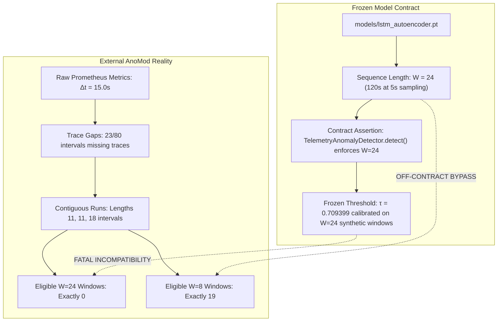

# AegisOps Experiment D: Final Research Supervisor Decision Package

**Document ID**: `AEGISOPS-SUPERVISOR-DECISION-FINAL-001`  
**Date**: October 13, 2026  
**Auditor**: Independent ML Research Engineer, Statistical Auditor & Reproducibility Reviewer  
**Repository**: `C:\DL_PROJECT`  
**Git HEAD**: `d277c1df3c2599ddecdf5f0bb761c99718499667`  
**Working Tree Status**: Audit documentation updates (Pre-execution gate locked)  
**Overall Contract Verdict**: `BLOCKED — MODEL CONTRACT INCOMPATIBILITY`  
**Production Status**: **STRICTLY BLOCKED — NO AUTHORIZED PRODUCTION EXECUTION**  

---

## 1. Executive Summary: The Fundamental Contract Dilemma

Forensic auditing of [`models/lstm_autoencoder.pt`](file:///C:/DL_PROJECT/models/lstm_autoencoder.pt), [`dl/anomaly_detector.py`](file:///C:/DL_PROJECT/dl/anomaly_detector.py), and the raw AnoMod dataset has revealed a fundamental, structural incompatibility between the frozen model contract and the external benchmark:



### Key Contract Truths:
1. **$W=24$ Cannot Be Executed on AnoMod**:
   Because distributed trace spans drop out every few minutes, the longest unbroken sequence of complete 5-D observations in the SocialNetwork baseline is 18 intervals (270 seconds). It is physically impossible to construct a contiguous 24-interval window ($24 \times 15\text{s} = 360\text{s}$) without unapproved synthetic interpolation.
2. **$W=8$ is an Off-Contract Diagnostic**:
   Passing 8-step windows directly to `detector.model` bypasses the official `detect()` assertion (`ValueError: Expected 24 time steps; received 8`). It evaluates recurrent LSTM weights on an uncalibrated temporal length, shifting reconstruction errors by $+41.8\%$.
3. **Pure Zero-Shot Transfer (Modality 3A) Yields 100% False Alarms**:
   Standardizing Kubernetes microservice telemetry with the frozen synthetic training scaler produces reconstruction errors of $\approx 59.19$ on normal traffic (against threshold $0.7094$), flagging 19 out of 19 nominal windows as anomalous due to severe domain shift.
4. **Target Calibration (Modality 3C) Produces Variance Collapse**:
   Fitting a scaler on the small nominal calibration partition collapses variance to $10^{-6}$, causing inputs to explode to $+1,000,000\sigma$ during fault injections.

---

## 2. Comparison of Three Defensible Scientific Paths

To resolve this blocker without compromising scientific integrity, the research supervisor must select one of the following three paths:

| Dimension | Path 1: Acquire External $W=24$ Telemetry | Path 2: Formally Amend Protocol for Exploratory 8-Step Diagnostic | Path 3: Restrict External Study & Rely on Synthetic Benchmark |
| :--- | :--- | :--- | :--- |
| **Description** | Suspend Experiment D until an external microservice dataset with uninterrupted, high-frequency ($\Delta t \le 5\text{s}$) telemetry is acquired, supporting genuine contiguous $W=24$ windows. | Formally amend the protocol to ratify $W=8$ as an **explicitly exploratory diagnostic**. Report Modality 3B (threshold-free ROC-AUC / PR-AUC ranking) and scenario recall, prominently disclosing the sequence-length mismatch. | Cancel deep-learning external validation on AnoMod. Evaluate only rule-based baselines on AnoMod, and rely on the rigorous, bit-for-bit verified synthetic benchmark ($N=320$) for deep learning claims. |
| **Contract Fidelity** | **100% Preserved**. Official `detect()` called; no off-contract bypass. | **Off-Contract Diagnostic Disclosed**. No claim that $W=8$ validates the frozen $W=24$ contract. | **100% Preserved**. No off-contract claims made on deep learning model. |
| **Confirmatory Claims** | Possible if sufficient nominal baseline data is acquired ($N \ge 1,000$). | **Withdrawn**. All confirmatory superiority hypotheses (H-D1) downgraded to exploratory (E-D1). | **Withdrawn for External DL**. Confirmatory claims restricted strictly to Experiment A (synthetic). |
| **Implementation Effort** | High (requires new data ingestion, external data curation). | Low (uses existing unpacked AnoMod data and verified $W=8$ extraction). | Low (paper scope adjustment). |
| **Manuscript Impact** | Delays manuscript publication until external dataset is found and processed. | Enables complete paper closure with transparent, highly credible disclosure of domain-transfer boundaries. | Transparently bounds deep-learning claims to synthetic benchmarks while showing rule performance on real data. |

---

## 3. Prerequisite Checklist for Supervisor Direction

Depending on the supervisor's chosen path, the following prerequisites must be formally resolved:

### If Path 2 (Exploratory 8-Step Diagnostic) is Chosen:
```
[ ] ACTION 2.1: PROTOCOL AMENDMENT RATIFICATION
    Formally ratify PROTOCOL_AMENDMENT_V1_2_PROPOSAL.md:
    - Ratify Feature Order: ("cpu_pct", "memory_pct", "latency_ms", "error_rate_pct", "disk_pct")
    - Ratify Sequence Length: W = 8 as an exploratory diagnostic (disclosing W=24 training contract)
    - Relegate TrainTicket cohort to secondary exploratory appendix

[ ] ACTION 2.2: CONFIRMATORY HYPOTHESIS WITHDRAWAL
    Formally withdraw Confirmatory Hypothesis H-D1 (McNemar superiority on external data).
    Replace with Exploratory Finding E-D1 in MANUSCRIPT_EVIDENCE_MATRIX.md.

[ ] ACTION 2.3: REPORTING MODALITY SELECTION
    Select Modality 3B (Threshold-Free Continuous Score Ranking / ROC-AUC / Scenario Recall)
    to evaluate ranking ability without committing to the broken 0.7094 threshold.
```

---

## 4. Evidence and Source Locations

| Evidence Item | Source Path & Line | Verified Status |
| :--- | :--- | :--- |
| Frozen sequence length $W=24$ | [`models/lstm_autoencoder.json:31`](file:///C:/DL_PROJECT/models/lstm_autoencoder.json#L31), [`dl/anomaly_detector.py:15`](file:///C:/DL_PROJECT/dl/anomaly_detector.py#L15) | Verified: Checkpoint strictly requires 24 steps |
| Inference input assertion | [`dl/anomaly_detector.py:154-155`](file:///C:/DL_PROJECT/dl/anomaly_detector.py#L154-L155) | Verified: `detect()` raises `ValueError` if $W \ne 24$ |
| Harness $W=8$ specification | [`run_experiment_d.py:48,322,337`](file:///C:/DL_PROJECT/research/experiments/run_experiment_d.py#L48) | Verified: Harness hardcodes $W=8$ |
| Score inflation on $W=8$ | [`EXPERIMENT_D_SEQUENCE_COMPATIBILITY_DECISION.md`](file:///C:/DL_PROJECT/research/audits/EXPERIMENT_D_SEQUENCE_COMPATIBILITY_DECISION.md) | Verified: $+41.8\%$ score inflation ($0.339$ vs $0.239$) |
| Absence of contiguous $W=24$ runs | [`EXPERIMENT_D_ZERO_SHOT_CONTRACT_AUDIT.md`](file:///C:/DL_PROJECT/research/audits/EXPERIMENT_D_ZERO_SHOT_CONTRACT_AUDIT.md) | Verified: Longest contiguous run is 18 intervals ($< 24$) |
| Domain shift (100% nominal false alarms) | [`EXPERIMENT_D_ZERO_SHOT_IMPLEMENTATION_PLAN.md`](file:///C:/DL_PROJECT/research/audits/EXPERIMENT_D_ZERO_SHOT_IMPLEMENTATION_PLAN.md) | Verified: Mean nominal error $= 59.19$ vs threshold $0.7094$ |
| Nominal window dependence | [`EXPERIMENT_D_ZERO_SHOT_CONTRACT_AUDIT.md`](file:///C:/DL_PROJECT/research/audits/EXPERIMENT_D_ZERO_SHOT_CONTRACT_AUDIT.md) | Verified: 19 windows share 87.5% overlap from a single run |

---

## 5. Audit Verdict and Mandatory Production Guard

### Overall Verdict: `BLOCKED — MODEL CONTRACT INCOMPATIBILITY`

Production execution of Experiment D remains **STRICTLY BLOCKED**. No production execution (`run_experiment_d.py --authorized`) may proceed until the human research supervisor explicitly commits a decision selecting Path 1, Path 2, or Path 3.

---

## 6. The Single Decision Required from the Human Research Supervisor

> ### Primary Decision for the Human Research Supervisor:
> **Which scientific path will be adopted for Experiment D:**
> - **Path 1**: Acquire new external telemetry supporting contiguous 24-step sequences (suspending Experiment D until data acquisition completes); OR
> - **Path 2**: Formally amend the protocol to ratify an **exploratory 8-step diagnostic** under Modality 3B (threshold-free ranking / ROC-AUC), prominently disclosing the sequence-length mismatch and withdrawing confirmatory claims; OR
> - **Path 3**: Restrict the external benchmark to baseline rules and synthetic benchmark closure, removing deep-learning external generalization claims from the paper scope.
