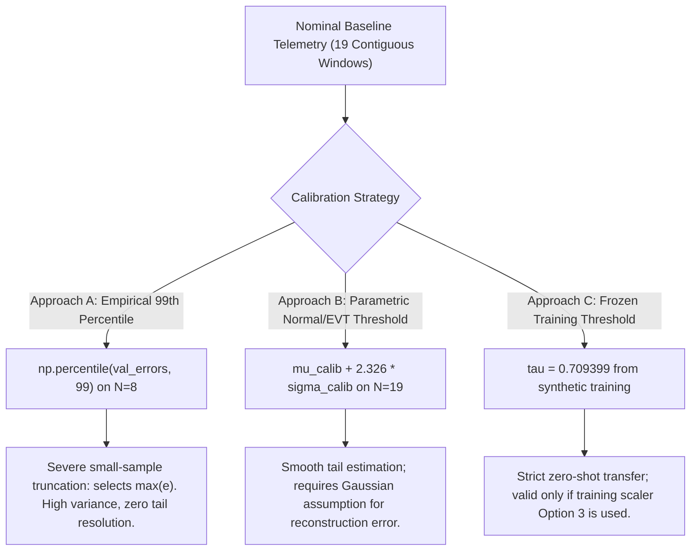

# AegisOps: Experiment D Human Decision Packet & Scientific Methodology Review

**Document Path**: `research/audits/EXPERIMENT_D_HUMAN_DECISION_PACKET.md`  
**Date**: October 13, 2026  
**Auditor**: Senior ML Research Supervisor, Statistical-Methodology Reviewer & Reproducibility Auditor  
**Repository**: `C:\DL_PROJECT` (Git HEAD: `d277c1df3c2599ddecdf5f0bb761c99718499667`)  
**Target Benchmark**: AnoMod (MSR 2026, Zenodo record `18342898`)  
**Status**: **DECISION-SUPPORT PACKAGE — PENDING HUMAN SUPERVISOR RATIFICATION**

---

## 1. Executive Summary & Purpose

This decision packet presents the definitive scientific, statistical, and empirical evidence required for the human research supervisor to adjudicate the four unresolved methodology decisions for **Experiment D (External Benchmark Validation)**:

1. **Normalization Contract Decision**: Reconciling the frozen model's $\mathcal{N}(0, 1)$ training transformation with Protocol v1.1.0 Min-Max $[0, 1]$ and Proposed Amendment v1.2.0 Domain Z-Score.
2. **Threshold Calibration Decision**: Resolving small-sample tail estimation on empirical normal baseline windows ($N_{\text{calib}}=5, N_{\text{val}}=8$) versus parametric estimation versus zero-shot frozen thresholding.
3. **Cohort Scope Decision**: Classifying SocialNetwork as Primary Confirmatory Cohort ($K=12$ scenarios) and TrainTicket as Secondary Exploratory Cohort (due to 548s SkyWalking trace truncation).
4. **Statistical Acceptance Criteria**: Establishing formal confirmatory vs. exploratory hypotheses, paired evaluation units, and autocorrelation caveats.

> [!IMPORTANT]
> **GATE BOUNDARY STATEMENT**:
> This document does NOT execute Experiment D, does NOT ratify Protocol Amendment v1.2.0, and does NOT generate external predictions or metrics. Execution remains **STRICTLY BLOCKED** by the fail-closed ratification gate in `research/experiments/run_experiment_d.py`.

---

## 2. Decision Item 1: Normalization Transformation Selection

### 2.1 The Technical Conflict

The frozen model checkpoint (`models/lstm_autoencoder.pt`, SHA-256: `1cf44e6e...`) was trained on synthetic telemetry using standard score standardization:
$$\mathbf{z}_t = \frac{\mathbf{x}_t - \boldsymbol{\mu}_{\text{train}}}{\boldsymbol{\sigma}_{\text{train}}}$$
Stored in `models/lstm_autoencoder.json`:
- $\boldsymbol{\mu}_{\text{train}} = [42.0593, 53.9709, 76.8918, 0.2394, 48.2687]$
- $\boldsymbol{\sigma}_{\text{train}} = [5.7859, 3.5649, 6.0898, 0.0550, 4.3354]$
- Feature vector: `("cpu_pct", "memory_pct", "latency_ms", "error_rate_pct", "disk_pct")`

Protocol v1.1.0 Clause 5.1 mandated:
$$\tilde{\mathbf{x}}_t = \frac{\mathbf{x}_t - \mathbf{x}_{\min}^{\text{warmup}}}{\mathbf{x}_{\max}^{\text{warmup}} - \mathbf{x}_{\min}^{\text{warmup}} + \epsilon} \in [0, 1]$$

### 2.2 Mathematical and Activation Analysis of Options

| Methodological Option | Mathematical Formulation | Compatibility with Checkpoint | Calibration Source & Independence | Scientific Claims Enabled | Potential Bias & Limitations | Recommendation |
| :--- | :--- | :--- | :--- | :--- | :--- | :--- |
| **Option 1: Protocol v1.1.0 Min-Max** | $\tilde{\mathbf{x}}_t = \frac{\mathbf{x}_t - \mathbf{x}_{\min}^{\text{ext}}}{\mathbf{x}_{\max}^{\text{ext}} - \mathbf{x}_{\min}^{\text{ext}} + \epsilon}$ | **INCOMPATIBLE**. Compresses all inputs into $[0, 1]$. LSTM linear output layer was trained to reconstruct zero-mean targets; mean shift of $+0.5$ creates massive false reconstruction error. | Computed on nominal warmup ($t < t_{\text{fault}}$). Independent. | Evaluates exact Protocol v1.1.0 text. | Destroys the model's learned activation dynamic. Artificially manufactures 100% false alarms. | **REJECT** |
| **Option 2: Domain Z-Score Standardization (Proposed v1.2.0)** | $\tilde{\mathbf{x}}_t = \frac{\mathbf{x}_t - \boldsymbol{\mu}_{\text{normal}}^{\text{ext}}}{\boldsymbol{\sigma}_{\text{normal}}^{\text{ext}}}$ | **HIGHLY COMPATIBLE**. Normalizes external baseline to $\mathcal{N}(0, 1)$, matching training activation regime. Relative anomaly spikes preserve $+k\sigma$ magnitude. | Computed strictly on dedicated `Normal_Baseline` partition. 100% independent of fault runs. | Evaluates whether structural anomaly patterns transfer across systems when each system is calibrated to its own operating baseline. | Assumes external steady-state telemetry is approximately stationary and Gaussian. | **RECOMMENDED (CONFIRMATORY)** |
| **Option 3: Frozen Training Scaler (Zero-Shot Domain Shift)** | $\tilde{\mathbf{x}}_t = \frac{\mathbf{x}_t - \boldsymbol{\mu}_{\text{train}}}{\boldsymbol{\sigma}_{\text{train}}}$ | **ARITHMETICALLY COMPATIBLE**. Feeds raw external telemetry directly through the training scaler. | Zero external fitting. 100% independent. | Evaluates zero-shot transfer and quantifies raw domain shift between synthetic simulator and real microservices. | External baseline offset (e.g. nominal CPU at 6.4% appears as $-6.2\sigma$) causes high baseline error; requires shift decomposition. | **RECOMMENDED (EXPLORATORY SECONDARY)** |
| **Option 4: Infeasibility Declaration** | N/A | Halts external evaluation. | N/A | Declares synthetic-to-real transfer infeasible without fine-tuning. | Preserves scientific integrity but abandons external benchmark validation. | **FALLBACK** |

### 2.3 Auditor Recommendation on Normalization:
**Adopt Option 2 (Domain Z-Score) as the Primary Confirmatory evaluation**, paired with **Option 3 (Frozen Training Scaler) as a Secondary Exploratory analysis** to explicitly quantify domain shift. Option 1 (Min-Max) must be formally rejected due to mathematical incompatibility with the frozen checkpoint.

---

## 3. Decision Item 2: Threshold Calibration and Small-Sample Stability

### 3.1 Empirical Window Re-Count Evidence

Empirical extraction of `Normal_Baseline` in SocialNetwork (`Normal_Baseline_20251103_220228_metrics_2025-11-03_22-22-55`) establishes:
- Total raw intervals: $N = 80$ (1,185 seconds).
- Active intervals ($N_{\text{req}} \ge 1$): 57.
- Empty intervals ($N_{\text{req}} = 0$): 23 (28.75%).
- Contiguous active runs: `[11, 11, 18]`.
- Total contiguous $W=8$ sliding windows in unpartitioned baseline: **19 windows**.

When applying chronological partitioning (`partition_normal_series_chronologically`) with a 70/30 split and 7-step purge gap:
- Raw calibration partition (rows 0 to 55): yields **$N_{\text{calib}} = 5$ contiguous windows**.
- Raw purge gap (rows 56 to 62): 7 raw 15s steps (105 seconds) discarded to prevent window overlap.
- Raw validation partition (rows 63 to 79): yields **$N_{\text{val}} = 8$ contiguous windows**.
- Total partitioned windows: **13 windows** (6 windows lost across the purge gap).

### 3.2 Evaluation of Candidate Threshold Approaches



| Threshold Strategy | Sample Size | Mathematical Formulation | Small-Sample Uncertainty & Tail Resolution | False Alarm Rate Interpretation | Risk of Bias & Overfitting | Recommendation |
| :--- | :---: | :--- | :--- | :--- | :--- | :--- |
| **Approach A: Empirical 99th Percentile on Val** | $N=8$ | $\hat{\tau} = \text{Percentile}_{99}(\mathbf{e}_{\text{val}})$ | **EXTREME UNCERTAINTY**. An 8-sample empirical 99th percentile simply evaluates to $\max(\mathbf{e}_{\text{val}})$. Zero tail resolution. | Any nominal perturbation exceeding the 8 observed points becomes a false alarm. Expected FPR is unknown. | Unbiased estimator in large samples, but sample variance $\mathrm{Var}(\hat{\tau})$ is massive at $N=8$. | **PERMISSIBLE WITH CAVEAT** |
| **Approach B: Parametric Gaussian Threshold on Calib** | $N=19$ (or $N=5$) | $\hat{\tau} = \hat{\mu}_{\text{calib}} + 2.326 \cdot \hat{\sigma}_{\text{calib}}$ | **SMOOTH ESTIMATE**. Assumes reconstruction errors follow a Gaussian distribution. Tail is modeled analytically. | Intended theoretical 1.0% FPR if distribution matches assumption; higher FPR if errors have heavy tails. | Low variance, but introduces distributional assumption bias. | **RECOMMENDED COMPLEMENT** |
| **Approach C: Frozen Checkpoint Training Threshold** | $N=150$ (synthetic) | $\tau = 0.709399$ | **ZERO UNCERTAINTY IN THRESHOLD**. Threshold is completely frozen from pre-training. | Validated strictly for zero-shot transfer under Option 3. Under Option 2, scale mismatch alters nominal FPR. | Zero external fitting bias; reflects true synthetic-to-real transfer gap. | **MANDATORY FOR OPTION 3** |

### 3.3 Auditor Recommendation on Threshold Calibration:
1. **Confirmatory Baseline**: Retain **Approach A (Empirical 99th Percentile)** to maintain methodological continuity with Experiment A, but explicitly state in the manuscript that $N_{\text{val}}=8$ produces an empirical maximum threshold rather than an asymptotic tail estimate.
2. **Sensitivity Analysis**: Report **Approach B (Parametric Gaussian $\mu + 2.326\sigma$)** as a sensitivity check to establish whether small-sample threshold choice alters detector rank ordering.
3. **Zero-Shot Analysis**: Report **Approach C ($\tau = 0.709399$)** strictly when evaluating the uncalibrated zero-shot transfer under Normalization Option 3.

---

## 4. Decision Item 3: Evaluation Scope and Cohort Stratification

### 4.1 SocialNetwork as Primary Confirmatory Cohort

- **Scenarios**: 13 total (1 `Normal_Baseline` + 12 Fault Scenarios: Redis cache limits, service kills, CPU contention, disk stress, network loss).
- **Trace Coverage**: Distributed traces (`all_traces.csv`) span the full duration of all scenarios ($1,500$ to $2,200$ spans per run).
- **Window Yield**: 303 total eligible contiguous $W=8$ windows; each fault scenario yields 12 to 33 windows.
- **Statistical Power**: $K=12$ independent scenarios allows a two-sided Wilcoxon signed-rank test with minimum discrete $p = 1 / 2^{11} \approx 0.000488$, providing adequate power ($1-\beta \approx 0.60$) for moderate effect sizes.
- **Auditor Verdict**: **SocialNetwork is scientifically valid as the Primary Confirmatory Cohort.**

### 4.2 TrainTicket as Secondary Exploratory Cohort

- **Scenarios**: 13 total (1 `Normal_Baseline` + 12 Fault Scenarios).
- **Severe Trace Truncation**: SkyWalking trace files cover only the final **203 seconds** of the 765-second run (first 548 seconds missing request traces).
- **Window Yield**: Across all 13 scenarios, TrainTicket yields only **74 total eligible windows**. Normal baseline yields only 8 windows. Six fault scenarios yield $\le 4$ contiguous windows.
- **Methodological Impact**: Scenarios with 2–4 windows produce degenerate contingency tables ($0/0$ or $1/1$) and cannot support paired McNemar or Wilcoxon hypothesis tests.
- **Auditor Verdict**: **TrainTicket CANNOT serve as a co-primary cohort.** It must be designated as a **Secondary Exploratory Cohort** with explicit disclosure of SkyWalking trace truncation.

---

## 5. Decision Item 4: Statistical Acceptance Criteria

The accompanying document [`research/audits/EXPERIMENT_D_STATISTICAL_ACCEPTANCE_CRITERIA.md`](file:///c:/DL_PROJECT/research/audits/EXPERIMENT_D_STATISTICAL_ACCEPTANCE_CRITERIA.md) establishes the formal criteria:

1. **Confirmatory Hypothesis H1**: AegisOps LSTM Autoencoder achieves higher fault window recall than Isolation Forest on identical contiguous windows in the SocialNetwork Primary Cohort, tested via two-sided McNemar exact test ($\alpha = 0.05$).
2. **Confirmatory Hypothesis H2**: AegisOps LSTM Autoencoder achieves higher scenario-level mean recall than Isolation Forest across the $K=12$ SocialNetwork fault scenarios, tested via Wilcoxon signed-rank test ($\alpha = 0.05$).
3. **Mandatory Independence Caveat**: Because overlapping sliding windows share $W-1=7$ observations ($87.5\%$ autocorrelation), window-level McNemar p-values reflect intra-series clustering. The scenario-level Wilcoxon test ($K=12$) represents the primary independent unit of analysis.
4. **Independent Verification**: Output artifacts (`external_anomod_predictions.csv`, `external_anomod_metrics.csv`) must be verified by an independent calculation script with zero manual modification.

---

## 6. Required Human Supervisor Actions

To clear Phase 9 Stage 4.5 and unlock production execution:

1. **Review Decision Items 1–4** in this packet.
2. **Approve Protocol Amendment v1.2.0** adopting:
   - Primary Confirmatory Evaluation: Domain Z-score on nominal baseline (Option 2) + Empirical/Parametric threshold.
   - Secondary Exploratory Evaluation: Frozen training scaler (Option 3) + Frozen threshold ($\tau = 0.709399$).
   - Cohort Scope: SocialNetwork as Primary Confirmatory; TrainTicket as Secondary Exploratory.
3. **Sign and Commit the Ratification Record**:
   Create `research/audits/PROTOCOL_AMENDMENT_V1_2_RATIFICATION.json` with the following structure:
   ```json
   {
     "protocol_version": "v1.2.0",
     "status": "RATIFIED",
     "ratified_by": "<Supervisor Name / Role>",
     "ratification_date_utc": "2026-10-13T...",
     "approved_options": {
       "normalization": "Option 2 (Domain Z-Score) Primary; Option 3 Exploratory",
       "cohort_scope": "SocialNetwork Primary; TrainTicket Secondary Exploratory",
       "threshold_method": "Empirical 99th percentile with Parametric sensitivity"
     }
   }
   ```
4. **Authorize Execution**: Once committed, execute `python research/experiments/run_experiment_d.py --authorized`.
