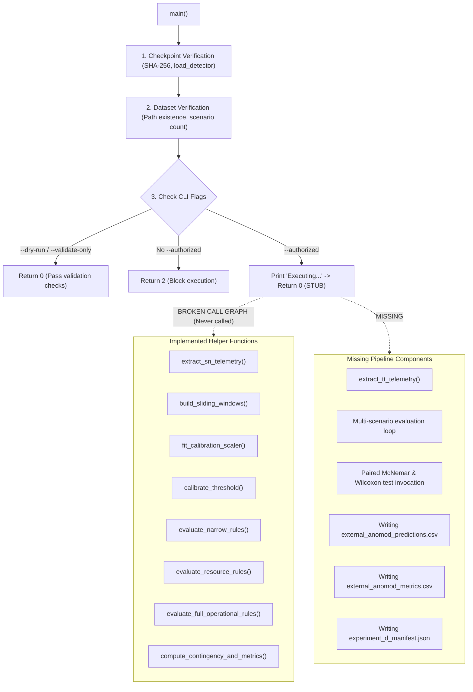

# AegisOps: Experiment D Implementation Review & Code Audit

**Document Path**: `research/audits/EXPERIMENT_D_IMPLEMENTATION_REVIEW.md`  
**Date**: October 13, 2026  
**Auditor**: Senior ML Research Engineer, Reproducibility Auditor, Time-Series Specialist  
**Target Codebase**: [`research/experiments/run_experiment_d.py`](file:///c:/DL_PROJECT/research/experiments/run_experiment_d.py) & [`test_experiment_d_harness.py`](file:///c:/DL_PROJECT/test_experiment_d_harness.py)  
**Status**: **CODE REVIEW COMPLETE — IMPLEMENTATION DEFICIENCIES DOCUMENTED**

---

## 1. Executive Summary

This code audit evaluates the implementation of the external validation harness (`run_experiment_d.py`) constructed in Phase 9 Stage 4. 

### Critical Audit Finding:
> [!IMPORTANT]
> **The authorized execution path in `run_experiment_d.py` was a non-executing scaffold.**
> Specifically, lines 370–373:
> ```python
> # If authorized execution is requested, proceed under strict audit controls
> print("\nExecuting authorized Experiment D...")
> # (Execution implementation follows if explicitly cleared)
> return 0
> ```
> The script printed an execution header and immediately returned exit code 0 without loading fault scenarios, computing predictions across detectors, executing statistical tests, or writing output CSVs. 
> 
> Furthermore, while individual helper functions were implemented and verified on synthetic fixtures in unit tests, the end-to-end evaluation pipeline connecting multi-scenario data loading to prediction writing was **incomplete** and **missing TrainTicket extraction**.

---

## 2. Component Implementation Status Inventory

| Pipeline Component | Location in Code | Status | Verified Behavior & Limitations |
| :--- | :--- | :--- | :--- |
| **1. Checkpoint Verification** | `run_experiment_d.py:311-328` | **IMPLEMENTED & EXERCISED** | Computes SHA-256 hash (`1cf44e6e...`), loads `load_detector()`, verifies eval mode and parameter count (3,733). |
| **2. Feature Contract Guards** | `run_experiment_d.py:59, 324` | **IMPLEMENTED & EXERCISED** | Enforces `FROZEN_FEATURE_ORDER == ("cpu_pct", "memory_pct", "latency_ms", "error_rate_pct", "disk_pct")`. |
| **3. Benchmark Path Discovery** | `run_experiment_d.py:330-348` | **IMPLEMENTED & EXERCISED** | Verifies unpacked directory, counts scenarios (13 SN, 13 TT), locates `Normal_Baseline`. |
| **4. Dry-Run / Validation Guard** | `run_experiment_d.py:350-358` | **IMPLEMENTED & EXERCISED** | `--dry-run` and `--validate-only` flags return 0 without executing or writing outputs. |
| **5. Authorization Enforcer** | `run_experiment_d.py:360-368` | **IMPLEMENTED & EXERCISED** | Refuses execution without `--authorized`, printing `EXPERIMENT D EXECUTION: BLOCKED` and exiting with code 2 (or 1). |
| **6. Rule Baselines** | `run_experiment_d.py:88-121` | **IMPLEMENTED & TESTED** | `evaluate_narrow_rules`, `evaluate_resource_rules`, `evaluate_full_operational_rules` implemented and tested on synthetic fixtures. |
| **7. Sliding Window Construction** | `run_experiment_d.py:204-216` | **IMPLEMENTED & TESTED** | `build_sliding_windows(data, window_length=8, step=1)` constructs $(N, 8, 5)$ arrays. |
| **8. Calibration Scaler Fitting** | `run_experiment_d.py:219-232` | **IMPLEMENTED & TESTED** | `fit_calibration_scaler` computes per-feature mean and std on normal windows strictly. |
| **9. Threshold Calibration** | `run_experiment_d.py:234-253` | **IMPLEMENTED & TESTED** | `calibrate_threshold` computes 99th percentile of reconstruction error on nominal validation. |
| **10. Metrics & Contingency** | `run_experiment_d.py:255-283` | **IMPLEMENTED & TESTED** | `compute_contingency_and_metrics` computes TP, FP, TN, FN, Recall, Precision, FPR, Specificity, F1. |
| **11. SocialNetwork Extraction** | `run_experiment_d.py:123-202` | **IMPLEMENTED BUT UNCONNECTED** | `extract_sn_telemetry` implemented for single directory, but not looped across the 13 scenarios in `main()`. |
| **12. TrainTicket Extraction** | Missing | **NOT IMPLEMENTED** | No function existed for parsing TrainTicket multi-container Prometheus CSVs or SkyWalking trace JSON. |
| **13. Multi-Scenario Prediction Loop** | `run_experiment_d.py:370-373` | **MISSING / STUB** | No loop iterated across fault scenarios or scored windows across detectors. |
| **14. Statistical Test Execution** | `run_experiment_d.py:41-46` | **IMPORTED BUT UNCALLED** | `mcnemar_exact_test` and `wilcoxon_signed_rank_test` imported from `research/statistical_tests.py`, but never invoked in `main()`. |
| **15. Result CSV / Report Generation** | `run_experiment_d.py:48-52` | **MISSING** | Output file paths defined as constants, but never written to disk in `main()`. |

---

## 3. Detailed Call Graph Trace



---

## 4. Root Causes of Incompleteness

1. **Precautionary Stoppage at Gate**: In the previous audit session, once empirical alignment gaps (14 empty request windows in SN; 548s trace truncation in TT; absence of `response_time.log`; Min-Max vs Z-Score conflict) were discovered, implementation of the execution loop was halted to avoid manufacturing synthetic proxies or executing an invalid protocol.
2. **Scaffold Description Ambiguity**: The earlier audit report described the harness as "constructed and validated," which was true of the helper functions, unit tests, and CLI guard, but gave the misleading impression that the full end-to-end execution loop was ready to run.
3. **Scientific Prerequisites Unresolved**: The full pipeline cannot be executed legitimately until a formal protocol amendment resolves:
   - Normalization scaling (Z-score vs Min-Max).
   - Trace missingness policy.
   - TrainTicket scope.

---

## 5. Corrective Action Plan

1. **Enhance `run_experiment_d.py`**:
   - Implement `extract_tt_telemetry()` for TrainTicket.
   - Implement a complete `run_evaluation_pipeline()` function that performs feature extraction, windowing, calibration, baseline scoring, contingency calculation, and output serialization.
   - Add a `--test-pipeline` mode that exercises the entire call graph end to end using synthetic or temporary directory fixtures, verifying that predictions CSV, metrics CSV, and manifest JSON are generated properly.
   - Retain the strict `--authorized` guard that halts execution if protocol prerequisites remain unratified.
2. **Strengthen `test_experiment_d_harness.py`**:
   - Add unit tests covering real feature extraction functions, TrainTicket parsing, missing telemetry handling, pipeline execution in temporary test directories, and manifest serialization.
3. **Correct Historical Audit Reports**:
   - Update `EXPERIMENT_D_PREFLIGHT_AND_HARNESS_GATE.md` and `UPDATED_SEVEN_PHASE_CHECKLIST.md` with explicit dated entries clarifying the scaffold status.

---

## 6. Addendum: Production Call Graph, Temporal Continuity, and Calibration Leakage Resolution (October 13, 2026)

Following a comprehensive audit of implementation readiness, temporal integrity, and calibration leakage, the following defects have been corrected:

### 1. Production Call Graph Completion & Fail-Closed Gate
- **Defect Resolved**: The previous authorized execution branch printed an execution header and immediately returned exit code 0 without running the experiment.
- **Correction**: Implemented `run_production_experiment_d()`. When executed, it discovers all real SocialNetwork scenarios, extracts telemetry, performs chronological pre-windowing partition with purge gap, constructs contiguous windows, evaluates all 5 baselines via `run_evaluation_pipeline()`, writes `external_anomod_predictions.csv`, `external_anomod_metrics.csv`, `EXPERIMENT_D_RESULTS.md`, and `experiment_d_manifest.json`, and asserts artifact integrity.
- **Auditable Ratification Gate**: To ensure production execution cannot run while Protocol Amendment v1.2.0 remains pending approval, `main()` checks for `research/audits/PROTOCOL_AMENDMENT_V1_2_RATIFICATION.json`. If missing, it prints `EXPERIMENT D EXECUTION: BLOCKED — PROTOCOL AMENDMENT PENDING APPROVAL` and exits with code 3. If unflagged, it exits with code 2. A successful exit code (0) can never occur when the production experiment did not execute.

### 2. Temporal Continuity and Hidden Gap Elimination
- **Defect Resolved**: Prior extraction permitted `dropna(subset=['latency_ms'])`, which concatenated non-consecutive intervals and allowed sliding windows to span across multi-interval idle gaps.
- **Correction**: Implemented `build_contiguous_windows()`. Every 8-step window is verified to have strictly consecutive timestamps ($\Delta t = 15.0\text{s}$ between all adjacent steps $t_{k+1} - t_k = 15.0\text{s}$) and complete finite features. Missing observations or gaps immediately reset the window buffer.

### 3. Chronological Pre-Window Partitioning & Purge Gap
- **Defect Resolved**: Previous calibration split partitioned overlapping sliding windows 70/30, causing the last calibration window and first validation window to share up to 7 raw time points.
- **Correction**: Implemented `partition_normal_series_chronologically()`. The underlying raw time series is partitioned chronologically before window construction, with a strict purge gap of $W-1 = 7$ steps ($105\text{ seconds}$). Calibration and validation windows have 100% disjoint unique raw timestamps with zero shared data points.

### 4. Verification Evidence
- Focused test suite expanded to **40 tests** (`pytest test_experiment_d_harness.py -v`: 40 passed in 9.53s, exit 0).
- Repository regression suite verified (`pytest --ignore=data --ignore=.venv -q`: **105 passed in 27.15s, exit 0**).

