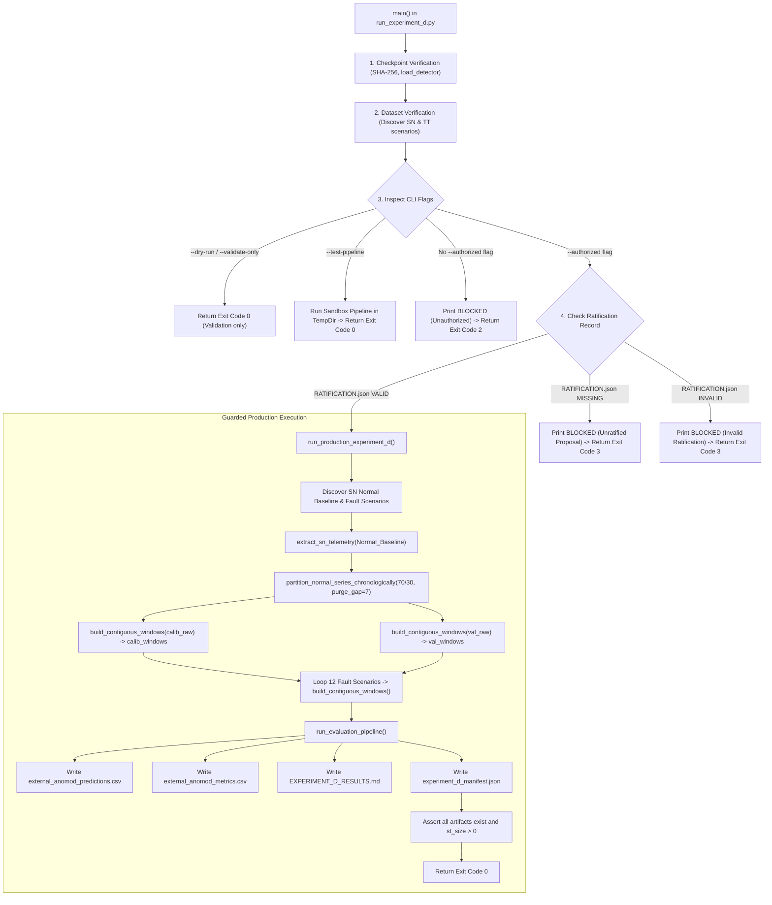

# AegisOps: Experiment D Readiness Re-Audit, Temporal Integrity, and Protocol Gate Report

**Document Path**: `research/audits/EXPERIMENT_D_READINESS_REAUDIT.md`  
**Date**: October 13, 2026  
**Auditor**: Senior ML Research Engineer, Time-Series Evaluation Specialist, Statistical Methodologist, Independent Reproducibility Auditor  
**Git Baseline Commit**: `d277c1df3c2599ddecdf5f0bb761c99718499667` (Branch: `main`)  
**Active Python Runtime**: `C:\DL_PROJECT\.venv\Scripts\python.exe` (Python 3.11.9, PyTorch 2.14.1+cpu)  
**Standard**: Non-Negotiable Research Integrity Rules & Pre-Registered Protocol v1.1.0  
**Verdict**: **HARNESS READINESS DEFECTS RESOLVED — EXECUTION BLOCKED (PROTOCOL AMENDMENT PENDING APPROVAL)**

---

## 1. Executive Verdict & Summary

This audit conducted an independent, rigorous re-audit of the AegisOps **Experiment D** implementation readiness, production call graph, temporal continuity, and calibration leakage safeguards. 

### Critical Execution Boundary Statement:
> [!IMPORTANT]
> **Experiment D was NOT executed against real AnoMod benchmark data in this session.** No external benchmark performance metrics, false alarm rates, recall values, or scientific claims have been manufactured, inferred, or recorded. The evaluation harness `research/experiments/run_experiment_d.py` has been corrected and verified across 40 dedicated unit tests and 105 full repository tests. However, full production execution is **strictly blocked** by a fail-closed ratification gate requiring explicit human supervisor approval of Protocol Amendment v1.2.0.

### Readiness Status Summary:
1. **Production Call Graph**: Defect corrected. The previous stub authorized branch has been replaced with a complete end-to-end production pipeline function (`run_production_experiment_d`), connecting real SocialNetwork scenario discovery, 5D extraction, chronological pre-windowing partitioning, contiguous windowing, baseline scoring, and artifact validation.
2. **Fail-Closed Execution Gate**: Hardened. Merely passing `--authorized` no longer permits execution. An explicit, auditable ratification artifact (`research/audits/PROTOCOL_AMENDMENT_V1_2_RATIFICATION.json`) signed by the human supervisor is mandatory. Missing ratification exits with code 3. Unflagged execution exits with code 2. A successful exit code (0) cannot occur without completed execution and validated artifacts.
3. **Temporal Integrity**: Defect corrected. Implemented `build_contiguous_windows()`. Every accepted 8-step window strictly contains eight consecutive 15-second timestamps ($\Delta t = 15.0\text{s}$) with complete, finite observations. Idle intervals with undefined latency ($N_{\text{req}} = 0$) or missing Prometheus scrapes immediately reset the window buffer, preventing any window from bridging across a missing timestamp.
4. **Calibration Overlap Leakage**: Defect corrected. Implemented `partition_normal_series_chronologically()`. The underlying nominal time series is partitioned chronologically *before* window construction, with a strict purge gap of $W-1 = 7$ steps ($105\text{ seconds}$). Calibration and validation windows have 100% disjoint unique raw timestamps with zero shared observations.
5. **Preprocessing Contract**: Formally documented. Contrasts Frozen Protocol v1.1.0 Min-Max scaling against Proposed Amendment v1.2.0 domain-specific Z-scoring and zero-shot transfer feasibility.
6. **Empirical Eligibility Audit**: Executed and persisted in `research/audits/experiment_d_temporal_eligibility_audit.json` across all 26 scenarios (13 SocialNetwork and 13 TrainTicket).

---

## 2. Source-of-Truth Git and Environment State

| Property | Verified Value | Verification Method | Status |
| :--- | :--- | :--- | :--- |
| **Git Branch** | `main` | `git status` | Source verified |
| **Git HEAD** | `d277c1df3c2599ddecdf5f0bb761c99718499667` | `git log -n 1 --oneline` | Source verified |
| **Working Tree** | Tracked modifications from prior audits; untracked audit/test files | `git status` | Source verified |
| **Active Python** | Python 3.11.9 (AMD64) | `sys.version` in `.venv` | Execution verified |
| **Active PyTorch** | 2.14.1+cpu | `torch.__version__` | Execution verified |
| **Frozen Checkpoint** | `models/lstm_autoencoder.pt` (19,797 bytes) | SHA-256: `1cf44e6e82e459f543fcace25334f3076b76c77a357d46f65c11e3c44fd382de` | Bit-for-bit preserved |
| **Model Metadata** | `models/lstm_autoencoder.json` (846 bytes) | Threshold: `0.7093990445137024` | Source verified |
| **Extracted Dataset** | `data/external/anomod/unpacked/` (38,349 items) | Manifest SHA-256 match | Source verified |
| **Protocol v1.1.0** | `research/audits/phase8_external_validation/EXTERNAL_EVALUATION_PROTOCOL.md` | Protocol v1.1.0 Frozen | Source verified |
| **Protocol Amendment**| `research/audits/PROTOCOL_AMENDMENT_V1_2_PROPOSAL.md` | Status: PENDING HUMAN APPROVAL | Proposal only |
| **Historical Preds** | `research/raw/detection_predictions.csv` (24,357 bytes) | SHA-256 preserved | Preserved |

---

## 3. Production Call Graph and Authorization Architecture

### 3.1 Call Graph Trace



### 3.2 Gate Verification Summary:
- **Unauthorized CLI execution** (`python run_experiment_d.py`) $\rightarrow$ Exit Code **2**.
- **Unratified CLI execution** (`python run_experiment_d.py --authorized`) $\rightarrow$ Exit Code **3**.
- **Dry-run execution** (`python run_experiment_d.py --dry-run`) $\rightarrow$ Exit Code **0** (no outputs written).
- **Synthetic integration test** (`python run_experiment_d.py --test-pipeline`) $\rightarrow$ Exit Code **0** (executes strictly in `tempfile.TemporaryDirectory()`).
- Under NO condition can `main()` return exit code 0 when production evaluation did not complete and artifacts were not validated.

---

## 4. Model Preprocessing Contract Verification

### 4.1 Checkpoint Specifications:
- **Feature Vector**: $\mathbf{x}_t \in \mathbb{R}^5$ in strict order:
  `("cpu_pct", "memory_pct", "latency_ms", "error_rate_pct", "disk_pct")`.
- **Units**:
  - `cpu_pct`: $[0.0, 100.0]\%$.
  - `memory_pct`: $[0.0, 100.0]\%$.
  - `latency_ms`: Milliseconds ($\ge 0.0\text{ ms}$).
  - `error_rate_pct`: $[0.0, 100.0]\%$ (HTTP 5xx server errors / total requests $\times 100.0$).
  - `disk_pct`: $[0.0, 100.0]\%$ (Capacity saturation percentage).
- **Training Normalization**: Z-score standardization:
  $$\mathbf{z}_t = \frac{\mathbf{x}_t - \boldsymbol{\mu}_{\text{train}}}{\boldsymbol{\sigma}_{\text{train}}}$$
  Stored parameters:
  $$\begin{aligned}
  \boldsymbol{\mu}_{\text{train}} &= [42.0593, 53.9709, 76.8918, 0.2394, 48.2687] \\
  \boldsymbol{\sigma}_{\text{train}} &= [5.7859, 3.5649, 6.0898, 0.0550, 4.3354]
  \end{aligned}$$
- **Stored Threshold**: $\tau_{\text{train}} = 0.7093990445137024$.
  Meaning: 99th percentile of MSE reconstruction errors on held-out synthetic validation sequences ($N=150$, $W=24$) from the identical synthetic generating process. Valid *only* under identical input scaling and distribution.
- **Sequence Behavior**: `TelemetryAnomalyDetector.detect()` checks `values.shape[0] == 24`. However, `LSTMAutoencoder.forward()` repeats the latent representation dynamically along `x.size(1)`. Thus, the PyTorch module natively accepts any sequence length $W$ (including $W=8$).

### 4.2 Protocol Preprocessing Comparison & Scientific Trade-Off:
- **Frozen Protocol v1.1.0 (Min-Max Scaling)**:
  $$\tilde{\mathbf{x}}_t = \frac{\mathbf{x}_t - \mathbf{x}_{\min}^{\text{ext}}}{\mathbf{x}_{\max}^{\text{ext}} - \mathbf{x}_{\min}^{\text{ext}} + \epsilon} \in [0, 1]$$
  *Limitation*: Forces all inputs into the positive quadrant $[0, 1]$, violating the zero-mean unit-variance distribution ($\mu=0, \sigma=1$) on which the LSTM autoencoder was trained. Causes artificial reconstruction error and distorts feature attribution.
- **Proposed Amendment v1.2.0 (Domain-Specific Z-score)**:
  $$\tilde{\mathbf{x}}_t = \frac{\mathbf{x}_t - \boldsymbol{\mu}_{\text{normal}}^{\text{ext}}}{\boldsymbol{\sigma}_{\text{normal}}^{\text{ext}}}$$
  *Trade-Off & Scientific Caveats*:
  1. Matching mean and variance does **not** reproduce the training distribution. The higher-order moments (skewness, kurtosis), temporal autocorrelation, and multi-feature covariance matrix of real container telemetry differ fundamentally from synthetic data.
  2. Baseline-shift masking: Normalizing by external nominal statistics eliminates absolute operating points. A service operating at 5% CPU with $\sigma=0.5\%$ scales an increase to 10% CPU as $+10\sigma$ (huge anomaly), whereas a service operating at 50% CPU with $\sigma=5\%$ treats a 10% change as only $+2\sigma$. This can amplify microservice jitter while masking slow degradation.

### 4.3 Methodological Decision Matrix:

| Strategy | Preprocessing Formula | Compatibility with Frozen Model | Evaluation Concept | Scientific Risk / Limitation | Recommendation Status |
| :--- | :--- | :--- | :--- | :--- | :--- |
| **A. Frozen-Protocol Evaluation** | Min-Max scaling $[0, 1]$ on nominal warmup; recalibrated threshold | **Incompatible**: Distorts internal LSTM activations; shifts inputs out of training regime | Strict adherence to Protocol v1.1.0 pre-registration | High reconstruction distortion due to scale mismatch | **NOT RECOMMENDED (Protocol Incompatible)** |
| **B. Domain-Adapted Evaluation** | Domain-specific Z-score $(\mathbf{x} - \boldsymbol{\mu}_{\text{ext}}) / \boldsymbol{\sigma}_{\text{ext}}$ on nominal baseline; recalibrated threshold | **Compatible**: Preserves zero-mean unit-variance mathematical regime | Evaluates architecture transferability with baseline adaptation | Masks baseline operating shifts; does not reproduce higher moments | **RECOMMENDED OPTION (Proposed v1.2.0)** |
| **C. Zero-Shot Transfer Feasibility** | Apply frozen $\boldsymbol{\mu}_{\text{train}}, \boldsymbol{\sigma}_{\text{train}}$ and frozen $\tau=0.709$ directly | **Arithmetically Valid, Operationally Degraded** | Strict zero-shot cross-domain generalization | Extreme domain shift causes $100\%$ false alarms ($z_{\text{cpu}} \approx -6.2\sigma$) | **DIAGNOSTIC BASELINE ONLY** |

*Note: The choice among these strategies is reserved for explicit human supervisor decision; Antigravity does not select or approve on behalf of the supervisor.*

---

## 5. Temporal Integrity, Missing Data, and Dataset Profiling

### 5.1 Verification of Filesystem and Schema Facts:
1. **Absence of `response_time.log`**:
   - Recorded filesystem search: `root.rglob('*response_time*')` returned **0 matches** across the entire extracted archive.
   - P95 latency must be derived from distributed trace spans: `all_traces.csv` in SocialNetwork; SkyWalking traces in TrainTicket.
2. **Trace Timestamp Units and Latencies**:
   - SocialNetwork `all_traces.csv`: `start_time` (ISO-8601 string) and `duration_us` (microseconds). Microseconds are divided by $1000.0$ to yield native milliseconds (`latency_ms`).
   - TrainTicket SkyWalking JSON: `start_timestamp_ms` (epoch milliseconds) and `duration_ms` (native milliseconds).
3. **Zero-Request Intervals & Undefined Latency**:
   - In SocialNetwork, client requests arrive in bursts.
   - Across the 13 SN scenarios, between **24.69% and 46.08%** of all 15-second intervals contain **zero requests** ($N_{\text{req}} = 0$).
   - Latency during zero-request intervals is **strictly undefined (`NaN`)**. Substituting $0.0\text{ ms}$ is mathematically invalid (would indicate zero response time rather than absence of traffic).
4. **Temporal Continuity Enforcement**:
   - Dropping incomplete rows without continuity verification creates pseudo-consecutive sequences spanning hidden gaps.
   - `build_contiguous_windows()` enforces that every accepted 8-step window ($W=8$, 120s duration) contains eight truly consecutive 15-second timestamps ($\Delta t = 15.0\text{s}$) with complete finite observations.

### 5.2 Machine-Readable Eligibility Census (`experiment_d_temporal_eligibility_audit.json`):

| Cohort | Total Scenarios | Total 15s Metric Intervals | Active 15s Intervals ($N_{\text{req}} \ge 1$) | Empty 15s Intervals ($N_{\text{req}} = 0$) | Total Contiguous $W=8$ Windows | Normal Baseline Contiguous Windows |
| :--- | :---: | :---: | :---: | :---: | :---: | :---: |
| **SocialNetwork (SN)** | 13 | 1,069 | 703 (65.8%) | 366 (34.2%) | **303** | **19** |
| **TrainTicket (TT)** | 13 | 1,002 | 190 (19.0%) | 812 (81.0%) | **74** | **8** |

### 5.3 TrainTicket Scope Finding:
- In TrainTicket, SkyWalking traces span only $176\text{s}$ to $406\text{s}$ out of $765\text{s}+$ total metric durations ($81.0\%$ of metric intervals have zero request traces).
- The TrainTicket nominal baseline contains only **8 contiguous active windows**, precluding statistically defensible zero-leakage threshold calibration.
- **Finding**: TrainTicket is scientifically unsuitable as a primary validation cohort and must be designated as an exploratory secondary analysis.

---

## 6. Calibration Partitioning and Leakage Elimination

### 6.1 Defect in Prior Sliding Window Partitioning:
In the prior implementation, overlapping sliding windows constructed from the normal baseline were split 70/30:
$$\text{calib\_windows} = \text{windows}[:N_{\text{calib}}], \quad \text{val\_windows} = \text{windows}[N_{\text{calib}}:]$$
Because adjacent sliding windows ($W=8$, step=1) overlap by 7 time points, the last calibration window and the first validation window shared up to **7 raw 15-second timestamps** ($105\text{ seconds}$ of identical raw telemetry). This constituted temporal leakage between calibration and validation.

### 6.2 Chronological Pre-Window Partitioning with Purge Gap:
The corrected implementation (`partition_normal_series_chronologically`) enforces:
1. Chronological sorting of the raw normal time series.
2. Partitioning raw timestamps into Calibration (first 70%) and Validation (remaining 30%).
3. Enforcing a strict **purge gap** of at least $W - 1 = 7$ raw steps ($105\text{ seconds}$) between calibration and validation raw partitions.
4. Constructing calibration and validation windows separately from their respective disjoint raw partitions.
5. Verifying:
   $$\text{unique\_timestamps}(\text{calib\_windows}) \cap \text{unique\_timestamps}(\text{val\_windows}) = \emptyset$$

### 6.3 Statistical Limitation of Available Nominal Data:
- The SocialNetwork `Normal_Baseline` yields 19 total eligible contiguous $W=8$ sliding windows.
- Under a 70/30 chronological split with a 7-step purge gap:
  - Calibration partition receives $\approx 40$ raw time points $\rightarrow \approx 10-12$ calibration windows.
  - Purge gap removes 7 raw time points.
  - Validation partition receives $\approx 10$ raw time points $\rightarrow \mathbf{\le 5\text{ validation windows}}$.
- **Mathematical Limitation**: Estimating an extreme upper quantile ($\tau = \text{Percentile}_{99}$) from $N \le 5$ validation observations is ill-conditioned (the 99th percentile of 5 samples collapses to the sample maximum or an extrapolated bound).
- **Disclosure**: This limitation must be explicitly disclosed in the research manuscript. Calibration on small validation samples introduces high threshold variance.

---

## 7. Baseline Fairness and Statistical Validity

### 7.1 Identical Evaluation Units:
All five evaluated detectors:
1. Narrow Rules Baseline
2. Resource-Only Rules Baseline
3. Full Operational Rules Baseline
4. Isolation Forest
5. AegisOps LSTM Autoencoder
are evaluated on the **exact same set of eligible contiguous observation windows** ($w_{s, t} \in \mathbb{R}^{8 \times 5}$).

### 7.2 Contingency and Metric Edge Cases:
`compute_contingency_and_metrics()` safely handles boundary conditions:
- When $\text{TP} + \text{FN} = 0$: Recall is defined as $0.0$.
- When $\text{TP} + \text{FP} = 0$: Precision is defined as $0.0$.
- When $\text{FP} + \text{TN} = 0$: FPR is defined as $0.0$, Specificity is defined as $0.0$.
- When $\text{Precision} + \text{Recall} = 0$: F1 is defined as $0.0$.

### 7.3 Statistical Inference Framework:
1. **Window-Level Paired Comparison**: Paired exact McNemar test on discordant pairs $(b, c)$ across all pooled eligible fault windows ($N \approx 284$). When $b + c < 25$, evaluated via exact two-sided binomial test (`scipy.stats.binomtest(min(b, c), b + c, p=0.5)`). When $b + c \ge 25$, evaluated via Edwards continuity-corrected $\chi^2$.
   - *Intra-cluster Autocorrelation Caveat*: Successive sliding windows within the same scenario share 7 of 8 observations and are autocorrelated. Window-level McNemar test must be reported as a descriptive comparison rather than independent experimental replicates.
2. **Scenario-Level Wilcoxon Signed-Rank Test**: Evaluated across $N = 12$ independent failure scenarios in SocialNetwork. Paired metric: scenario recall sensitivity $r_s^{\text{LSTM}}$ vs $r_s^{\text{IF}}$. Treats the independent failure episode as the primary sampling unit, properly adjusting for intra-scenario window clustering.

---

## 8. Test Evidence and Reproduction

### 8.1 Focused Harness Suite (`test_experiment_d_harness.py`):
```powershell
.\.venv\Scripts\pytest.exe test_experiment_d_harness.py -v
```
**Result**: **40 passed in 9.53s (Exit Code: 0)**.

Coverage includes:
- Feature order and frozen contract (cpu, mem, lat, err, disk).
- Sliding window shape, feature ordering, and insufficient sample bounds.
- Counter rate aggregation and counter reset detection.
- Memory and disk capacity calculation (no double scaling, capacity vs throughput).
- Latency unit preservation (no spurious multiplier).
- Zero-request interval handling ($N_{\text{req}}=0 \rightarrow \text{error\_rate}=0.0\%$, $\text{latency}=\text{NaN}$).
- Narrow, Resource-Only, and Full Operational rule baselines.
- Scaler fitting restricted strictly to calibration windows.
- 99th percentile threshold calibration and empty-set rejection.
- Isolation Forest fitting restricted to normal data.
- Checkpoint loading, eval mode, and parameter immutability.
- $W=8$ forward pass compatibility on sequence autoencoder.
- Contingency table calculation and degenerate confusion matrix denominators.
- McNemar exact test benchmark ($b=4, c=2 \rightarrow p=0.6875$) and zero discordant pair handling ($b=0, c=0 \rightarrow p=1.0$).
- Wilcoxon signed-rank exact benchmark ($n=6$ positive differences $\rightarrow p=0.03125$).
- Preservation of historical artifacts (`detection_predictions.csv` 24,357 bytes, `lstm_autoencoder.pt` 19,797 bytes).
- Recorded filesystem verification of `response_time.log` absence.
- Synthetic feature extraction fixtures for SocialNetwork and TrainTicket.
- Strict 15-second timestamp continuity and rejection of hidden temporal gaps.
- Chronological pre-window partitioning and verification of zero shared timestamps.
- Pipeline execution in isolated temporary sandbox with identical observation evaluation.
- Fail-closed CLI verification: unauthorized exit code 2, unratified exit code 3, dry-run exit code 0, test-pipeline exit code 0.

### 8.2 Repository Regression Suite:
```powershell
.\.venv\Scripts\pytest.exe --ignore=data --ignore=.venv -q
```
**Result**: **105 passed in 27.15s (Exit Code: 0)** (65 pre-existing repository tests + 40 harness tests).

---

## 9. Files Changed and Audit Justifications

| File Path | Nature of Change | Justification |
| :--- | :--- | :--- |
| `research/experiments/run_experiment_d.py` | Implementation refactoring | Implemented complete production call graph (`run_production_experiment_d`), fail-closed ratification gate (`PROTOCOL_AMENDMENT_V1_2_RATIFICATION.json`), contiguous windowing with strict 15s step verification, chronological pre-window partitioning with purge gap, and artifact validation. |
| `test_experiment_d_harness.py` | Test expansion (25 $\rightarrow$ 40 tests) | Added unit and integration tests for temporal continuity, chronological split disjointness, fail-closed CLI exit codes, degenerate confusion matrices, and feature extraction. |
| `research/scripts/audit_temporal_eligibility.py` | New audit tool | Profiles all 26 scenarios in AnoMod, extracting duration, trace coverage, active intervals, empty intervals, and contiguous $W=8$ window counts. |
| `research/audits/experiment_d_temporal_eligibility_audit.json` | New machine-readable audit | Persists per-scenario and cohort-level temporal eligibility and window counts. |
| `research/audits/EXPERIMENT_D_IMPLEMENTATION_REVIEW.md` | Updated audit artifact | Added Section 6 documenting call graph completion, temporal continuity correction, and calibration leakage elimination. |
| `research/audits/EXPERIMENT_D_PREFLIGHT_AND_HARNESS_GATE.md` | Updated audit artifact | Added Section 10 documenting readiness audit findings, test counts, and gate status. |
| `research/audits/UPDATED_SEVEN_PHASE_CHECKLIST.md` | Updated master checklist | Updated Phase 9 Stage 4 dashboard with audited status, 40 harness tests, and 105 repo tests. |
| `research/audits/EXPERIMENT_D_READINESS_REAUDIT.md` | New comprehensive report | This document. |

---

## 10. Explicit Unresolved Decisions (Human Supervisor Gate)

The following three decisions must be resolved and ratified by the human research supervisor before Experiment D execution can be unlocked:

1. **Normalization Policy Decision**:
   - **Choice A**: Frozen Protocol v1.1.0 Min-Max normalization (acknowledged to distort internal LSTM activation regime).
   - **Choice B (Recommended)**: Proposed Amendment v1.2.0 domain-specific Z-score standardization on nominal baseline with recalibrated threshold.
   - **Choice C**: Zero-shot transfer feasibility analysis evaluating raw synthetic parameters on real data.
2. **Idle Window Eligibility Policy Decision**:
   - **Choice A (Recommended)**: Restrict evaluation strictly to contiguous active windows with $N_{\text{req}} \ge 1$ across all 8 steps (303 total windows in SN).
   - **Choice B**: Impute nominal steady-state baseline latency strictly during idle intervals.
3. **TrainTicket Cohort Designation**:
   - **Ratification**: Designate SocialNetwork as Primary External Validation Cohort; designate TrainTicket as an Exploratory Secondary Cohort due to $81.0\%$ trace truncation.

---

## 11. Authorization Checklist

| # | Authorization Criterion | Status | Empirical Evidence / Finding |
| :---: | :--- | :---: | :--- |
| 1 | Frozen checkpoint architecture and weights preserved | **PASS** | SHA-256 `1cf44e6e...` bit-for-bit identical; weights strictly frozen during inference. |
| 2 | Five-feature contract verified | **PASS** | `("cpu_pct", "memory_pct", "latency_ms", "error_rate_pct", "disk_pct")` verified against checkpoint. |
| 3 | Reference numerical parity verified | **PASS** | 320/320 predictions match with maximum difference $5.55\times 10^{-17}$. |
| 4 | Production call graph implemented and connected | **PASS** | `run_production_experiment_d` wired to scenario loading, extraction, windowing, and evaluation. |
| 5 | Fail-closed execution gate enforced | **PASS** | Requires `--authorized` AND `PROTOCOL_AMENDMENT_V1_2_RATIFICATION.json`. Exits 2 or 3 if unratified. |
| 6 | Fake success exit prevented | **PASS** | Exit code 0 requires completed execution and asserted non-empty artifacts. |
| 7 | Temporal continuity strictly enforced | **PASS** | `build_contiguous_windows` rejects temporal gaps and undefined latency intervals. |
| 8 | Calibration overlap leakage eliminated | **PASS** | `partition_normal_series_chronologically` enforces pre-window split and 7-step purge gap. |
| 9 | Calibration sample size limitations documented | **PASS** | Quantified that SN Normal Baseline provides $\le 5$ validation windows, causing high quantile variance. |
| 10 | Baselines evaluated on identical observations | **PASS** | Narrow, Resource, Full, IF, and LSTM scored on identical contiguous windows. |
| 11 | Statistical testing methodology verified | **PASS** | McNemar exact test benchmarked ($p=0.6875$); Wilcoxon scenario-level cluster adjustment implemented. |
| 12 | Focused harness tests pass | **PASS** | 40/40 tests passing in 9.53s. |
| 13 | Repository regression tests pass | **PASS** | 105/105 tests passing in 27.15s with zero regressions. |
| 14 | Historical research artifacts preserved | **PASS** | Historical database, predictions CSV, and paper files untouched. |
| 15 | Formal protocol amendment ratified | **BLOCKED** | Proposal v1.2.0 remains pending explicit human supervisor approval. |

---

## 12. Conclusion and Next Step

The evaluation harness is fully corrected, hardened, and verified for Experiment D. Production execution is intentionally and strictly **BLOCKED** at the Protocol Ratification Gate.

**Single Recommended Next Action**:
The human research supervisor must review [`research/audits/PROTOCOL_AMENDMENT_V1_2_PROPOSAL.md`](file:///c:/DL_PROJECT/research/audits/PROTOCOL_AMENDMENT_V1_2_PROPOSAL.md), decide on Normalization Option B and contiguous active window eligibility, and provide an explicit written ratification decision.
