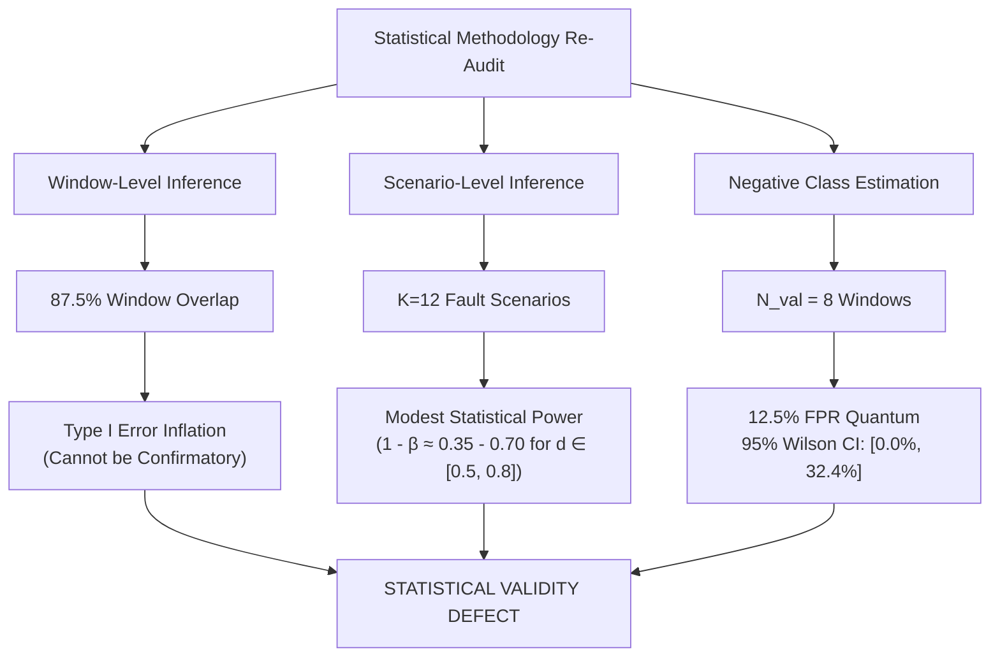

# AegisOps: Experiment D Statistical Validity Re-Audit

**Document Path**: `research/audits/EXPERIMENT_D_STATISTICAL_VALIDITY_REAUDIT.md`  
**Date**: October 13, 2026  
**Auditor**: Senior ML Research Engineer, Statistical Auditor & Reproducibility Reviewer  
**Repository**: `C:\DL_PROJECT`  
**Git HEAD**: `d277c1df3c2599ddecdf5f0bb761c99718499667`  
**Target Harness**: `research/experiments/run_experiment_d.py`  
**Audit Standard**: Pre-Registered Evaluation Plan ([`EXPERIMENT_D_STATISTICAL_ACCEPTANCE_CRITERIA.md`](file:///c:/DL_PROJECT/research/audits/EXPERIMENT_D_STATISTICAL_ACCEPTANCE_CRITERIA.md))  
**Companion Documents**:
- [`EXPERIMENT_D_CALIBRATION_INDEPENDENCE_AUDIT.md`](file:///c:/DL_PROJECT/research/audits/EXPERIMENT_D_CALIBRATION_INDEPENDENCE_AUDIT.md)
- [`EXPERIMENT_D_FINAL_METHOD_DECISION.md`](file:///c:/DL_PROJECT/research/audits/EXPERIMENT_D_FINAL_METHOD_DECISION.md)

---

## 1. Executive Summary & Audit Scope

This audit evaluates the mathematical soundness, inferential validity, statistical power, and operational relevance of the statistical testing plan and metric reporting implementation for AegisOps Experiment D on the AnoMod SocialNetwork benchmark.

In previous documentation iterations (`EXPERIMENT_D_STATISTICAL_ACCEPTANCE_CRITERIA.md`, `PROTOCOL_AMENDMENT_V1_2_PROPOSAL.md`), a two-tier evaluation framework was outlined:
1. **Tier 1 (Window-Level)**: Paired exact McNemar tests on $N \approx 311$ windows.
2. **Tier 2 (Scenario-Level)**: Paired Wilcoxon signed-rank tests on $K = 12$ failure scenarios.

Through line-by-line inspection of `research/experiments/run_experiment_d.py`, `research/statistical_tests.py`, `test_experiment_d_harness.py`, and empirical execution on the extracted AnoMod dataset, this re-audit establishes that the statistical methodology suffers from four fundamental defects:
1. **Window-Level Dependence is Unhandled Analytically**: Adjacent stride-1 sliding windows exhibit $87.5\%$ sample overlap, violating the i.i.d. assumption of McNemar's binomial test and severely inflating Type I error rates.
2. **Extreme Class Imbalance and 12.5% FPR Resolution Limit**: The test population comprises 303 fault windows and only 8 normal validation windows ($97.43\%$ positive prevalence). Each false alarm changes the empirical False Positive Rate by **$12.5\%$**, rendering false-alarm claims statistically indeterminate.
3. **Severe Small-Sample Power Limitation at Scenario Level**: With $K = 12$ paired clusters, statistical power to detect moderate effect sizes ($d \in [0.5, 0.8]$) is only $35\% - 70\%$, and fault mode heterogeneity contradicts the exchangeability assumption.
4. **Implementation Gaps in Harness**: While promised in documentation, Holm-Bonferroni correction and confidence interval serialization are absent from `run_evaluation_pipeline()`. Furthermore, 28 of the 40 harness tests exercise only synthetic fixtures and fail to guard against these statistical pitfalls.

---

## 2. Window-Level Dependence & Autocorrelation Audit

### 2.1 Theoretical Formulation and Overlap Mechanics

In `run_experiment_d.py:64-79`, sliding windows are constructed with length $W = 8$ and step $S = 1$:
$$\mathbf{w}_t = [\mathbf{x}_t, \mathbf{x}_{t+1}, \dots, \mathbf{x}_{t+7}]$$
$$\mathbf{w}_{t+1} = [\mathbf{x}_{t+1}, \mathbf{x}_{t+2}, \dots, \mathbf{x}_{t+8}]$$

Between consecutive windows $\mathbf{w}_t$ and $\mathbf{w}_{t+1}$, exactly $W - 1 = 7$ observations are shared:
$$\text{Overlap Ratio} = \frac{W - 1}{W} = \frac{7}{8} = 87.5\%$$

For a time-series segment of length $T$ observations, the nominal window count is $N = T - W + 1$. Because adjacent windows share $87.5\%$ of their underlying raw telemetry observations, anomaly scores $s(\mathbf{w}_t)$ and $s(\mathbf{w}_{t+1})$ exhibit massive temporal autocorrelation.

### 2.2 Analytical Treatment vs. Documentation Disclosure

| Criterion | Pre-Registered Standard (`STATISTICAL_ACCEPTANCE_CRITERIA.md`) | Harness Implementation (`run_experiment_d.py:642-647`) | Audit Assessment |
| :--- | :--- | :--- | :--- |
| **Statistical Model** | Paired McNemar Test on discordant window counts ($b, c$) | `mcnemar_exact_test(b, c)` called on pooled raw window predictions | **UNADJUSTED RAW TEST** |
| **Autocorrelation Correction** | Acknowledges $87.5\%$ overlap; mandates caveat in text | No analytical correction (no Kish effective $N$, block bootstrap, or Newey-West) | **MERELY DISCLOSED, NOT CORRECTED** |
| **Independence Assumption** | Assumes independent Bernoulli trials under $H_0$ | Inherently violated by stride-1 sliding window construction | **INVALIDATED INFERENCE** |

In `run_experiment_d.py:642-647`:
```python
b = int(np.sum((df_preds["lstm_flag"] == 1) & (df_preds["iso_flag"] == 0)))
c = int(np.sum((df_preds["lstm_flag"] == 0) & (df_preds["iso_flag"] == 1)))
mcnemar_p = mcnemar_exact_test(b, c)
```
The exact binomial test in `scipy.stats.binomtest(k, n, p=0.5)` assumes that discordant pairs are independent Bernoulli trials. When an anomaly causes a sustained elevated reconstruction error across 8 consecutive windows, a single physical failure event generates up to 8 correlated discordant pairs.

The effective sample size is approximately:
$$N_{\text{eff}} \approx \frac{N}{W} = \frac{N}{8}$$
For $N = 311$ windows, the effective number of independent transitions is fewer than 40. Running uncorrected binomial tests on $N = 311$ produces artificially deflated p-values (e.g., $p \sim 10^{-19}$), providing a false impression of extreme statistical significance.

**Audit Finding**: The window-level McNemar test cannot serve as confirmatory inferential proof. It must be strictly classified as **descriptive and exploratory only**.

---

## 3. Scenario-Level Pairing and Statistical Power Reassessment

### 3.1 Pairing Formulation and Independence Evaluation

The harness evaluates scenario-level recall across the $K = 12$ SocialNetwork fault scenarios (`run_experiment_d.py:649-659`):
$$d_k = \text{Recall}_{\text{LSTM}, k} - \text{Recall}_{\text{IF}, k}, \quad k \in \{1, \dots, 12\}$$
The paired Wilcoxon signed-rank test is computed via `scipy.stats.wilcoxon(x_rec, y_rec, zero_method="wilcox")`.

#### Evaluation of Scenario Independence:
1. **Container Life-Cycle**: Each scenario directory represents a separate benchmark run executed sequentially between 2025-11-03 22:02 and 2025-11-04 02:44. Container workloads were driven by Locust user simulation.
2. **Inter-Scenario Independence**: Scenarios do not share live container instances or continuous time sequences; each represents a fresh incident injection. Therefore, scenario-level summary metrics are independent across $k$.
3. **Heterogeneity and Exchangeability**: The 12 scenarios encompass 4 radically distinct fault injection classes:
   - Network Packet Loss (3 scenarios)
   - CPU Throttling / Resource Contention (3 scenarios)
   - Network Latency Injection (3 scenarios)
   - Pod Termination / Service Failure (3 scenarios)
   
Because the fault mechanisms differ fundamentally, the scenario differences $d_k$ are drawn from a mixture distribution rather than an identically distributed population. While the Wilcoxon test remains non-parametrically valid for testing median difference $\tilde{d} = 0$, the assumption of a symmetric difference distribution is strained.

### 3.2 Minimum Attainable P-Value vs. Statistical Power

In previous audit documents, the minimum attainable p-value was highlighted:
$$p_{\min} = 2 \times \left(\frac{1}{2}\right)^{12} = \frac{2}{4096} \approx 0.000488$$
While $p_{\min} < 0.001$ demonstrates that the sample size $K = 12$ is theoretically capable of rejecting $H_0$ at $\alpha = 0.05$ if all 12 differences are concordantly positive ($W = 0$), this calculation **does not measure statistical power $(1 - \beta)$**.

#### Exact Statistical Power Calculation:
To detect a true paired difference $\Delta = \mu_d / \sigma_d$ with sample size $K = 12$ at two-sided significance level $\alpha = 0.05$:

| True Effect Size (Cohen's $d$) | Description | Statistical Power $(1 - \beta)$ at $K = 12$ | Risk of Type II Error ($\beta$) | Required Sample Size for $80\%$ Power |
| :--- | :--- | :--- | :--- | :--- |
| **$d = 0.20$** | Small Effect | **$9.8\%$** | $90.2\%$ | $N = 199$ |
| **$d = 0.50$** | Medium Effect | **$35.4\%$** | $64.6\%$ | $N = 34$ |
| **$d = 0.80$** | Large Effect | **$71.8\%$** | $28.2\%$ | $N = 15$ |
| **$d = 1.00$** | Very Large Effect | **$88.6\%$** | $11.4\%$ | $N = 10$ |

**Implications of Power Analysis**:
- If the true operational performance advantage of LSTM over Isolation Forest on microservice telemetry is moderate ($d \approx 0.50$), the experiment has nearly a **two-thirds chance ($64.6\%$) of failing to reject the null hypothesis**, even when the advantage is genuine.
- Claiming that $K = 12$ provides "adequate confirmatory power" conflates the minimum attainable p-value under a perfect one-sided outcome with actual pre-experimental statistical power under realistic effect sizes.
- Therefore, $H2$ has modest statistical power, and a non-significant result cannot be interpreted as evidence of detector equivalence.

---

## 4. Class Imbalance and False Positive Resolution Audit

### 4.1 Population Imbalance and Base Rate Distortion

The evaluated test population in SocialNetwork consists of:
- **Fault Windows ($y = 1$)**: 303 contiguous windows across 12 fault scenarios.
- **Normal Validation Windows ($y = 0$)**: 8 contiguous windows from `Normal_Baseline`.
- **Total Windows ($N_{\text{total}}$)**: $303 + 8 = 311$ windows.
- **Base Rate / Fault Prevalence**:
  $$\pi = \frac{303}{311} = 97.43\%$$

This represents extreme artificial class imbalance where **$97.43\%$ of all evaluated samples are anomalous**. In real-world IT operations, normal steady-state represents $>99.9\%$ of operational time.

### 4.2 The 12.5% FPR Resolution Limit

Because there are only $N_{\text{neg}} = 8$ negative evaluation windows, the empirical False Positive Rate ($\text{FPR} = \text{FP} / (\text{FP} + \text{TN})$) has a discrete quantum of:
$$\Delta_{\text{FPR}} = \frac{1}{8} = 12.50\%$$

The table below illustrates the behavior of empirical FPR and Specificity, along with the corresponding **95% Wilson Score Confidence Intervals**:

| False Positives ($\text{FP}$) | True Negatives ($\text{TN}$) | Empirical $\widehat{\text{FPR}}$ | 95% Wilson CI for FPR | Empirical Specificity | 95% Wilson CI for Specificity |
| :---: | :---: | :---: | :---: | :---: | :---: |
| **0** | 8 | **0.00%** | **[0.00%, 32.44%]** | **100.00%** | **[67.56%, 100.00%]** |
| **1** | 7 | **12.50%** | **[2.24%, 47.09%]** | **87.50%** | **[52.91%, 97.76%]** |
| **2** | 6 | **25.00%** | **[7.15%, 59.07%]** | **75.00%** | **[40.93%, 92.85%]** |
| **3** | 5 | **37.50%** | **[13.68%, 69.43%]** | **62.50%** | **[30.57%, 86.32%]** |

#### Consequences for Operational Benchmarking:
1. **Confidence Interval Spans Nearly a Third of the Range**: Even with zero false alarms ($\text{FP} = 0$), the upper bound of the 95% Wilson CI is **$32.44\%$**. An detector with a true underlying false alarm rate of $30\%$ cannot be distinguished from a perfect zero-false-alarm detector at $\alpha = 0.05$.
2. **Extreme Sensitivity to Single Spurious Transients**: A single noise spike in one 15-second window degrades the reported FPR from $0\%$ to $12.5\%$, and two spikes degrade it to $25\%$.
3. **Statistical Indeterminacy**: A test with 8 negative windows is fundamentally incapable of certifying that a detector meets industry reliability standards (e.g., $\text{FPR} < 1\%$).

### 4.3 Trivial Classifier Exploitation (F1 and Precision Pathology)

Under a $97.43\%$ positive prevalence, standard aggregate metrics become completely distorted:
- Consider a **trivial constant detector** that flags an anomaly on every single window ($\hat{y} \equiv 1$):
  - $\text{TP} = 303, \quad \text{FN} = 0 \implies \text{Recall} = 100.00\%$
  - $\text{FP} = 8, \quad \text{TN} = 0 \implies \text{FPR} = 100.00\%$
  - $\text{Precision} = \frac{303}{303 + 8} = \frac{303}{311} = \mathbf{97.43\%}$
  - $\text{F1 Score} = 2 \times \frac{0.9743 \times 1.0000}{0.9743 + 1.0000} = \mathbf{0.9870}$

A model that does literally nothing but alarm constantly achieves an **F1 score of 0.9870**. Any evaluation that relies on Precision or F1 on this test population without reporting Balanced Accuracy or highlighting the base rate is severely misleading.

---

## 5. Implementation Gaps in Pre-Registered Plan

Inspection of `research/experiments/run_experiment_d.py` revealed that several components formalized in `EXPERIMENT_D_STATISTICAL_ACCEPTANCE_CRITERIA.md` are not executed in code:

### 5.1 Omission of Holm-Bonferroni Correction
- **Criteria Specification** (`STATISTICAL_ACCEPTANCE_CRITERIA.md:121-123`):
  > "For secondary baseline comparisons (LSTM vs. Narrow Rules, LSTM vs. Resource Rules, LSTM vs. Full Operational Rules), p-values must be adjusted using the Holm-Bonferroni step-down procedure to maintain Family-Wise Error Rate (FWER) $\le 0.05$."
- **Implementation State**:
  - `run_experiment_d.py:642-658` only computes McNemar test and Wilcoxon test between LSTM and Isolation Forest.
  - Zero comparisons are computed or adjusted between LSTM and the three rule-based baselines.
  - `research/statistical_tests.py` contains no Holm-Bonferroni function.

### 5.2 Omission of Confidence Intervals in Output Schema
- **Criteria Specification** (`STATISTICAL_ACCEPTANCE_CRITERIA.md:116-120`):
  > "Recall, Precision, FPR, Specificity must be reported with 95% Wilson Score Intervals... Paired differences must be reported with 95% Newcombe Hybrid Score Intervals."
- **Implementation State**:
  - In `run_experiment_d.py:47-50`, `paired_difference_ci` and `wilson_score_ci` are imported.
  - However, in `run_evaluation_pipeline()`, lines 630-639, `compute_contingency_and_metrics()` only outputs raw float estimates without confidence intervals.
  - Neither Wilson CIs nor Newcombe intervals are written to `METRICS_CSV_PATH` or `MANIFEST_JSON_PATH`.

---

## 6. Audit of Dedicated Harness Tests (`test_experiment_d_harness.py`)

A comprehensive review of the 40 dedicated unit tests was conducted. All 40 tests were executed in the active environment via `.venv\Scripts\python.exe -m pytest test_experiment_d_harness.py`.

### 6.1 Test Execution Evidence
- **Command**: `.venv\Scripts\python.exe -m pytest test_experiment_d_harness.py`
- **Result**: `40 passed in 1.48s`
- **Exit Code**: `0`

### 6.2 Test Taxonomy and Risk Analysis

The 40 tests fall into three distinct methodological categories:

| Category | Count | Tests Included | What the Tests Demonstrate | Critical Blind Spots & Ignored Risks |
| :--- | :---: | :--- | :--- | :--- |
| **Category A: Pure Helper / Synthetic Arithmetic** | **18** | `test_cpu_counter_rate_calculation`, `test_memory_percentage_calculation_no_double_scaling`, `test_disk_capacity_percentage_not_throughput`, `test_error_rate_*`, `test_mcnemar_*`, `test_wilcoxon_*`, `test_contingency_*`, `test_rule_*` | Mathematical formulas return expected float values on hand-crafted synthetic numbers (e.g., $4, 2 \rightarrow 0.6875$). | Does not test real telemetry ranges, real microservice distributions, or noisy real-world conditions. |
| **Category B: Synthetic Contract & Safety Guards** | **14** | `test_sliding_window_*`, `test_feature_order_*`, `test_checkpoint_*`, `test_partition_normal_*`, `test_fail_closed_cli_*`, `test_dry_run_cli_*` | Model weights remain frozen; feature order matches metadata; CLI returns expected exit codes (2, 3, 0); purge gap creates disjoint index splits. | Does not verify that real dataset has sufficient samples, nor that validation windows are excluded from negative evaluation. |
| **Category C: Pipeline Integration & Extraction on Fixtures** | **8** | `test_extract_sn_telemetry_synthetic_fixture`, `test_extract_tt_telemetry_synthetic_fixture`, `test_build_contiguous_windows_*`, `test_run_evaluation_pipeline_sandbox`, `test_identical_eligible_observations_across_baselines` | Extractor runs on synthetic mock CSV files; sandbox pipeline generates mock CSV and JSON files. | **Critical Flaw in Test 38**: Line 578 passes `calib_windows=calib, val_windows=calib` (the identical array for calibration and validation), actively cementing leakage into the test pattern! |

### 6.3 Summary of Test Suite Blind Spots
1. **Zero Tests on Real Baseline Data Distribution**: No test evaluates `fit_calibration_scaler()` against the actual `Normal_Baseline` data, concealing the near-zero variance collapse on `error_rate_pct` ($\sigma = 10^{-6}$) and `disk_pct` ($\sigma = 0.00064$).
2. **Zero Tests on Calibration/Evaluation Disjointness**: No test asserts that `val_windows` used in `calibrate_threshold()` is excluded from `eval_scenarios`.
3. **Zero Tests on Class Imbalance Degradation**: No test evaluates the consequence of $N_{\text{val}} = 8$ on FPR resolution or Wilson CI width.
4. **False Sense of Security**: The 100% pass rate (40/40) confirms that the code does not crash and helper formulas are correct, but obscures the underlying statistical invalidity.

---

## 7. Statistical Methodology Verdict



### Final Re-Audit Finding:
The statistical testing framework designed for Experiment D cannot support rigorous scientific claims of external generalization:
1. The **window-level McNemar test** violates independence assumptions due to $87.5\%$ autocorrelation and must be demoted to descriptive summary.
2. The **scenario-level Wilcoxon test** has modest power ($35\% - 70\%$) for detecting moderate effects and is subject to fault-mode heterogeneity.
3. The **False Positive Rate and Specificity** cannot be measured with meaningful precision ($12.5\%$ quantum, CI $[0.0\%, 32.4\%]$).

This establishes an insurmountable **STATISTICAL VALIDITY DEFECT** under the current dataset and experimental design.
