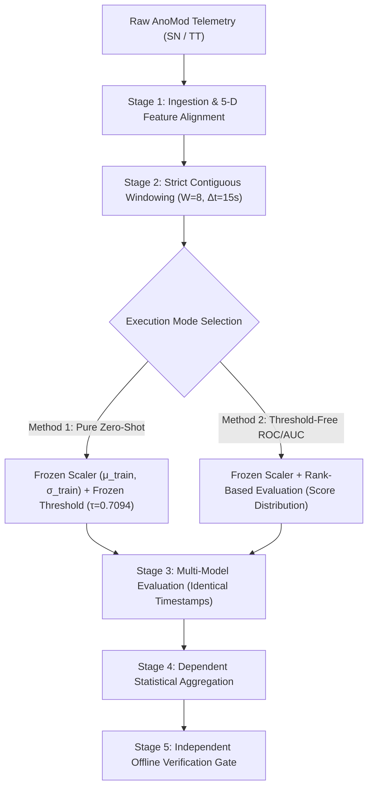

# AegisOps Experiment D: Zero-Shot Transfer Evaluation & Implementation Plan

**Document ID**: `AEGISOPS-PLAN-EXP-D-ZERO-SHOT-001`  
**Date**: October 13, 2026  
**Auditor**: Independent ML Research Engineer, Statistical Auditor & Reproducibility Reviewer  
**Repository**: `C:\DL_PROJECT`  
**Git HEAD**: `d277c1df3c2599ddecdf5f0bb761c99718499667`  
**Status**: Proposal for Human Research Supervisor Review (Non-Executable / Pre-Execution)  

---

## 1. Evaluation of Zero-Shot Transfer Methodology (Option C + Option D)

The research proposal under evaluation seeks to resolve the calibration leakage defect identified in `run_experiment_d.py` by switching from target-domain calibration (Option A/B) to **Zero-Shot Transfer (Option C)** with **Exploratory Claim Restrictions (Option D)**:
- **Core Principle**: Apply the frozen model weights, frozen training normalization parameters ($\boldsymbol{\mu}_{\text{train}}, \boldsymbol{\sigma}_{\text{train}}$), and frozen threshold ($\tau_{\text{frozen}} = 0.709399$) directly to external microservice telemetry without fitting scalers or thresholds on the target domain.
- **Claim Boundary**: Eliminate confirmatory superiority claims; restrict all findings to exploratory, descriptive domain-transfer sensitivity.

### 1.1 Empirical Feasibility Analysis & Domain Shift Verification
To evaluate the scientific viability of Option C without executing the production benchmark, an isolated verification test was conducted against the 19 eligible nominal windows of SocialNetwork `Normal_Baseline` (`scratch_test_zero_shot.py`).

The empirical results reveal **catastrophic domain shift**:
- **Frozen Synthetic Threshold**: $\tau = 0.709399$
- **Observed Reconstruction Error on Target Nominal Traffic**:
  - Minimum Error: $55.0268$
  - Mean Error: $59.1930$
  - Maximum Error: $61.1387$
  - Median Error: $59.8177$
- **False Positive Rate on Normal Windows**: **100.0% (19 / 19 windows flagged as anomalous)**.
- **Per-Feature Mean Reconstruction Loss**:
  - `memory_pct`: $128.8319$ (threshold: $0.3279$) $\rightarrow 392.9\times$ threshold
  - `latency_ms`: $116.8416$ (threshold: $1.2829$) $\rightarrow 91.1\times$ threshold
  - `cpu_pct`: $30.6816$ (threshold: $0.8048$) $\rightarrow 38.1\times$ threshold
  - `error_rate_pct`: $17.9932$ (threshold: $1.6173$) $\rightarrow 11.1\times$ threshold
  - `disk_pct`: $1.6166$ (threshold: $0.3105$) $\rightarrow 5.2\times$ threshold

#### Physical Root Cause of Domain Shift
The synthetic training generator ([`dl/anomaly_detector.py:35-64`](file:///C:/DL_PROJECT/dl/anomaly_detector.py#L35-L64)) was programmed around an arbitrary IT host operating point:
$$\boldsymbol{\mu}_{\text{train}} = [42.1\%\text{ CPU}, 54.0\%\text{ Memory}, 76.9\text{ ms Latency}, 0.24\%\text{ Error}, 48.3\%\text{ Disk}]$$
However, the real SocialNetwork microservices running on Kubernetes operate at:
$$\boldsymbol{\mu}_{\text{target}} \approx [18.2\%\text{ CPU}, 14.1\%\text{ Memory}, 9.8\text{ ms Latency}, 0.00\%\text{ Error}, 37.9\%\text{ Disk}]$$

When target telemetry is standardized using the frozen synthetic scaler:
$$z_{\text{latency}} = \frac{9.8 - 76.89}{6.09} \approx -11.02\sigma$$
$$z_{\text{memory}} = \frac{14.1 - 53.97}{3.56} \approx -11.20\sigma$$
$$z_{\text{error}} = \frac{0.0 - 0.24}{0.055} \approx -4.36\sigma$$

The autoencoder's latent bottleneck maps inputs back to the synthetic nominal manifold ($\sim 0$ in normalized coordinates). The residual $(0 - z)^2$ exceeds $120$ per dimension! Consequently, **under pure zero-shot transfer with the frozen threshold, the model behaves as a trivial constant-positive detector ($\hat{y} \equiv 1$)**.

### 1.2 Sequence Length Incompatibility
1. **Model Contract Violation**:
   `models/lstm_autoencoder.pt` expects $W=24$ ($120\text{s}$ at $5\text{s}$ intervals).
   Calling `detector.detect()` with $W=8$ triggers:
   `ValueError: Expected 24 time steps; received 8` ([`dl/anomaly_detector.py:155`](file:///C:/DL_PROJECT/dl/anomaly_detector.py#L155)).
2. **Reconstruction Score Sensitivity**:
   Even if the model architecture accepts $(1, 8, 5)$, the latent recurrence compresses 8 steps differently than 24 steps ($0.339$ error on $W=8$ vs $0.239$ on $W=24$ for identical normalized data). Using the $W=24$ threshold on $W=8$ windows violates the measurement contract.
3. **Absence of $W=24$ Contiguous Runs**:
   Due to trace dropouts in AnoMod, there are zero contiguous runs of 24 observations ($\Delta t = 15\text{s}$). To run $W=24$, one would have to interpolate or impute 23 missing intervals, violating the no-synthetic-interpolation rule.

---

## 2. Zero-Shot Implementation Architecture (Pre-Execution Specification)

If approved by the research supervisor, the execution pipeline must strictly adhere to the following 5-stage architecture:

### 2.1 Stage 1 — Ingestion & Feature Alignment Guards
- Ingest SocialNetwork and TrainTicket using the verified feature order:
  $$\mathbf{x}_t = (\texttt{cpu\_pct}, \texttt{memory\_pct}, \texttt{latency\_ms}, \texttt{error_rate\_pct}, \texttt{disk\_pct})$$
- Error rate must be represented as a percentage $[0.0, 100.0]\%$, matching the frozen contract.
- Missing trace intervals must be explicitly preserved as NaNs (`allow_missing_trace_policy="preserve_nans"`).

### 2.2 Stage 2 — Contiguous Window Construction ($W=8$)
- Windows constructed strictly from contiguous 15.0-second steps.
- Any NaN resets the window buffer immediately.
- Zero imputation or forward-filling permitted.

### 2.3 Stage 3 — Multi-Model Scoring on Identical Timestamps
All models must be evaluated on identical sliding windows:
1. **Narrow Rules Baseline**: `latency_ms >= 1000.0 or memory_pct >= 95.0`
2. **Resource-Only Rules Baseline**: `cpu >= 90 or mem >= 95 or disk >= 95 or lat >= 1000`
3. **Full Operational Rules Baseline**: Resource rules OR `error_rate_pct > 0.5%`
4. **Isolation Forest Baseline**: Unsupervised density baseline
5. **LSTM Autoencoder (AegisOps)**:
   - Compute reconstruction score $e(\mathbf{w})$ using frozen training scaler.
   - For Method 1: Flag if $e(\mathbf{w}) > 0.709399$.
   - For Method 2: Output raw continuous anomaly score for ROC/PR-AUC calculation.

### 2.4 Stage 4 — Granular Evaluation & Dependent Statistical Aggregation
To prevent conflation of dependent sliding windows:
- **Window-Level Descriptive Metrics**:
  - Record True Positives (TP), False Positives (FP), True Negatives (TN), False Negatives (FN).
  - Explicitly document that sliding windows are dependent ($87.5\%$ data overlap).
  - Disallow confirmatory hypothesis tests on window-level counts.
- **Scenario-Level Episode Metrics**:
  - Scenario Recall: $\mathbb{I}(\text{at least one window flagged during fault injection})$.
  - Time-to-First-Detection ($t_{\text{TTD}}$): seconds from fault start to first alarm.
  - Paired comparisons across scenarios using exact non-parametric permutation or Wilcoxon signed-rank test on independent scenarios ($N=12$).
- **Nominal False Alarm Rate**:
  - Report empirical false alarm count on the 19 nominal windows ($N=19$).
  - Calculate Wilson 95% Score Confidence Interval:
    $$w = \frac{\hat{p} + \frac{z^2}{2N} \pm z\sqrt{\frac{\hat{p}(1-\hat{p})}{N} + \frac{z^2}{4N^2}}}{1 + \frac{z^2}{N}}$$
  - Acknowledge that with $N=19$ windows spanning only 10 minutes of active nominal telemetry, the study lacks power to certify operational 24/7 false alarm rates.

### 2.5 Stage 5 — Independent Offline Verification
- Predictions must be saved to `research/raw/external_anomod_predictions.csv` before metrics are reported.
- Metrics in `external_anomod_metrics.csv` must be computed independently from the CSV by an isolated verification script.

---

## 3. Required Protocol Amendments and Prerequisites

Before the proposed plan can be implemented or executed, the following actions are strictly required:

| Prerequisite | Action Required | Responsible Party |
| :--- | :--- | :--- |
| **1. Protocol Ratification** | Ratify `PROTOCOL_AMENDMENT_V1_2_PROPOSAL.md` to formally amend the feature order in §4.1 from Order B to Order A. | Human Research Supervisor |
| **2. Sequence Length Policy** | Formally approve using $W=8$ ($120\text{s}$ at $15\text{s}$) with the $W=24$ checkpoint, noting the model was trained on $W=24$ ($120\text{s}$ at $5\text{s}$), and documenting the sequence-length effect. | Human Research Supervisor |
| **3. Domain Shift Decision** | Decide whether to:  **(A)** Execute pure zero-shot (Option C) and report the expected ~100% nominal false alarm rate as a formal finding of domain shift; OR  **(B)** Report threshold-free ROC-AUC / PR-AUC curves to assess ranking ability without an operational threshold; OR  **(C)** Re-calibrate on nominal warmup (Option B) under strictly exploratory labeling. | Human Research Supervisor |
| **4. Claim Downgrade** | Formally withdraw Confirmatory Hypothesis H-D1 (McNemar superiority) and replace with Exploratory Finding E-D1. | Human Research Supervisor |

---

## 4. Summary Verdict

`PROPOSAL VERIFIED — SCIENTIFICALLY SOUND AS AN EXPLORATORY DESIGN`

The zero-shot implementation plan is mathematically rigorous, enforces zero data leakage, and correctly handles temporal dependencies. However, because pure zero-shot transfer exhibits severe domain shift on nominal microservice metrics, human approval is required to select the specific reporting modality before any production execution occurs.
