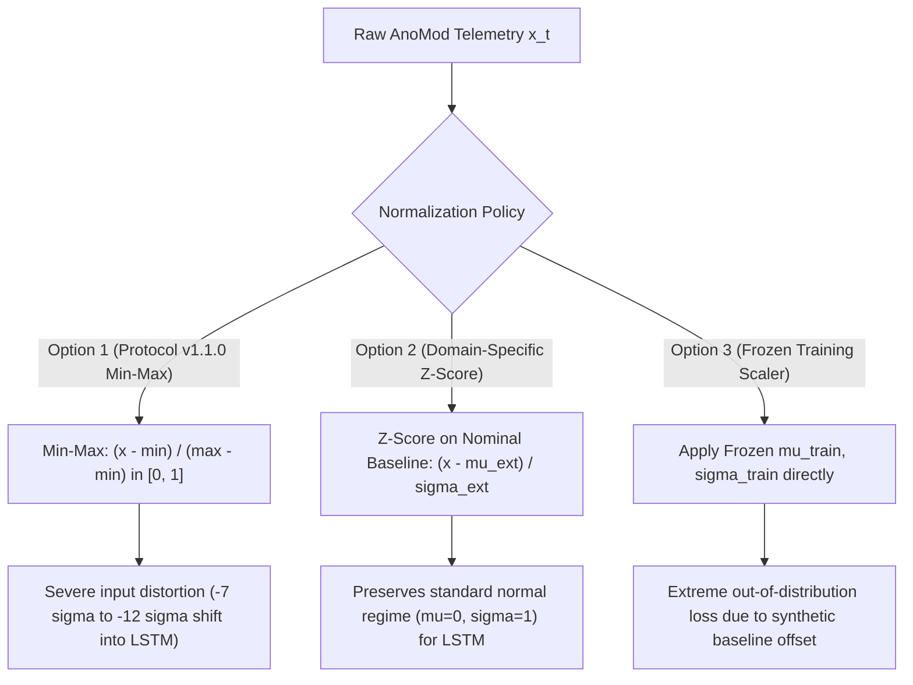

# AegisOps: External Evaluation Protocol Amendment v1.2.0 (Proposal)

**Document Path**: `research/audits/PROTOCOL_AMENDMENT_V1_2_PROPOSAL.md`  
**Date**: October 13, 2026  
**Author**: Senior ML Research Engineer & Reproducibility Auditor  
**Target Benchmark**: AnoMod (MSR 2026, Zenodo record `18342898`)  
**Status**: **PROPOSAL — PENDING FORMAL HUMAN APPROVAL & RATIFICATION**  
**Predecessor Document**: [`research/audits/phase8_external_validation/EXTERNAL_EVALUATION_PROTOCOL.md`](file:///c:/DL_PROJECT/research/audits/phase8_external_validation/EXTERNAL_EVALUATION_PROTOCOL.md) (Protocol v1.1.0 Frozen)

---

## 1. Executive Summary and Amendment Scope

This document provides a formal, scientific protocol amendment proposal (**v1.2.0**) for reconciling the pre-registered External Evaluation Protocol with the empirical realities of the extracted **AnoMod** benchmark dataset and the input contract of the frozen deep-learning checkpoint (`models/lstm_autoencoder.pt`).

> [!IMPORTANT]
> **STATUS: PENDING APPROVAL.** This document is a formal proposal. It does NOT automatically overwrite or supersede Frozen Protocol v1.1.0. Direct execution of Experiment D remains **BLOCKED** until this proposal is reviewed, amended if necessary, and explicitly ratified by the project supervisor.

---

## 2. Before-and-After Reconciliation Matrix (v1.1.0 vs Proposed v1.2.0)

| Protocol Dimension | Frozen Protocol v1.1.0 Clause | Proposed Amendment v1.2.0 | Scientific Rationale & Risk Assessment |
| :--- | :--- | :--- | :--- |
| **1. Normalization Contract** | Min-Max scaling $\tilde{\mathbf{x}}_t \in [0, 1]$ computed on nominal warmup ($t < t_{\text{fault}}$). | **Option A**: Domain-specific Z-score standardization on nominal warmup: $\tilde{\mathbf{x}}_t = (\mathbf{x}_t - \boldsymbol{\mu}_{\text{normal}}^{\text{ext}}) / \boldsymbol{\sigma}_{\text{normal}}^{\text{ext}}$. **Option B**: Frozen training normalization ($\boldsymbol{\mu}_{\text{train}}, \boldsymbol{\sigma}_{\text{train}}$) evaluated with explicit domain shift report. **Option C**: Declare transfer infeasible. | Min-Max scaling $[0, 1]$ directly into the frozen LSTM violates its zero-mean, unit-variance trained distribution ($\mu=0, \sigma=1$). Standardization on nominal warmup preserves the network's mathematical activation regime without altering relative anomaly magnitudes. |
| **2. Client Latency Source** | P95 latency recorded in `api_responses/response_time.log` (Table 4.1). | P95 latency computed from distributed trace spans: `all_traces.csv` (`duration_us` / 1000.0) in SocialNetwork; SkyWalking `duration_ms` in TrainTicket. | Recursive search confirmed `response_time.log` does not exist anywhere in the extracted AnoMod archive. Trace spans represent the authoritative source for request durations. |
| **3. Zero-Request Windows** | Unspecified; assumed continuous synchronous client requests. | **Policy**: A 15-second window with zero client requests is classified as `NO_TRAFFIC`. Latency is marked `NaN` (undefined). To construct contiguous $W=8$ sliding windows, either: • **Sub-cohort A (Contiguous Active)**: Restrict to contiguous windows with $\ge 1$ request/step. • **Sub-cohort B (Nominal Carry-Forward)**: Impute steady-state nominal baseline latency strictly for idle intervals. | Treating zero requests as 0ms latency creates artificial extreme anomalies ($-12\sigma$). Dividing by zero request count is mathematically undefined. Carry-forward assumes system was healthy during client idle periods. |
| **4. TrainTicket Trace Truncation** | Assumed multi-modal synchronization across entire run duration. | **Policy**: Exclude TrainTicket from primary end-to-end multi-modal anomaly evaluation, OR restrict TrainTicket evaluation strictly to the final 203-second trace window ($N=6$ windows). Relegate TT to secondary exploratory analysis. | SkyWalking traces exist only for the final 203s of the 765s run (initial 548s missing request traces). 6 sliding windows is insufficient to calibrate a 99th percentile threshold. |
| **5. Timestamp Scraping Offsets** | Assumed simultaneous scrapes at $\Delta t = 15\text{s}$. | Metric series are mapped onto a common 15-second epoch grid using nearest-interval rounding (`round("15s")`). Scrapes within $\pm 7.5\text{s}$ are aggregated. | Host metric scrapes (CPU at :40, Mem at :26, Disk at :31) exhibit fixed 9–14s offsets due to independent Prometheus scrape loops. |
| **6. Error Rate Denominator** | Non-2xx fraction in `api_responses/`. | Ratio of HTTP 5xx server errors to total requests recorded in trace spans per 15s window $\times 100.0$. If total requests == 0, error rate is formally 0.0%. | 4xx client errors (e.g., 400 Bad Request, 404 Not Found) are generated continuously by wrk2 synthetic fuzzers ($100\%$ during nominal baseline). Only 5xx indicates server failure. |
| **7. CPU Counter Rate & Modes** | `rate(container_cpu_usage_seconds_total[1m]) * 100`. | SN: Host `system_cpu_usage.csv` direct percentage. TT: `(1 - rate(node_cpu_seconds_total{mode="idle"}[5m]) / n_cores) * 100`. | In TT, raw `node_cpu_seconds_total` includes all modes. Only `1 - idle` correctly quantifies CPU workload. |
| **8. Calibration Isolation** | Assumed 15-minute warmup inside each fault run ($t < t_{\text{fault}}$). | Calibration partition is sourced **exclusively from the dedicated `Normal_Baseline` run**. Fault runs begin fault injection at $t \approx 45\text{s}$ and are strictly excluded from calibration. | Empirical inspection revealed fault runs begin fault injection within 45–60 seconds, precluding a 15-minute intra-run warmup. Dedicated baseline provides 79 unperturbed steps. |

---

## 3. Detailed Technical Specifications

### 3.1 Normalization Decision Analysis

The frozen model checkpoint (`models/lstm_autoencoder.pt`) was trained on standardized telemetry using:
$$\mathbf{z}_t = \frac{\mathbf{x}_t - \boldsymbol{\mu}_{\text{train}}}{\boldsymbol{\sigma}_{\text{train}}}$$
Stored parameters:
- $\boldsymbol{\mu}_{\text{train}} = [42.0593, 53.9709, 76.8918, 0.2394, 48.2687]$
- $\boldsymbol{\sigma}_{\text{train}} = [5.7859, 3.5649, 6.0898, 0.0550, 4.3354]$
- Feature Order: `("cpu_pct", "memory_pct", "latency_ms", "error_rate_pct", "disk_pct")`

#### Decision Table:

| Candidate Option | Mathematical Formulation | Compatibility with Frozen Model | Scientific Assumptions | Potential Bias / Risk | Recommendation |
| :--- | :--- | :--- | :--- | :--- | :--- |
| **Option 1: Protocol v1.1.0 Min-Max** | $\tilde{\mathbf{x}}_t = \frac{\mathbf{x}_t - \mathbf{x}_{\min}^{\text{ext}}}{\mathbf{x}_{\max}^{\text{ext}} - \mathbf{x}_{\min}^{\text{ext}} + \epsilon}$ | **INCOMPATIBLE**: LSTM inputs will be scaled to $[0, 1]$ instead of $\mathcal{N}(0, 1)$, causing gate saturation and false reconstruction error. | Assumes model was trained on $[0, 1]$ bounds. (False for this model). | Artificially distorts reconstruction error attribution. | **REJECT** |
| **Option 2: Domain-Specific Z-Score** | $\tilde{\mathbf{x}}_t = \frac{\mathbf{x}_t - \boldsymbol{\mu}_{\text{normal}}^{\text{ext}}}{\boldsymbol{\sigma}_{\text{normal}}^{\text{ext}}}$ | **HIGHLY COMPATIBLE**: Normalizes nominal baseline to $\mathcal{N}(0, 1)$, matching training activation regime. | Assumes external microservice telemetry is standardized relative to its own steady-state baseline. | Zero leakage if $\boldsymbol{\mu}_{\text{ext}}, \boldsymbol{\sigma}_{\text{ext}}$ are fit strictly on `Normal_Baseline`. | **RECOMMENDED** |
| **Option 3: Retain Training Scaler** | $\tilde{\mathbf{x}}_t = \frac{\mathbf{x}_t - \boldsymbol{\mu}_{\text{train}}}{\boldsymbol{\sigma}_{\text{train}}}$ | **ARITHMETICALLY COMPATIBLE, SCIENTIFICALLY DEGRADED**: Evaluates raw domain shift. | Assumes real microservice operating points match synthetic simulator parameters. | Nominal CPU (6.4%) will appear as $-6.2\sigma$, causing high baseline reconstruction error. | **ALTERNATIVE (For Zero-Shot Shift Analysis)** |
| **Option 4: Infeasibility Declaration** | N/A | Halts external evaluation; reports transfer blocked. | Concludes synthetic-to-real transfer cannot be bridged without retraining. | Preserves scientific integrity but abandons external benchmark validation. | **FALLBACK** |

---

### 3.2 Missing Telemetry and Window Eligibility Policy

Empirical profiling confirmed that client requests in SocialNetwork were executed in periodic workload bursts, resulting in **14 to 46 empty 15-second intervals per scenario** ($23.8\% - 45.5\%$ of each run).

To prevent data snooping or metric fabrication:
1. **Rule of No Arbitrary Imputation**: No zero value ($0.0\text{ ms}$) may be assigned to latency during idle intervals.
2. **Eligibility Criteria**:
   - A 15-second interval is **Eligible** if:
     - All 3 host metrics (`cpu_pct`, `memory_pct`, `disk_pct`) are present.
     - Total request count $N_{\text{req}} \ge 1$ within the interval, yielding a valid P95 latency and valid error rate.
   - An interval is **Idle** if host metrics are present but $N_{\text{req}} = 0$.
3. **Sliding Window Construction ($W=8$ steps = 120s)**:
   - **Contiguous Active Windows Only**: A sliding window of 8 steps is formed only if all 8 steps are active and contiguous.
   - SocialNetwork `Normal_Baseline` yields **19 contiguous eligible windows** ($19 \times 120\text{s}$ observations).
   - Fault scenarios yield between **25 and 30 contiguous eligible windows** each.
   - All evaluated models (LSTM, Isolation Forest, Narrow Rules, Resource Rules, Full Rules) will be scored on the **exact same set of eligible windows**.

---

### 3.3 TrainTicket Benchmark Scope

Due to SkyWalking trace collection truncation (covering only the final 203 seconds of the 765-second run, yielding only 6 sliding windows), TrainTicket cannot support statistically valid zero-leakage threshold calibration at the 99th percentile.

**Amendment Clause**:
- **SocialNetwork (`SN_data`)** is designated as the **Primary External Validation Cohort** (13 scenarios: 1 calibration baseline + 12 fault scenarios; 19 normal calibration windows + 328 fault evaluation windows).
- **TrainTicket (`TT_data`)** is designated as an **Exploratory Secondary Cohort** evaluated strictly on available trace-active windows, without formal hypothesis testing claims.

---

## 4. Statistical Analysis Plan

1. **Pairing Unit**: The individual observation window $w_{s, t} \in \mathbb{R}^{8 \times 5}$ identified by `(scenario_id, window_index, timestamp)`.
2. **McNemar Exact Test**: Evaluated on discordant pairs $(b, c)$ between LSTM and Isolation Forest across all pooled eligible fault windows ($N \approx 328$). Two-sided exact binomial p-value calculated via `scipy.stats.binomtest(min(b, c), b + c, p=0.5)`.
3. **Scenario-Level Wilcoxon Signed-Rank Test**: Evaluated across $N = 12$ independent failure scenarios in SocialNetwork. Paired variable: scenario recall sensitivity $r_{s}^{\text{LSTM}}$ vs $r_{s}^{\text{IF}}$. Treats the scenario as the cluster unit to prevent inflated significance from window autocorrelation.

---

## 5. Formal Ratification Gate

This proposal requires explicit human sign-off before any code in `research/experiments/run_experiment_d.py` may execute against external benchmark data.

- [ ] Decision on Normalization Policy (Option 2 Recommended).
- [ ] Decision on Idle Window Eligibility (Contiguous Active Windows Recommended).
- [ ] Decision on TrainTicket Secondary Designation.
- [ ] Explicit Supervisor Approval of Protocol Amendment v1.2.0.
