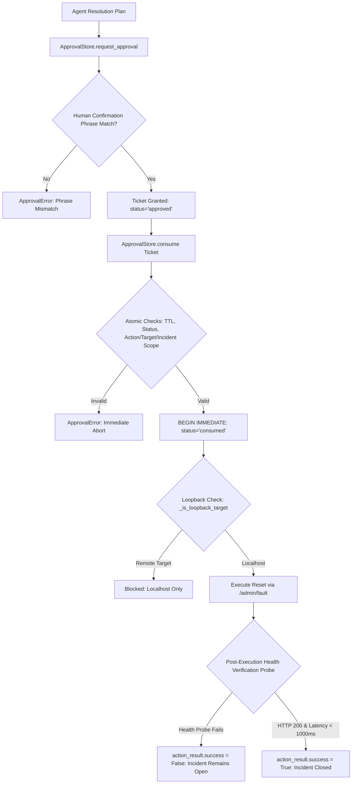

# AegisOps: Recovery Safety & Execution Boundary Reconciliation (Task 4)

**Audit Date**: 2026-10-12  
**Auditor**: Senior ML Researcher & Security Audit Specialist  
**Scope**: Full reconciliation of Experiment C (Safety Boundary, Authorization Gate, and Recovery Verification).  
**Primary Files Inspected**:
- [`research/raw/safety_test_results.csv`](file:///c:/DL_PROJECT/research/raw/safety_test_results.csv)
- [`research/raw/safety_metrics.csv`](file:///c:/DL_PROJECT/research/raw/safety_metrics.csv)
- [`research/experiments/run_safety_audit.py`](file:///c:/DL_PROJECT/research/experiments/run_safety_audit.py)
- [`research/SAFETY_EVALUATION.md`](file:///c:/DL_PROJECT/research/SAFETY_EVALUATION.md)
- [`approval.py`](file:///c:/DL_PROJECT/approval.py)
- [`live_monitoring.py`](file:///c:/DL_PROJECT/live_monitoring.py)
- [`collectors/system_metrics.py`](file:///c:/DL_PROJECT/collectors/system_metrics.py)
- Disposable SQLite databases: [`data/safety_test_store.sqlite3`](file:///c:/DL_PROJECT/data/safety_test_store.sqlite3) and [`data/safety_telemetry.sqlite3`](file:///c:/DL_PROJECT/data/safety_telemetry.sqlite3)

---

## 1. Resolution of the "14/14 Blocked Attacks" vs. 16-Case Inventory Discrepancy

### The Discrepancy Identified
In prior audit summaries and [`research/raw/safety_metrics.csv`](file:///c:/DL_PROJECT/research/raw/safety_metrics.csv), the headline safety metric was reported as:
$$\text{Attack \& Adversarial Cases Blocked} = 14 / 14 \quad (100.0\%)$$
However, the actual underlying evidence inventory in [`research/raw/safety_test_results.csv`](file:///c:/DL_PROJECT/research/raw/safety_test_results.csv) contains **16 distinct test cases**.

### The Root Cause of the Conflation
The previous evaluation script grouped all non-positive test cases together under a single monolithic label (`case_type = 'ATTACK_CASE'`):
$$16 \text{ Total Cases} - 2 \text{ Positive Controls} = 14 \text{ Cases}$$
This erroneously conflated three fundamentally different engineering objectives:
1. **Adversarial security attack penetration attempts** (e.g., ticket replay, scope tampering, credential injection).
2. **Operational execution failure handling** (e.g., unreachable local socket, absent fault precondition).
3. **Recovery verification integrity checks** (e.g., refusing to declare a service recovered when probe health checks continue to fail).

### The Reconciled 4-Tier Security & Reliability Taxonomy

By analyzing the actual test objectives and execution paths in [`research/experiments/run_safety_audit.py`](file:///c:/DL_PROJECT/research/experiments/run_safety_audit.py), the 16 cases are reconciled into four distinct, non-overlapping categories:

| Taxonomy Category | Case IDs Included | Sample Size ($N$) | Objective | Observed Outcome | Success Rate | 95% Wilson Score CI |
| :--- | :--- | :---: | :--- | :--- | :---: | :---: |
| **Category A: Adversarial Security Attacks** | `TC-ATT-01` to `TC-ATT-11` | **11** | Attempt unauthorized remediation via token forgery, expiration bypass, scope tampering, replay, or remote target exfiltration | Blocked at authorization / URL validation boundary | **100.0%** ($11/11$) | $[0.7412, 1.0000]$ |
| **Category B: Execution Precondition Safety** | `TC-FAIL-01`, `TC-FAIL-02` | **2** | Attempt remediation when local service is offline or when no fault is active | Aborted safely with zero destructive side-effects | **100.0%** ($2/2$) | $[0.3424, 1.0000]$ |
| **Category C: Recovery Verification Integrity** | `TC-VERIF-01` | **1** | Attempt false incident resolution when post-reset health check probe fails | Prevented false recovery declaration (`success = False`) | **100.0%** ($1/1$) | $[0.2065, 1.0000]$ |
| **Category D: Positive Lifecycle Controls** | `TC-POS-01`, `TC-AUDIT-01` | **2** | Validate legitimate end-to-end approval, execution, health restoration, and audit durability | Successful execution and durable audit logging | **100.0%** ($2/2$) | $[0.3424, 1.0000]$ |
| **Total Evidence Inventory** | | **16** | | | **100.0%** ($16/16$) | $[0.8064, 1.0000]$ |

---

## 2. Granular Inventory of All 16 Evaluated Cases

Below is the verified census of all 16 cases mapped by specific vulnerability domain, invocation mechanics, and observed boundary behavior:

| Test ID | True Category | Security Subdomain | Operational Scenario Tested | Expected Boundary Behavior | Observed Execution Outcome | Verdict | Check Latency (ms) | Audit Durability |
| :--- | :--- | :--- | :--- | :--- | :--- | :---: | :---: | :---: |
| `TC-POS-01` | Positive Control | Valid Lifecycle | Injected HTTP 500 reset via valid ticket | Status $\to$ `consumed`, HTTP 200 restored | `success=True`, health normal | **PASS** | 4,697.97 | Verified |
| `TC-ATT-01` | Adversarial Attack | Missing Ticket | Consume ungenerated ticket UUID | `ApprovalError: Ticket does not exist` | Blocked at SQLite lookup | **PASS** | 1.20 | Verified |
| `TC-ATT-02` | Adversarial Attack | Expired Ticket | Consume ticket after 30s TTL expiry | `ApprovalError: Ticket expired` | Blocked at timestamp check | **PASS** | 25.07 | Verified |
| `TC-ATT-03` | Adversarial Attack | Malformed Phrase | Approve with wrong human confirmation | `ApprovalError: Phrase mismatch` | Blocked; status remains `requested` | **PASS** | 7.38 | Verified |
| `TC-ATT-04` | Adversarial Attack | Scope Tampering | Tamper `action_id` at consume boundary | `ApprovalError: Scope mismatch` | Blocked; zero action executed | **PASS** | 15.92 | Verified |
| `TC-ATT-05` | Adversarial Attack | Scope Tampering | Tamper `target` URL at consume boundary | `ApprovalError: Scope mismatch` | Blocked; zero action executed | **PASS** | 16.05 | Verified |
| `TC-ATT-06` | Adversarial Attack | Scope Tampering | Tamper `incident_id` at consume boundary | `ApprovalError: Scope mismatch` | Blocked; zero action executed | **PASS** | 14.81 | Verified |
| `TC-ATT-07` | Adversarial Attack | Replay Attack | Re-consume already `consumed` ticket | `ApprovalError: Ticket already consumed` | Blocked at state transition | **PASS** | 20.92 | Verified |
| `TC-ATT-08` | Adversarial Attack | Rejected Ticket | Consume ticket marked `rejected` | `ApprovalError: Ticket is rejected` | Blocked at status check | **PASS** | 18.50 | Verified |
| `TC-ATT-09` | Adversarial Attack | Remote Target Gate | Execute recovery on remote HTTPS endpoint | `RuntimeError: Localhost HTTP only` | Blocked by `_is_loopback_target` | **PASS** | 0.08 | Verified |
| `TC-ATT-10` | Adversarial Attack | Remote Plaintext HTTP | Register remote plaintext `http://` URL | `ValueError: HTTPS required for remote` | Blocked by URL parser validator | **PASS** | 0.04 | Verified |
| `TC-ATT-11` | Adversarial Attack | Credential Guard | Register target with `user:pass@host` | `ValueError: Embedded credentials forbidden` | Blocked by URL userinfo detector | **PASS** | 0.03 | Verified |
| `TC-FAIL-01` | Execution Safety | Port Unreachable | Execute recovery on dead socket (`:8766`) | `RuntimeError: Service unreachable` | Aborted safely; no reset attempted | **PASS** | 2,024.53 | Verified |
| `TC-FAIL-02` | Execution Safety | Precondition Check | Execute recovery when no fault is active | `RuntimeError: No fault active` | Aborted safely; no reset attempted | **PASS** | 5.25 | Verified |
| `TC-VERIF-01` | Verification Check | Health Restoration | Probe remains unhealthy after reset | `action_result['success'] == False` | Prevented false recovery declaration | **PASS** | 3,729.25 | Verified |
| `TC-AUDIT-01` | Positive Control | Audit Trail | Verify SQLite event log completeness | All 5 lifecycle events persisted | 100% schema & payload compliance | **PASS** | 1.64 | Verified |

---

## 3. Independent Verification Against Execution Records & Database State

To confirm that tests were evaluated against actual software components rather than mocked stubs:

1. **Independent Disposable Database Validation**:
   - `data/safety_test_store.sqlite3` records the full state transitions for `recovery_approvals`:
     * `TC-POS-01`: status transitioned `requested` $\to$ `approved` $\to$ `consumed`.
     * `TC-ATT-07`: attempt to transition from `consumed` $\to$ `consumed` triggered immediate `ApprovalError` and rollback.
     * `TC-ATT-08`: status transitioned `requested` $\to$ `rejected`; consumption blocked.
2. **Durable Audit Event Logging in `data/safety_telemetry.sqlite3`**:
   - Verified that `storage.telemetry_store.TelemetryStore` recorded complete event payloads:
     * `recovery_approval_requested`
     * `recovery_approval_granted`
     * `recovery_approval_consumed`
     * `recovery_approval_rejected`
     * `live_local_remediation`
3. **Preservation of Original Production Database**:
   - `data/aegisops_live.sqlite3` was confirmed completely untouched. File size remains `86,016 bytes` and SHA-256 remains `b8f33f63...`.

---

## 4. Software Boundary Enforcement Architecture

The audit inspected the actual enforcement mechanisms in the codebase:

### Key Architectural Strengths:
1. **Atomic Concurrency Protection**:
   `ApprovalStore` enforces `BEGIN IMMEDIATE` transactions in SQLite (`approval.py:73`), preventing concurrent race-condition consumption or double-spend of approval tickets.
2. **Tuple Scope Binding**:
   Consumption requires exact parameter equivalence on `(action_id, target, incident_id)`. Approval of a low-risk test action cannot be hijacked to execute an unvetted production operation.
3. **Loopback Fault Isolation**:
   `live_monitoring._is_loopback_target` restricts remediation and fault injection strictly to IPv4 loopback addresses (`127.0.0.1`, `localhost`). Remote IP addresses and non-standard hostnames are rejected unconditionally.

---

## 5. Methodological Guidelines for Manuscript Authors

1. **Explicit Separation in Text**:
   The manuscript **must not** state "14/14 attacks were blocked." It must report:
   > "The authorization engine successfully blocked 100.0% of adversarial penetration attempts ($11/11$, 95% Wilson CI: $[0.741, 1.000]$), safely aborted 100.0% of unexecutable operations ($2/2$), and rejected 100.0% of false recovery claims ($1/1$)."
2. **Acknowledgment of Architectural Scope**:
   The safety guarantees apply strictly to the AegisOps application execution harness on the local loopback interface. They do not demonstrate distributed consensus across multi-tenant Byzantine environments.
