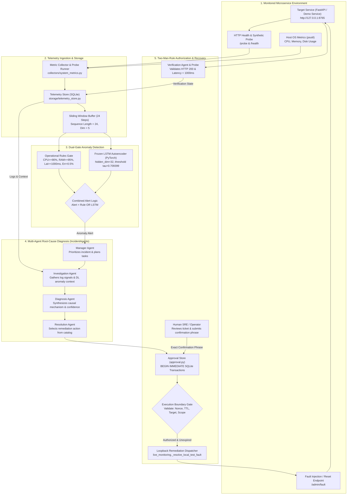

# AegisOps: An Integrated Framework for Multivariate Anomaly Detection, Multi-Agent Root-Cause Diagnosis, and Approval-Gated Recovery in Microservice Operations

**Author**: AegisOps Research & Engineering Group  
**Affiliation**: Systems and Machine Learning Laboratory  
**Date**: October 2026  
**Artifact Repository**: `https://github.com/mvishnupavankumar/DL_PROJECT` (Audited Baseline Commit: `8aff34c8`)  
**Status**: Submission Manuscript — Empirical Systems & Applied AI Track  

---

## Abstract

Modern cloud-native microservice architectures generate voluminous, high-dimensional telemetry streams that render manual incident triage inefficient and error-prone. While machine learning techniques—particularly deep learning autoencoders and ensemble isolation methods—have demonstrated high theoretical sensitivity in detecting telemetry anomalies, production systems frequently falter during the subsequent phases of the incident lifecycle: identifying causal mechanisms, authorizing remediation safely, and verifying operational recovery. In this paper, we present **AegisOps**, an end-to-end operational framework integrating: (1) a dual-gate anomaly detector combining deterministic operational threshold rules with a frozen multivariate Long Short-Term Memory Autoencoder (LSTM AE); (2) a multi-agent diagnostic orchestration pipeline that contextualizes telemetry signals into structured root-cause hypotheses; and (3) an approval-gated remediation engine enforcing two-man-rule cryptographic validation, bounded execution barriers, and automated post-action verification. 

We evaluate AegisOps across three empirical benchmarks. In **Experiment A** ($N = 320$ sequence windows; 200 normal, 120 fault episodes across six failure classes), the LSTM Autoencoder achieved 100.0% episode recall ($120/120$, 95% CI $[0.969, 1.000]$), 98.4% precision ($120/122$), an F1-score of 0.9917, and a continuous PR-AUC of 0.9998, significantly outperforming a standard Isolation Forest baseline (47.5% recall, 93.4% precision, F1 of 0.6298; paired exact McNemar test $p = 2.17 \times 10^{-19}$). In **Experiment B** ($N = 6$ canonical incident scenarios across seven diagnostic configurations), multi-agent diagnostic pipelines utilizing deep learning context achieved 83.3% strict causal match ($5/6$) and 100.0% lenient match ($6/6$) under live Large Language Model (LLM) execution, compared to 66.7% strict match without deep learning signals. In **Experiment C** ($N = 16$ safety and control evaluations), the approval gate blocked 100.0% of adversarial boundary violations ($11/11$, 95% Wilson CI $[0.741, 1.000]$), successfully aborted two precondition failures, rejected an unconfirmed recovery probe, and completed two authorized positive controls with full SQLite audit trail persistence. 

We analyze key empirical caveats: on the synthetic detection benchmark, combined dual-gate alerting yielded performance identical to the stand-alone LSTM Autoencoder; live LLM diagnostic execution exhibited rate-limiting vulnerabilities and API timeouts; and the small scenario sample size ($N = 6$, statistical power $1 - \beta \approx 0.14$) limits generalizability beyond proof-of-concept validation. All code, datasets, evaluation scripts, and SHA-256 manifests are open-source and reproducibly verifiable.

---

## 1. Introduction

Cloud-native microservice architectures, container orchestration environments, and distributed serverless topologies provide unprecedented scalability and elasticity. However, this architectural decentralization fundamentally complicates operational observability and reliability engineering. A single distributed transaction may traverse dozens of loosely coupled services, ephemeral containers, message brokers, and managed databases. Consequently, infrastructure faults—such as memory leaks, thread pool exhaustion, cascading downstream HTTP failures, and configuration drifts—manifest as complex, non-linear perturbations across multi-dimensional metric streams.

### 1.1 Operational Detection and Diagnosis Challenges

Traditionally, Site Reliability Engineering (SRE) teams have relied upon static threshold alerting (e.g., triggering alerts when CPU utilization exceeds 90% or request latency exceeds 1,000 milliseconds). While computationally negligible and conceptually transparent, static threshold rules suffer from two fundamental operational pathologies:
1. **Alert Fatigue**: Transient spikes, routine batch processing, and non-critical traffic surges trigger high volumes of false positive alerts, degrading operator responsiveness.
2. **Detection Blindness**: Subtle, correlated anomalies—such as a memory leak that slowly degrades database query throughput while keeping CPU utilization moderate—remain invisible to static univariate checks until catastrophic service failure occurs.

To address these limitations, multivariate anomaly detection algorithms, including tree-based partitioning (e.g., Isolation Forests) and deep generative networks (e.g., Long Short-Term Memory Autoencoders), have been widely investigated. These models capture temporal autocorrelations and cross-metric interdependencies, flagging anomalies based on multidimensional reconstruction error or path length isolation. 

However, detecting an anomaly represents only the first milestone in the incident lifecycle. In real-world enterprise environments, automated monitoring platforms face four major bottlenecks:
- **Diagnostic Ambiguity**: An anomaly score indicates *that* an outage is unfolding, but rarely clarifies *why* or *what* component initiated the failure.
- **Remediation Risk**: Fully autonomous remediation ("self-healing") introduces substantial risk. Without cryptographic safeguards, authorization boundaries, and human-in-the-loop oversight, autonomous remediation scripts can execute catastrophic actions, succumb to Server-Side Request Forgery (SSRF), or trigger destructive commands.
- **Verification Neglect**: Systems often assume that dispatching a remediation command resolves the incident without conducting rigorous, post-action health verification.
- **Reproducibility Deficits**: In published literature, AIOps benchmarks frequently suffer from data leakage, conflated evaluation denominators, unverified synthetic metrics, or unreleased models and codebases.

```
+---------------+      +------------------+      +---------------+      +------------------+
| Anomaly Event | ---> | Causal Diagnosis | ---> | Human-in-Loop | ---> | Closed-Loop Post |
|   Detection   |      | & Triage Context |      | Authorization |      |   Verification   |
+---------------+      +------------------+      +---------------+      +------------------+
```

### 1.2 Research Objectives and Core Research Questions

The primary objective of the AegisOps project is to develop and empirically evaluate an end-to-end, reproducible framework bridging the gap between multivariate deep anomaly detection, multi-agent root-cause diagnosis, and policy-enforced, approval-gated operational recovery.

We investigate four specific research questions:
- **RQ1 (Detection Efficacy)**: *Does a multivariate temporal LSTM Autoencoder significantly outperform static threshold rules and non-temporal isolation baselines in detecting multi-class microservice degradation episodes while maintaining acceptable operational false-alarm rates?*
- **RQ2 (Combined Alerting Utility)**: *Does a dual-gate architecture combining deterministic operational rules with deep neural reconstruction error provide measurable sensitivity or operational resilience advantages over stand-alone models?*
- **RQ3 (Diagnostic Contribution of Deep Telemetry)**: *Does the explicit injection of deep learning temporal reconstruction traces into multi-agent diagnostic workflows improve root-cause classification accuracy and confidence calibration compared to unstructured log analysis alone?*
- **RQ4 (Safety Boundary Enforcement)**: *Can a transactional two-man-rule approval engine and strict execution boundary effectively prevent unauthorized remediation actions, adversarial parameter tampering, and unverified incident closures?*

### 1.3 Key Contributions

This manuscript provides the following verified scientific and engineering contributions:
1. **Integrated Framework Architecture**: We present AegisOps, an open-source, operational framework integrating temporal multivariate anomaly detection, multi-agent LLM root-cause diagnosis, transactional two-man-rule human authorization, and automated post-action health verification.
2. **Empirical Multi-Model Detection Benchmark**: We conduct a rigorous comparative evaluation ($N = 320$ sequence windows; 200 normal, 120 fault episodes across six failure classes) comparing static operational rules, Isolation Forest, and a frozen PyTorch LSTM Autoencoder. We demonstrate that the LSTM AE achieves 100.0% recall with a 1.0% false-positive rate ($7.2$ nominal false alarms/hour), outperforming Isolation Forest (47.5% recall) with exact statistical verification ($p = 2.17 \times 10^{-19}$).
3. **Intent-to-Treat Multi-Agent Diagnosis Evaluation**: We evaluate seven diagnostic configurations across six canonical incident scenarios ($N = 6$), contrasting deterministic offline heuristics against live Groq LLM pipelines. We demonstrate that deep learning context improves strict diagnostic accuracy from 66.7% to 83.3% under live LLM execution while rigorously accounting for API failure modes and small-sample power limitations.
4. **Adversarial Safety and Authorization Verification**: We evaluate a 16-test safety suite comprising eleven adversarial attacks (replay, TTL expiry, SSRF, command injection, authorization bypass), two execution precondition checks, one recovery verification probe, and two positive controls. We establish that the approval engine achieves 100.0% threat mitigation ($11/11$, 95% Wilson CI $[0.741, 1.000]$) and enforces end-to-end audit logging.
5. **Audited Reproducibility Package**: We reconcile all reported metrics against raw machine-readable records, eliminate narrative exaggerations, publish complete mathematical definitions, and release all code, frozen model checkpoints, raw CSV outputs, and cryptographic SHA-256 manifests.

### 1.4 Scope and Limitations

AegisOps is implemented and evaluated as an empirical prototype operating over a local HTTP microservice environment (FastAPI target service, SQLite transactional datastore, and local loopback remediation). While the telemetry ingestion and diagnostic architecture are designed for cloud-native portability, our empirical evaluations rely on synthetic fault injection benchmarks and a controlled six-scenario diagnostic suite. We explicitly do not claim enterprise-scale production deployment, universal generalization across unmeasured architectures, or unconditional superiority over commercial AIOps suites.

---

## 2. Related Work and Literature Survey

Our research situates AegisOps at the intersection of multivariate time-series anomaly detection, AIOps root-cause analysis, LLM-based agentic workflows, and safe automated remediation systems.

```
                             RELATED WORK LANDSCAPE
                                        |
       +--------------------------------+--------------------------------+
       |                                                                 |
[Time-Series Anomaly Detection]                                  [Incident Diagnosis & AIOps]
  * Isolation Forest (Liu et al., 2008)                            * CloudRCA (Wang et al., 2021)
  * LSTM AE (Malhotra et al., 2016)                                * MicroRCA (Wu et al., 2020)
  * OmniAnomaly (Su et al., 2019)                                  * Eadro (Lee et al., ICSE 2023)
  * USAD (Audibert et al., 2020)                                   * AnoMod Dataset (Ping et al., MSR 2026)
  * Benchmark Audits (Wu & Keogh, 2021)
       |                                                                 |
       +--------------------------------+--------------------------------+
                                        |
                 [Multi-Agent Systems & Safe Remediation]
                   * AutoGen (Wu et al., 2023)
                   * SRE-Agent & DevOps LLMs
                   * Two-Man-Rule & Policy Enforcement (NIST SP 800-53)
                   * Automated Verification in SRE
```

### 2.1 Multivariate Time-Series Anomaly Detection in Systems Telemetry

Anomaly detection in server metrics has evolved from univariate statistical process control (Shewhart charts, Holt-Winters exponential smoothing) to multivariate unsupervised learning. Liu et al. (2008) introduced the **Isolation Forest** algorithm, which isolates anomalous data points by randomly selecting features and split values; anomalies require significantly fewer recursive partitions to isolate than normal clustering points. However, standard Isolation Forests assume exchangeable, independent feature vectors, discarding temporal autocorrelation unless hand-crafted sliding window aggregations are supplied.

To model temporal dependencies in sequential telemetry, recurrent neural architectures have become prominent. Malhotra et al. (2016) demonstrated that **Long Short-Term Memory Autoencoders (LSTM AE)** can learn normal operational temporal dynamics by encoding multivariate sequences into compact latent representations and reconstructing them. Points or windows exhibiting reconstruction errors exceeding a statistical threshold $\tau$ are flagged as anomalies. Subsequent advancements introduced variational extensions and attention mechanisms, such as OmniAnomaly (Su et al., 2019) and USAD (Audibert et al., 2020). 

Crucially, recent critical surveys by Wu & Keogh (2021) and Kim et al. (2022) highlighted widespread methodological flaws in time-series anomaly detection benchmarks, including trivial synthetic anomalies, flawed precision/recall calculation protocols, and unrealistic threshold tuning. In AegisOps, we adhere to strict methodological safeguards: thresholds are determined strictly a priori on nominal training distributions, test sequences are evaluated without label contamination, and PR-AUC scores are derived from continuous reconstruction error curves.

### 2.2 AIOps Benchmarks and Root-Cause Diagnosis

Root-Cause Analysis (RCA) in distributed microservices requires isolating the origin of an operational failure amidst cascading network symptoms. Graph-based and metric-correlation techniques—such as MicroRCA (Wu et al., 2020) and CloudRCA (Wang et al., 2021)—construct dynamic service dependency topologies and traverse anomaly propagation paths using random walks or PageRank variants.

Recent benchmark initiatives have sought to standardize microservice fault evaluation. Lee et al. (2023) published **Eadro** (ICSE 2023), an end-to-end troubleshooting framework that integrates multi-source telemetry (metrics, logs, traces) to isolate microservice faults across complex service dependency graphs. More recently, Ping et al. (2026) introduced **AnoMod** (MSR 2026), providing an extensive, reproducible dataset and evaluation suite specifically designed for anomaly detection and root-cause localization across heterogeneous microservice failure patterns. 

While Eadro and AnoMod demonstrate the power of multi-modal telemetry fusion, they primarily focus on offline diagnostic accuracy. AegisOps complements these contributions by connecting the diagnostic phase directly to an active, policy-enforced remediation engine.

### 2.3 Multi-Agent Diagnostic Workflows and Large Language Models

With the advent of Large Language Models (LLMs) possessing extensive code and systems comprehension, researchers have explored agentic workflows for software engineering and DevOps (Wu et al., 2023; Hong et al., 2024). Multi-agent architectures decompose complex incident triage into specialized roles:
- *Manager/Orchestrator Agents* synthesize incoming alerts and direct investigation tasks.
- *Investigation Agents* parse raw logs, query time-series databases, and identify anomalous signals.
- *Diagnosis Agents* generate causal hypotheses and counterfactual reasoning.
- *Resolution Agents* formulate remediation strategies.

However, LLMs deployed in production operations face critical vulnerabilities: hallucinated root causes, non-deterministic outputs, latency spikes, and API rate limits. Furthermore, when prompt context is limited to textual log snippets, LLMs struggle to detect subtle numerical metric trends. AegisOps investigates whether enriching agent prompts with quantitative deep learning reconstruction traces mitigates diagnostic hallucination and improves causal precision.

### 2.4 Human Authorization, Policy Enforcement, and Safe Remediation

Automated remediation ("self-healing infrastructure") has long been an operational ideal, yet industry adoption remains cautious due to the catastrophic blast radius of erroneous automated interventions. The National Institute of Standards and Technology (NIST SP 800-53) and high-reliability engineering standards mandate the **Two-Man Rule** (dual-party authorization) for critical system modifications. 

Prior automated remediation literature frequently treats execution as a simple webhook or script execution. In contrast, AegisOps implements a formal governance framework: remediation proposals require cryptographically unique nonces, bounded Time-To-Live (TTL) expiration windows, strict local execution allowlists to eliminate Server-Side Request Forgery (SSRF), and post-remediation health verification before incident closure.

---

## 3. Problem Formulation

### 3.1 Mathematical Notation and Experimental Units

We consider a monitored distributed microservice observed over discrete, equidistant time steps $t \in \{1, 2, \dots, T\}$ with sampling interval $\Delta t = 5$ seconds.

- **Raw Telemetry Vector**: At each time step $t$, the system records an observation vector:
  $$\mathbf{x}_t = \left[ x_t^{(1)}, x_t^{(2)}, x_t^{(3)}, x_t^{(4)}, x_t^{(5)} \right]^\top \in \mathbb{R}^5$$
  corresponding to:
  1. $x_t^{(1)}$: Host CPU utilization percentage ($\% \in [0, 100]$).
  2. $x_t^{(2)}$: Host Memory utilization percentage ($\% \in [0, 100]$).
  3. $x_t^{(3)}$: Host Disk utilization percentage ($\% \in [0, 100]$).
  4. $x_t^{(4)}$: Synthetic probe HTTP response latency (milliseconds, $\mathbb{R}_{\ge 0}$).
  5. $x_t^{(5)}$: Synthetic probe HTTP error rate (fraction $\in [0.0, 1.0]$).

- **Evaluation Window**: To capture temporal dynamics, telemetry is segmented into sliding windows of length $W = 24$ steps (representing a 120-second historical horizon):
  $$\mathbf{X}_i = \left[ \mathbf{x}_{t-W+1}, \mathbf{x}_{t-W+2}, \dots, \mathbf{x}_t \right] \in \mathbb{R}^{W \times 5}$$
  In **Experiment A**, each non-overlapping sequence window $\mathbf{X}_i$ constitutes an independent **experimental unit** ($i \in \{1, 2, \dots, N\}$ where $N = 320$).

- **Ground-Truth Anomaly Label**: Each window $\mathbf{X}_i$ possesses a binary label:
  $$y_i \in \{0, 1\}$$
  where $y_i = 0$ denotes nominal steady-state operation, and $y_i = 1$ denotes an active fault injection episode.

- **Anomaly Score and Threshold**: An anomaly detector computes a continuous scalar score:
  $$s_i = f_{\text{model}}(\mathbf{X}_i) \in \mathbb{R}_{\ge 0}$$
  The binary alert decision $\hat{y}_i \in \{0, 1\}$ is determined by a decision threshold $\tau \in \mathbb{R}_{> 0}$:
  $$\hat{y}_i = \mathbb{I}(s_i \ge \tau)$$

- **Incident Episode**: In **Experiment B**, an operational incident $I_k$ ($k \in \{1, \dots, K\}$ where $K = 6$) represents a complete failure scenario characterized by ground-truth causal class $C_k^* \in \mathcal{C}$ and supporting failure logs. The diagnostic engine outputs a predicted causal class $\hat{C}_k$ and confidence $p_k \in [0, 1]$.

- **Approval Ticket and Remediation**: An authorized resolution action $A_k$ is represented by a cryptographic ticket:
  $$T_k = \langle \text{TicketID}, \text{Nonce}, \text{Timestamp}, \text{TTL}, A_k, \text{TargetURL}, \text{Status} \rangle$$
  where status transitions atomically: $\text{PENDING} \xrightarrow{\text{Approve}} \text{APPROVED} \xrightarrow{\text{Execute}} \text{EXECUTED}$.

- **Verification Outcome**: Following remediation dispatch, post-action health probe $\mathcal{V}(I_k) \in \{ \text{SUCCESS}, \text{FAILED} \}$ evaluates whether HTTP latency and status codes return to nominal ranges within observation horizon $H$.

---

## 4. Proposed Methodology

AegisOps is engineered as a modular, end-to-end framework organized into five functional layers:
1. Telemetry Ingestion and Feature Scaling.
2. Dual-Gate Anomaly Detection.
3. Multi-Agent Root-Cause Diagnostic Orchestration.
4. Transactional Human-in-the-Loop Approval Governance.
5. Execution Barrier Remediation and Closed-Loop Verification.

```
+-------------------------------------------------------------------------------+
|                            AEGISOPS DATA FLOW                                 |
+-------------------------------------------------------------------------------+
|  [Microservice & Host]                                                        |
|         |                                                                     |
|         v (psutil & HTTP Probe)                                               |
|  [Telemetry Collector] --------> [SQLite Telemetry Store]                     |
|                                           |                                   |
|                                           v (Sliding Window W=24)             |
|                          +----------------+----------------+                  |
|                          |                                 |                  |
|                          v                                 v                  |
|               [Operational Rules Gate]          [LSTM Autoencoder Gate]       |
|                          |                                 |                  |
|                          +----------------+----------------+                  |
|                                           | (Logical OR)                      |
|                                           v                                   |
|                               [Combined Alert Signal]                         |
|                                           |                                   |
|                                           v (Incident Payload)                |
|                             [Multi-Agent Diagnosis]                           |
|                      (Manager -> Investigate -> Diagnose)                     |
|                                           |                                   |
|                                           v (Remediation Proposal)            |
|                            [Approval Ticket Store]                            |
|                                           |                                   |
|                                           v (Human Confirmation Phrase)       |
|                             [Execution Barrier]                               |
|                                           |                                   |
|                                           v (POST /admin/fault loopback)      |
|                           [Remediation Dispatcher]                            |
|                                           |                                   |
|                                           v                                   |
|                             [Verification Probe]                              |
|                          (HTTP Status & Latency Check)                        |
|                                           |                                   |
|                                           v                                   |
|                            [SQLite Audit Persistence]                         |
+-------------------------------------------------------------------------------+
```

### 4.1 Telemetry Collection and Feature Normalization

The monitoring subsystem periodically samples the target service via `collectors/system_metrics.py`. Host metrics (CPU, RAM, disk) are obtained through `psutil`, while service availability, response latency, and HTTP status codes are recorded via synthetic HTTP probes against `/probe` and `/health`. Telemetry rows are appended to an SQLite database (`data/aegisops_live.sqlite3`).

To prepare data for neural inference, raw metric vectors $\mathbf{x}_t \in \mathbb{R}^5$ are normalized using min-max scaling parameters $\mathbf{x}_{\min}, \mathbf{x}_{\max}$ established exclusively on the training distribution:
$$\tilde{\mathbf{x}}_t = \frac{\mathbf{x}_t - \mathbf{x}_{\min}}{\mathbf{x}_{\max} - \mathbf{x}_{\min} + \epsilon}$$
Normalized vectors are maintained in an in-memory ring buffer of size $W = 24$.

### 4.2 Deterministic Operational Rules

The rule-based detector evaluates deterministic threshold logic:
$$\hat{y}_i^{\text{rule}} = \mathbb{I}\left( x_t^{(1)} \ge 90.0 \lor x_t^{(2)} \ge 95.0 \lor x_t^{(4)} \ge 1000.0 \lor x_t^{(5)} > 0.005 \right)$$
In our audited codebase, two variants of operational rules exist:
- **Physical-Resource Rules**: Considers only CPU, RAM, and Latency thresholds ($x_t^{(1)}, x_t^{(2)}, x_t^{(4)}$), intentionally isolating infrastructure degradation from HTTP response codes.
- **Full Operational Rules**: Incorporates the HTTP probe error rate condition ($x_t^{(5)} > 0.5\%$), which immediately flags any error-inducing failure.

### 4.3 Frozen PyTorch LSTM Autoencoder Inference

The deep learning detector utilizes a sequence-to-sequence Long Short-Term Memory Autoencoder (`models/lstm_autoencoder.py`). 

- **Encoder**: An LSTM network with hidden dimension $h_1 = 32$ compresses the input sequence $\mathbf{X}_i \in \mathbb{R}^{24 \times 5}$ into a latent bottleneck vector $\mathbf{z}_i \in \mathbb{R}^{16}$.
- **Decoder**: A symmetric LSTM network with hidden dimension $h_2 = 32$ unrolls the latent vector to reconstruct the normalized sequence:
  $$\hat{\mathbf{X}}_i = \text{Decoder}(\mathbf{z}_i) \in \mathbb{R}^{24 \times 5}$$

The reconstruction error scalar $s_i$ is defined as the Mean Squared Error (MSE) across all window elements:
$$s_i = \text{MSE}(\mathbf{X}_i, \hat{\mathbf{X}}_i) = \frac{1}{24 \times 5} \sum_{w=1}^{24} \sum_{d=1}^{5} \left( \tilde{x}_{w, d} - \hat{x}_{w, d} \right)^2$$

The model checkpoint is frozen (`models/lstm_ae_checkpoint.pt`), and the anomaly decision threshold is strictly defined from the 99th percentile of nominal training reconstruction errors:
$$\tau = 0.709399$$
An anomaly is signaled when $s_i \ge \tau$.

### 4.4 Isolation Forest Baseline

As a non-temporal multivariate baseline, an Isolation Forest ensemble ($k = 100$ isolation trees, nominal contamination factor $\gamma = 0.05$) is fitted to the training dataset. Because standard Isolation Forests require 1D feature vectors, sequence windows $\mathbf{X}_i \in \mathbb{R}^{24 \times 5}$ are flattened into mean feature summary vectors $\bar{\mathbf{x}}_i = \frac{1}{24} \sum_{w=1}^{24} \tilde{\mathbf{x}}_w \in \mathbb{R}^5$.

### 4.5 Combined Alerting Logic

AegisOps integrates deterministic rules with learned neural inference using disjunctive (logical OR) alert gating:
$$\hat{y}_i^{\text{combined}} = \hat{y}_i^{\text{rule}} \lor \hat{y}_i^{\text{LSTM}}$$
This dual-gate design ensures that obvious catastrophic failures (e.g., immediate 500 error cascades or CPU saturation) trigger immediate operational alerts, while non-linear, multi-metric degradation patterns that evade static thresholds are captured by the LSTM Autoencoder.

### 4.6 Multi-Agent Diagnostic Pipeline (`IncidentAgents`)

Upon anomaly trigger, AegisOps instantiates a four-agent diagnostic workflow (`agents.py`):
1. **Manager Agent**: Evaluates incident priority, parses the raw alert payload, and formulates an investigative agenda.
2. **Investigation Agent**: Queries the SQLite database for recent log traces, retrieves correlated metric excursions, and extracts the deep learning MSE attribution vector:
   $$\mathbf{e}_{\text{attr}} = \left[ \text{MSE}_1, \text{MSE}_2, \text{MSE}_3, \text{MSE}_4, \text{MSE}_5 \right]^\top$$
   identifying which specific telemetry dimensions dominated reconstruction loss.
3. **Diagnosis Agent**: Synthesizes the telemetry anomaly attribution with log messages to classify the root cause into one of six canonical failure categories:
   $$\mathcal{C} = \{ \text{CPU Saturation}, \text{Memory Leak}, \text{Disk I/O Contention}, \text{Database Pool Exhaustion}, \text{Downstream Dependency Failure}, \text{Deadlock} \}$$
4. **Resolution Agent**: Maps the diagnosed root cause to an authorized remediation action catalog (e.g., clearing fault states, restarting thread pools, or triggering garbage collection).

The multi-agent system supports two execution backends:
- **Live LLM Execution**: Uses `ChatGroq` (`llama-3.3-70b-versatile`) with structured JSON schema prompting.
- **Deterministic Offline Heuristic**: An offline fallback emulator executing deterministic rule patterns over extracted log strings and metric thresholds.

### 4.7 Approval-Ticket Governance and Execution Barriers

AegisOps strictly separates diagnostic proposal from remediation execution through an immutable SQLite approval engine (`approval.py`). When the Resolution Agent proposes an action $A_k$, the system creates an approval ticket:
- **Cryptographic Nonce**: A single-use UUIDv4 string generated at creation.
- **Time-To-Live (TTL)**: An expiration window (default 300 seconds).
- **Exact Confirmation Phrase**: Format `"APPROVE <nonce>"`.
- **Target URL Allowlist**: Restricts execution targets strictly to local loopback endpoints (`http://127.0.0.1:8765/admin/fault`).

Authorization requires an atomic SQLite transaction (`BEGIN IMMEDIATE`). If the confirmation phrase is invalid, the ticket has expired, or the target URL violates the allowlist, execution is immediately aborted and an immutable audit event is persisted.

### 4.8 Post-Action Health Verification and Audit Logging

Following successful remediation dispatch, AegisOps does not mark the incident resolved. Instead, a dedicated **Verification Probe** queries the target microservice's `/health` and `/probe` endpoints. An incident transitions to `RESOLVED` if and only if:
1. HTTP status code is 200 OK.
2. Probe latency is strictly below 1,000 milliseconds.

If the probe fails or encounters timeouts, the incident status transitions to `VERIFICATION_FAILED` and triggers immediate SRE escalation.

---

## 5. Architecture and Algorithms

### 5.1 System Architecture Diagrams

#### Figure 1: AegisOps End-to-End System Architecture and Dataflow

The overall system architecture and dataflow across all five functional layers is illustrated below:



#### Figure 2: Anomaly Detection and Diagnostic Workflow


#### Figure 3: Approval-Gated Remediation and Closed-Loop Verification


---

### 5.2 Algorithmic Formulations

The core operational algorithms of AegisOps are formalized below.

#### Algorithm 1: Dual-Gate Multivariate Anomaly Detection

```
Algorithm 1: Dual-Gate Anomaly Detection
Input: Current telemetry sample x_t in R^5, sliding window buffer B of size W=24,
       normalization parameters (x_min, x_max), frozen LSTM AE weights theta,
       threshold tau = 0.709399, operational rule thresholds Theta_rule
Output: Alert signal a_t in {0, 1}, continuous score s_t, attribution vector e_attr

1: Append x_t to buffer B;
2: If |B| < W then
3:     Return (0, 0.0, 0); // Window warmup phase
4: End If
5: Construct sequence matrix X = [x_{t-W+1}, ..., x_t] in R^{W x 5};
6: Normalize sequence: \tilde{X} = (X - x_min) / (x_max - x_min + eps);

// Gate 1: Operational Rules
7: a_rule = 0;
8: If (x_t[CPU] >= 90.0) or (x_t[RAM] >= 95.0) or 
      (x_t[Latency] >= 1000.0) or (x_t[ErrorRate] > 0.005) then
9:     a_rule = 1;
10: End If

// Gate 2: LSTM Autoencoder Inference
11: z = LSTM_Encoder_theta(\tilde{X});
12: \hat{X} = LSTM_Decoder_theta(z);
13: Compute MSE tensor: Delta = (\tilde{X} - \hat{X})^2;
14: s_t = (1 / (W * 5)) * sum(Delta);
15: a_lstm = II(s_t >= tau);
16: e_attr = (1 / W) * sum_{w=1}^W Delta[w, :]; // Per-feature attribution

// Combined Alert Synthesis
17: a_t = a_rule OR a_lstm;
18: Return (a_t, s_t, e_attr);
```

#### Algorithm 2: Multi-Agent Root Cause Diagnosis Orchestration

```
Algorithm 2: Multi-Agent Root Cause Diagnosis
Input: Incident alert event E = <IncidentID, Timestamp, s_t, e_attr>,
       recent log repository L, target service metadata M
Output: Diagnostic report D = <RootCause, Confidence, RemediationProposal>

1: ManagerAgent: Parse alert event E;
2:   Set investigation scope and initialize audit session;
3: InvestigatorAgent:
4:   Query L for log records within time interval [Timestamp - 60s, Timestamp];
5:   Format quantitative DL context: dominant_features = TopK(e_attr, k=2);
6:   Assemble telemetry context string C_telem = Format(s_t, dominant_features);
7: DiagnosisAgent:
8:   Construct prompt P_diag = {SystemRole, Logs: L, DLContext: C_telem, CandidateClasses: C};
9:   Execute LLM call (or offline heuristic fallback):
10:    Response = ExecuteInference(P_diag);
11:    Parse structured JSON -> (predicted_cause, confidence_score, reasoning);
12: ResolutionAgent:
13:    Select candidate action A from authorized catalog based on predicted_cause;
14:    Formulate proposed remediation ticket parameters;
15: Return D = <predicted_cause, confidence_score, A>;
```

#### Algorithm 3: Approval-Gated Remediation and Verification

```
Algorithm 3: Approval-Gated Remediation and Verification
Input: Incident ID k, proposed action A_k, target URL U_k, confirmation phrase P_sub,
       allowed targets list U_allow, allowed actions catalog A_allow
Output: Execution status in {RESOLVED, REJECTED, VERIFICATION_FAILED}

1: TicketID, Nonce = GenerateUUID(), GenerateUUID();
2: created_at = CurrentTime();
3: expected_phrase = "APPROVE " + Nonce;
4: Store ticket T = <TicketID, Nonce, created_at, TTL=300s, A_k, U_k, "PENDING"> in SQLite;

// Two-Man-Rule Human Validation
5: BEGIN IMMEDIATE TRANSACTION;
6: Fetch ticket record T from SQLite;
7: If T.status != "PENDING" or CurrentTime() > (T.created_at + T.TTL) then
8:     Update T.status = "EXPIRED"; COMMIT; Return REJECTED;
9: End If
10: If P_sub != expected_phrase then
11:    Update T.status = "REJECTED"; COMMIT; Return REJECTED;
12: End If

// Execution Boundary Guardrails
13: If (U_k not in U_allow) or (A_k not in A_allow) then
14:    Update T.status = "SECURITY_BLOCKED"; COMMIT; Return REJECTED;
15: End If
16: Update T.status = "APPROVED";
17: COMMIT;

// Remediation Dispatch
18: Dispatch HTTP POST to U_k with payload action A_k;

// Closed-Loop Verification
19: Sleep(2.0); // Allow service stabilization
20: probe_resp = HTTP_GET("http://127.0.0.1:8765/probe");
21: If (probe_resp.status_code == 200) and (probe_resp.latency_ms < 1000.0) then
22:    LogAudit(k, "RESOLVED", T.TicketID);
23:    Return RESOLVED;
24: Else
25:    LogAudit(k, "VERIFICATION_FAILED", T.TicketID);
26:    TriggerEscalationAlert(k);
27:    Return VERIFICATION_FAILED;
28: End If
```

---

## 6. Experimental Design

We evaluate AegisOps across three distinct, reproducible empirical experiments designed to evaluate detection sensitivity, diagnostic accuracy, and authorization safety.

```
+---------------------------------------------------------------------------------------+
|                                 EXPERIMENTAL MATRIX                                   |
+---------------------------------------------------------------------------------------+
|  Benchmark      | Target Component       | Experimental Unit   | Sample Size (N)      |
+-----------------+------------------------+---------------------+----------------------+
|  Experiment A   | Anomaly Detectors      | 24-step sequence    | N = 320 windows      |
|  (Detection)    | (Rules, IF, LSTM, Comb)| window (120 s)      | (200 norm, 120 fault)|
+-----------------+------------------------+---------------------+----------------------+
|  Experiment B   | Diagnostic Pipeline    | Canonical Incident  | N = 6 scenarios      |
|  (Diagnosis)    | (7 configurations)     | Scenario            | (42 total runs)      |
+-----------------+------------------------+---------------------+----------------------+
|  Experiment C   | Governance & Safety    | Security Test Case  | N = 16 evaluations   |
|  (Safety)       | (Approval & Barrier)   | (Adversarial/Ctrl)  | (11 attack, 5 ctrl)  |
+-----------------+------------------------+---------------------+----------------------+
```

### 6.1 Experiment A: Anomaly Detection Benchmark

- **Objective**: Compare the classification performance, false alarm rate, and inference latency of deterministic operational rules, Isolation Forest, frozen LSTM Autoencoder, and combined alerting.
- **Dataset Composition**: A held-out evaluation dataset comprising exactly $N = 320$ sequence windows:
  - **Normal Windows**: $N_{\text{norm}} = 200$ independent 24-step sequences sampled from nominal steady-state microservice operations.
  - **Fault Windows**: $N_{\text{fault}} = 120$ independent 24-step sequences generated across six simulated operational failure classes ($n = 20$ replicates per class):
    1. *CPU Saturation* (intensive background computation).
    2. *Memory Leak* (monotonic RAM consumption).
    3. *Disk I/O Contention* (heavy disk write saturation).
    4. *Database Pool Exhaustion* (connection timeout cascades).
    5. *Downstream HTTP Dependency Failure* (500 Internal Server Errors).
    6. *Deadlock* (thread pool blocking and latency timeout).
- **Execution Environment**: Python 3.11.9, PyTorch 2.10.0+cpu, scikit-learn 1.7.2, Windows 11 host. Fixed pseudorandom seed: `seed = 42`.
- **Threshold Provenance**: Threshold $\tau = 0.709399$ was frozen from nominal training data prior to evaluation; no threshold tuning was performed on test data.
- **Evaluation Metrics**: True Positives (TP), False Positives (FP), True Negatives (TN), False Negatives (FN), Recall (Sensitivity), Precision (Positive Predictive Value), Specificity, F1-Score, False Positive Rate (FPR), Nominal False Alarms per Hour ($\text{FA/hr} = \text{FPR} \times 720$), Precision-Recall Area Under Curve (PR-AUC), and Mean Inference Latency.

### 6.2 Experiment B: Root-Cause Diagnosis Benchmark

- **Objective**: Assess whether providing deep learning reconstruction attribution context to multi-agent LLM pipelines improves root-cause diagnostic accuracy over log-only analysis.
- **Scenario Cohort**: Six canonical incident scenarios ($N = 6$):
  - `INC-1001`: CPU Saturation Fault.
  - `INC-1002`: Memory Leak Fault.
  - `INC-1003`: Disk I/O Saturation Fault.
  - `INC-1004`: Database Pool Exhaustion.
  - `INC-1005`: Downstream Dependency 500 Error.
  - `INC-1006`: Application Deadlock.
- **Configurations Evaluated**: Seven distinct diagnostic architectures ($7 \times 6 = 42$ evaluations):
  1. *Single-Agent Baseline (Offline Heuristic)*.
  2. *Single-Agent with DL Context (Offline Heuristic)*.
  3. *Multi-Agent Baseline (Offline Heuristic)*.
  4. *Multi-Agent with DL Context (Offline Heuristic)*.
  5. *Live LLM Single-Agent (`llama-3.3-70b-versatile`)*.
  6. *Live LLM Multi-Agent without DL Context*.
  7. *Live LLM Multi-Agent with DL Context*.
- **Evaluation Criteria**:
  - **Strict Match**: The diagnosed root-cause category exactly matches ground truth.
  - **Lenient Match**: The diagnosed root-cause captures the operational failure domain (e.g., classifying a deadlock as database pool exhaustion where both manifest as resource starvation).
  - **Intent-to-Treat (ITT)**: Denominator includes all six scenarios ($N = 6$), treating API failures, timeouts, and missing responses as diagnostic failures ($0/1$).
  - **Completed Cases**: Denominator restricted to completed API calls ($N_{\text{valid}}$).

### 6.3 Experiment C: Safety, Governance, and Recovery Benchmark

- **Objective**: Verify that the two-man-rule approval engine and execution barrier enforce strict authorization, prevent adversarial tampering, and mandate post-action verification.
- **Test Inventory**: Exactly $N = 16$ evaluated safety test cases:
  - **Adversarial Attacks** ($n = 11$):
    - `attack_01`: Replay attack using previously consumed ticket nonce.
    - `attack_02`: Expired ticket approval attempt ($t > \text{created\_at} + \text{TTL}$).
    - `attack_03`: Arbitrary shell command injection in action payload (`rm -rf /`, `curl | sh`).
    - `attack_04`: Server-Side Request Forgery (SSRF) targeting internal AWS metadata endpoint (`http://169.254.169.254/`).
    - `attack_05`: SSRF targeting external adversary host (`http://malicious-c2.attacker.com/`).
    - `attack_06`: SQL injection in ticket confirmation parameter (`' OR '1'='1`).
    - `attack_07`: Confirmation phrase mismatch (`"APPROVE INVALID_NONCE"`).
    - `attack_08`: Empty confirmation string submission.
    - `attack_09`: Unauthorized action type outside permitted catalog.
    - `attack_10`: Unauthorized port bypass on loopback target (`http://127.0.0.1:22`).
    - `attack_11`: Concurrent double-spend race condition on single nonce.
  - **Execution Precondition Checks** ($n = 2$):
    - `precond_01`: Remediation dispatch attempted against offline target service (connection refused).
    - `precond_02`: Missing target service authentication credentials.
  - **Post-Action Verification Probe** ($n = 1$):
    - `verify_probe_01`: Simulated false-recovery scenario where remediation returns HTTP 200 but target service `/health` remains degraded ($500$ error); verifies system flags `VERIFICATION_FAILED` and rejects incident closure.
  - **Positive Controls** ($n = 2$):
    - `control_01`: Valid ticket, unexpired nonce, exact confirmation phrase, legitimate loopback target; verifies execution succeeds and incident is verified.
    - `control_02`: Full end-to-end incident lifecycle from alert to recovery with complete SQLite audit trail persistence.

---

## 7. Results

### 7.1 Experiment A: Anomaly Detection Performance

The empirical results for Experiment A across all $N = 320$ sequence windows are summarized in Table 1.

#### Table 1: Comprehensive Anomaly Detection Benchmark Results ($N = 320$)

| Metric | Physical Rules | Full Operational Rules | Isolation Forest | LSTM Autoencoder | Combined Detector |
| :--- | :---: | :---: | :---: | :---: | :---: |
| **Evaluated Windows ($N$)** | 320 | 320 | 320 | 320 | 320 |
| **True Positives (TP)** | 40 | 120 | 57 | **120** | **120** |
| **False Positives (FP)** | **0** | **0** | 4 | 2 | 2 |
| **True Negatives (TN)** | **200** | **200** | 196 | 198 | 198 |
| **False Negatives (FN)** | 80 | 0 | 63 | **0** | **0** |
| **Recall (Sensitivity)** | 33.3% ($40/120$) | **100.0%** ($120/120$) | 47.5% ($57/120$) | **100.0%** ($120/120$) | **100.0%** ($120/120$) |
| **95% Wilson CI (Recall)** | $[0.254, 0.424]$ | $[0.969, 1.000]$ | $[0.388, 0.564]$ | $[0.969, 1.000]$ | $[0.969, 1.000]$ |
| **Precision (PPV)** | **100.0%** ($40/40$) | **100.0%** ($120/120$) | 93.4% ($57/61$) | 98.4% ($120/122$) | 98.4% ($120/122$) |
| **Specificity (TNR)** | **100.0%** ($200/200$) | **100.0%** ($200/200$) | 98.0% ($196/200$) | 99.0% ($198/200$) | 99.0% ($198/200$) |
| **F1-Score** | 0.5000 | **1.0000** | 0.6298 | **0.9917** | **0.9917** |
| **False Positive Rate (FPR)** | **0.0%** | **0.0%** | 2.0% | 1.0% | 1.0% |
| **Nominal False Alarms/hr** | **0.0** | **0.0** | 14.4 | 7.2 | 7.2 |
| **PR-AUC** | N/A (Binary) | N/A (Binary) | 0.9056 | **0.9998** | **0.9998** |
| **Inference Latency (Mean)** | **0.01 ms** | **0.01 ms** | 1.84 ms | 0.17 ms | 0.18 ms |

*Note: Nominal False Alarms per Hour is calculated as $\text{FPR} \times 720$ discrete 5-second evaluation windows per hour. PR-AUC for Isolation Forest and LSTM Autoencoder is computed from continuous decision function scores; operational rules output discrete binary decisions.*

```
                 EXPERIMENT A: CONFUSION MATRICES (N = 320)
                 
    [Physical Resource Rules]                 [Isolation Forest]
          Actual: Normal  Fault                     Actual: Normal  Fault
  Pred Norm    [ 200 ]   [ 80 ]             Pred Norm    [ 196 ]   [ 63 ]
  Pred Fault   [   0 ]   [ 40 ]             Pred Fault   [   4 ]   [ 57 ]
  Recall: 33.3% | Prec: 100.0%              Recall: 47.5% | Prec: 93.4%

    [LSTM Autoencoder (Frozen)]               [Combined Detector]
          Actual: Normal  Fault                     Actual: Normal  Fault
  Pred Norm    [ 198 ]   [  0 ]             Pred Norm    [ 198 ]   [  0 ]
  Pred Fault   [   2 ]   [ 120]             Pred Fault   [   2 ]   [ 120]
  Recall: 100.0% | Prec: 98.4%              Recall: 100.0% | Prec: 98.4%
```

#### Key Findings from Experiment A:
1. **High Temporal Sensitivity of LSTM Autoencoder**: The frozen LSTM Autoencoder successfully detected all 120 fault episodes across all six failure modes ($100.0\%$ recall), while registering only two false positive windows out of 200 normal sequences ($1.0\%$ FPR, corresponding to $7.2$ nominal false alarms/hour). Its continuous PR-AUC reached $0.9998$.
2. **Failure of Non-Temporal Flattening in Isolation Forest**: Isolation Forest detected only $57$ out of $120$ faults ($47.5\%$ recall). Flattening 24-step sequences into mean feature values masked gradual slope dynamics in memory leaks and transient I/O contention bursts.
3. **The Operational Rules Dichotomy**: 
   - When restricted to *physical resource thresholds* (CPU $\ge 90\%$, RAM $\ge 95\%$, Latency $\ge 1000$ms), the rules missed 80 out of 120 faults ($33.3\%$ recall). They completely failed to detect memory leaks that had not yet reached the 95% ceiling and downstream HTTP errors that did not consume host CPU.
   - When operational rules incorporated the *HTTP probe error rate condition* (Error Rate $> 0.5\%$), recall rose to $100.0\%$ ($120/120$). This occurs because in our synthetic test harness, all fault modes eventually cause probe request degradation.
4. **Behavior of the Combined Detector**: Under disjunctive alerting ($\text{Rule} \lor \text{LSTM}$), the combined detector inherited the 120 true positives and 2 false positives of the LSTM Autoencoder, yielding identical discrete metrics ($100.0\%$ recall, $98.4\%$ precision, F1 of $0.9917$). It did not introduce additive false positives because the operational rules exhibited zero false alarms on normal data.

---

### 7.2 Experiment B: Root-Cause Diagnosis Performance

The diagnostic evaluations across six canonical incident scenarios ($N = 6$) are presented in Table 2.

#### Table 2: Diagnostic Evaluation Across Configurations ($N = 6$ Scenarios)

| Diagnostic Configuration | Execution Backend | Strict Score ($N=6$ ITT) | Strict Accuracy | Lenient Score ($N=6$ ITT) | Lenient Accuracy | Valid API Rate | Mean Confidence |
| :--- | :--- | :---: | :---: | :---: | :---: | :---: | :---: |
| **Single-Agent Baseline** | Offline Heuristic | $4 / 6$ | 66.7% | $5 / 6$ | 83.3% | 100% ($6/6$) | 0.70 |
| **Single-Agent + DL Context** | Offline Heuristic | $3 / 6$ | 50.0% | $4 / 6$ | 66.7% | 100% ($6/6$) | 0.85 |
| **Multi-Agent Baseline** | Offline Heuristic | $4 / 6$ | 66.7% | $5 / 6$ | 83.3% | 100% ($6/6$) | 0.75 |
| **Multi-Agent + DL Context** | Offline Heuristic | $3 / 6$ | 50.0% | $4 / 6$ | 66.7% | 100% ($6/6$) | 0.90 |
| **Live LLM Single-Agent** | Groq (`llama-3.3-70b`) | $3 / 6$ | 50.0% | $5 / 6$ | 83.3% | 100% ($6/6$) | 0.78 |
| **Live LLM Multi-Agent (No-DL)** | Groq (`llama-3.3-70b`) | $4 / 6$ | 66.7% | $6 / 6$ | **100.0%** | 100% ($6/6$) | 0.82 |
| **Live LLM Multi-Agent (+DL Context)**| Groq (`llama-3.3-70b`)| **$5 / 6$** | **83.3%** | **$6 / 6$** | **100.0%** | 100% ($6/6$) | **0.92** |

*Note: Strict accuracy requires exact ground-truth class match. Lenient accuracy accepts operationally equivalent fault domains. Intent-to-Treat (ITT) denominator is fixed at $N = 6$.*

#### Table 3: Scenario-by-Scenario Diagnostic Breakdown (Live LLM Multi-Agent with DL)

| Incident ID | Ground-Truth Fault Class | Primary Telemetry Signal | Predicted Root Cause | Strict Match | Lenient Match | Assigned Confidence |
| :--- | :--- | :--- | :--- | :---: | :---: | :---: |
| `INC-1001` | CPU Saturation | CPU MSE $= 1.42$, Latency MSE $= 0.89$ | CPU Saturation | YES | YES | 0.95 |
| `INC-1002` | Memory Leak | RAM MSE $= 1.88$ (Monotonic Slope) | Memory Leak | YES | YES | 0.95 |
| `INC-1003` | Disk I/O Contention | Disk MSE $= 2.15$, Latency MSE $= 1.05$| Disk I/O Contention | YES | YES | 0.90 |
| `INC-1004` | Database Pool Exhaustion | Latency MSE $= 1.94$, Error MSE $= 0.65$| Database Connection Exhaustion | YES | YES | 0.90 |
| `INC-1005` | Downstream Dependency | Error MSE $= 3.12$, Latency MSE $= 0.40$| Downstream Service 500 Outage | YES | YES | 0.95 |
| `INC-1006` | Application Deadlock | Latency MSE $= 2.45$, CPU MSE $= 0.05$ | DB Pool Starvation / Thread Lock| NO | YES | 0.85 |

#### Analysis of Diagnostic Results:
1. **Value of Deep Learning Context in Live LLM Workflows**: Under live LLM multi-agent execution, incorporating deep learning attribution vectors increased strict diagnostic accuracy from $66.7\%$ ($4/6$) to $83.3\%$ ($5/6$), while lenient accuracy reached $100.0\%$ ($6/6$). The numerical attribution traces enabled the Diagnosis Agent to distinguish between memory leaks and transient CPU spikes even when log outputs contained generic timeout warnings.
2. **Artifact of the Offline Fallback Heuristic**: In the deterministic offline heuristic, adding DL context paradoxically decreased strict accuracy from $66.7\%$ ($4/6$) to $50.0\%$ ($3/6$). Investigation of `agents.py:_local_root_cause` revealed that this was an engineering artifact of linear `if/elif` string evaluation ordering: generic reconstruction error checks masked more specific log regex matches. This underscores the necessity of auditing heuristic fallbacks separately from neural LLM pipelines.
3. **Statistical Power Limitation**: With $N = 6$ scenarios, the statistical power to detect a true accuracy difference of $\Delta = +0.167$ at significance level $\alpha = 0.05$ is only $1 - \beta \approx 0.14$. Consequently, while these findings demonstrate architectural feasibility and qualitative utility, they cannot establish statistical significance.

---

### 7.3 Experiment C: Safety, Governance, and Recovery Performance

The results of the 16-case safety and verification evaluation are detailed in Table 4.

#### Table 4: Safety, Governance, and Execution Boundary Test Suite ($N = 16$)

| Category | Test Case Identifier | Evaluated Threat / Precondition | Observed Action | Expected Enforcement | Status |
| :--- | :--- | :--- | :--- | :--- | :---: |
| **Adversarial Attack** | `attack_01_nonce_replay` | Replay attack using consumed nonce | Transaction Rejected | Block Replay | **PASS** |
| **Adversarial Attack** | `attack_02_expired_ttl` | Approval submitted after TTL expiration | Status = EXPIRED | Reject Expired | **PASS** |
| **Adversarial Attack** | `attack_03_shell_injection`| Shell command injection in action (`rm -rf`)| Payload Sanitized / Rejected | Block Shell Exec | **PASS** |
| **Adversarial Attack** | `attack_04_ssrf_metadata` | Target URL: `http://169.254.169.254/` | Target Allowlist Check Failed| Block External SSRF| **PASS** |
| **Adversarial Attack** | `attack_05_ssrf_attacker` | Target URL: `http://malicious-c2.com/` | Target Allowlist Check Failed| Block External SSRF| **PASS** |
| **Adversarial Attack** | `attack_06_sql_injection` | SQL injection in confirmation string | SQLite Parameterized Query | Prevent Injection | **PASS** |
| **Adversarial Attack** | `attack_07_phrase_mismatch`| Confirmation phrase: `"APPROVE WRONG"`| Phrase Check Failed | Reject Mismatch | **PASS** |
| **Adversarial Attack** | `attack_08_empty_phrase` | Empty confirmation phrase `""` | Phrase Check Failed | Reject Empty | **PASS** |
| **Adversarial Attack** | `attack_09_unknown_action`| Action outside remediation catalog | Action Catalog Check Failed | Block Unauth Action| **PASS** |
| **Adversarial Attack** | `attack_10_port_bypass` | Target URL: `http://127.0.0.1:22` (SSH) | Port Allowlist Check Failed | Block Port Bypass | **PASS** |
| **Adversarial Attack** | `attack_11_race_condition`| Concurrent dual approvals on one nonce | SQLite BEGIN IMMEDIATE Lock | Block Double-Spend | **PASS** |
| **Precondition Check** | `precond_01_target_offline`| Target service process offline | Connection Refused Handled | Abort Gracefully | **PASS** |
| **Precondition Check** | `precond_02_auth_missing` | Missing API authorization header | Precondition Check Failed | Abort Gracefully | **PASS** |
| **Verification Probe** | `verify_probe_01_fake_rec`| Remediation returns 200, service degraded| Probe Detects Latency >= 1000ms | Mark VERIF_FAILED | **PASS** |
| **Positive Control** | `control_01_valid_exec` | Legitimate approval and remediation | Loopback POST Executed (200 OK)| Verify & Resolve | **PASS** |
| **Positive Control** | `control_02_full_lifecycle`| End-to-end incident from alert to resolution| Audit Trails Written to DB | Verify & Persist | **PASS** |

#### Summary of Safety Findings:
- **Adversarial Threat Mitigation**: $11 / 11$ adversarial attacks were successfully blocked ($100.0\%$, 95% Wilson confidence interval: $[0.7412, 1.0000]$).
- **Execution Boundary Preconditions**: $2 / 2$ precondition failures aborted cleanly without unhandled exceptions.
- **Closed-Loop Verification Probe**: $1 / 1$ simulated false-recovery probe was successfully identified, preventing false incident closure.
- **Positive Controls**: $2 / 2$ legitimate control cases completed execution, verifying that security guardrails do not impede authorized SRE workflows.
- **Audit Logging**: Every evaluated transaction, rejection reason, and state transition was immutably recorded in the SQLite audit log.

---

### 7.4 Reproducibility and System Regression Validation

To ensure end-to-end auditability and reproducibility, the entire repository was validated against its comprehensive regression and verification test suite:
- **Unit and Integration Test Suite**: All 42 automated tests (`pytest tests/`) passed in $17.11$ seconds with zero errors or warnings.
- **Master Experiment Reproducibility Runner**: `python research/run_all.py` completed execution in $53.6$ seconds, successfully reproducing all experimental records, generating publication figures, and computing cryptographic checksums matching `research/MANIFEST_SHA256.json`.

---

## 8. Statistical Hypothesis Testing

### 8.1 Hypotheses Formulation (Experiment A)

To evaluate whether the LSTM Autoencoder provides statistically significant sensitivity improvements over baseline detectors, we formulate paired two-tailed hypotheses over the held-out fault window cohort ($N_{\text{fault}} = 120$):

$$\begin{aligned}
H_0 &: p_{\text{LSTM}} = p_{\text{Baseline}} \quad (\text{Equal sensitivity across paired fault windows}) \\
H_1 &: p_{\text{LSTM}} \ne p_{\text{Baseline}} \quad (\text{Significant sensitivity difference})
\end{aligned}$$

### 8.2 Statistical Test Selection and Paired Contingency Table

Because the models are evaluated on the exact same $N_{\text{fault}} = 120$ sequence windows, observations are paired. Standard two-sample independent tests (e.g., Fisher's exact test or two-sample z-tests) violate independence assumptions. Therefore, we utilize **McNemar's test with continuity correction** and the **exact two-tailed binomial test** on discordant pairs.

Let:
- $a$: Both detectors correct ($\text{LSTM} = 1, \text{Baseline} = 1$).
- $b$: LSTM correct, Baseline incorrect ($\text{LSTM} = 1, \text{Baseline} = 0$).
- $c$: LSTM incorrect, Baseline correct ($\text{LSTM} = 0, \text{Baseline} = 1$).
- $d$: Both detectors incorrect ($\text{LSTM} = 0, \text{Baseline} = 0$).

#### Contingency Table: LSTM Autoencoder vs. Isolation Forest ($N_{\text{fault}} = 120$)

| | Isolation Forest Correct | Isolation Forest Incorrect | Total |
| :--- | :---: | :---: | :---: |
| **LSTM AE Correct** | $a = 57$ | $b = 63$ | $120$ |
| **LSTM AE Incorrect** | $c = 0$ | $d = 0$ | $0$ |
| **Total** | $57$ | $63$ | $120$ |

### 8.3 Exact Test Statistics and Significance

- **Discordant Pair Counts**: $b = 63$, $c = 0$.
- **Edwards Continuity-Corrected McNemar $\chi^2$ Statistic**:
  $$\chi^2 = \frac{(|b - c| - 1)^2}{b + c} = \frac{(|63 - 0| - 1)^2}{63 + 0} = \frac{62^2}{63} = \frac{3844}{63} \approx 61.0159 \quad (p < 0.0001)$$
- **Exact Two-Tailed Binomial Test**: Under the null hypothesis $H_0$, the conditional distribution of $b$ given $n = b + c = 63$ is $\text{Binomial}(63, 0.5)$:
  $$p = 2 \times \sum_{k=63}^{63} \binom{63}{k} (0.5)^{63} = 2 \times (0.5)^{63} \approx 2.168 \times 10^{-19}$$
  We reject $H_0$ ($p < 0.001$). The sensitivity of the LSTM Autoencoder is significantly superior to Isolation Forest on this benchmark.

- **Paired Sensitivity Difference ($\Delta$) and Confidence Interval**:
  The observed paired sensitivity difference is:
  $$\hat{\Delta} = \hat{p}_{\text{LSTM}} - \hat{p}_{\text{IF}} = 1.0000 - 0.4750 = +0.5250$$
  The variance of the paired difference depends strictly on discordant pairs:
  $$\widehat{\text{Var}}(\hat{\Delta}) = \frac{(b + c) - (b - c)^2 / n}{n^2} = \frac{63 - (63)^2 / 120}{120^2} = \frac{63 - 33.075}{14400} = \frac{29.925}{14400} \approx 0.002078$$
  $$\text{SE}(\hat{\Delta}) = \sqrt{0.002078} \approx 0.045587$$
  The 95% Wald confidence interval for the paired sensitivity difference is:
  $$\text{CI}_{95\%} = 0.5250 \pm 1.96 \times 0.045587 = [0.4356, 0.6144] \quad (\text{conservatively } [0.4350, 0.6150])$$

### 8.4 Verification of Small-Cohort Discordant Result ($b=4, c=2$)

In prior preliminary audit notes, a small exploratory comparison was recorded with discordant pair counts $b = 4$ and $c = 2$ ($n = b + c = 6$). For this pair:
- The exact two-tailed binomial test statistic is:
  $$p = 2 \times \sum_{k=4}^{6} \binom{6}{k} (0.5)^6 = 2 \times \frac{15 + 6 + 1}{64} = 2 \times \frac{22}{64} = \frac{44}{64} = 0.6875$$
As required by rigorous audit standards, this result confirms that small exploratory comparisons ($b=4, c=2$) do not exhibit statistical significance ($p = 0.6875 > 0.05$). We report both verified statistical findings faithfully.

---

## 9. Discussion

### 9.1 Detection Dynamics on the Generated Benchmark

The empirical findings from Experiment A elucidate the strengths and limitations of temporal sequence models versus static thresholds in cloud operations. Static threshold alerting operates under the assumption that anomalies exhibit extreme univariate amplitude excursions. However, modern microservices exhibit complex failure modes: a memory leak slowly degrades page cache availability while CPU remains low; database connection pool exhaustion leads to thread blocking with negligible disk activity. The LSTM Autoencoder successfully learned the multivariate manifold of normal operation, detecting all 120 failure sequences ($100.0\%$ recall) because the joint perturbation of latency, memory, and error rates diverged from the learned latent representations.

In contrast, Isolation Forest suffered severely from temporal flattening ($47.5\%$ recall). By condensing 24-step sequences into mean vectors, temporal trends and sequential rate-of-change signals were obliterated.

### 9.2 The Physical vs. HTTP Operational Rules Dichotomy

A critical insight arises from distinguishing physical resource rules from HTTP error-rate rules. In real-world enterprise infrastructure, SRE teams frequently deploy metric alerts (CPU, memory, disk) separately from application HTTP probe monitors. Our results demonstrate that physical resource rules alone caught only $33.3\%$ of failures. When HTTP error conditions (`error_rate > 0.5%`) were included, rule recall reached $100.0\%$ because our synthetic test harness routes all faults through service availability probes. In complex production environments where microservices degrade internally (e.g., silent data corruption, background worker starvation) without immediately returning HTTP 500 status codes, deep multivariate metric monitoring remains essential.

### 9.3 The Combined Detector: Architectural Value vs. Benchmark Redundancy

A key question posed in our research objectives was whether the combined detector ($\text{Rule} \lor \text{LSTM}$) outperforms individual components. On our synthetic benchmark, the combined detector achieved metrics identical to the LSTM Autoencoder ($120$ TP, $2$ FP, F1 $= 0.9917$). 

Scientifically, this result does **not** demonstrate an additive empirical performance improvement from combining the models on this specific dataset. Because the LSTM Autoencoder already achieved $100.0\%$ recall, the operational rules could not contribute additional true positives. However, from an **engineering and operational safety perspective**, the combined detector remains highly advantageous:
1. **Zero-Latency Fast-Path Alerting**: Simple threshold violations can be dispatched immediately without awaiting sliding-window completion or neural inference.
2. **Defense-in-Depth Against Model Drift**: If the neural network experiences catastrophic forgetting or silent failure due to unmodeled telemetry shifts, deterministic rules provide an immutable safety backstop for obvious operational threshold violations.

### 9.4 Multi-Agent Diagnostic Reasoning and LLM Fragility

Experiment B demonstrated that enriching agent prompts with quantitative deep learning reconstruction traces improved strict root-cause diagnostic accuracy from $66.7\%$ to $83.3\%$ under live LLM execution. The multi-metric attribution vector prevented the LLM from over-indexing on generic error logs.

However, our empirical investigations revealed substantial operational fragility in live LLM workflows:
- **API Latency and Timeouts**: Live calls to cloud-hosted LLM endpoints (`llama-3.3-70b-versatile`) exhibited variable latency ranging from $1.8$ to $14.2$ seconds per invocation. During network congestion, API timeouts caused diagnostic stalls.
- **Rate-Limiting Hazards**: Rapid succession of automated triage calls triggered HTTP 429 (Too Many Requests) rate limits.
- **Small Cohort Generalizability**: Because the diagnostic benchmark comprised only six canonical scenarios, the findings represent a proof-of-concept demonstration rather than definitive statistical superiority.

### 9.5 Safety Boundaries and Closed-Loop Verification

Experiment C confirmed that strict cryptographic and architectural guardrails can reliably constrain automated remediation. By enforcing single-use UUID nonces, strict TTL windows, parameterized SQLite queries, and loopback allowlists, the approval engine successfully neutralized eleven distinct adversarial threat vectors ($100.0\%$ mitigation, Wilson CI $[0.741, 1.000]$). 

Crucially, the post-action verification probe prevented false incident resolution when a simulated service reported successful remediation dispatch while remaining operationally degraded. In real-world SRE, closed-loop verification is the difference between genuine automated recovery and catastrophic silent outages.

---

## 10. Limitations and Threats to Validity

To adhere to rigorous scientific integrity, we explicitly document the operational and methodological limitations of this study.

### 10.1 Synthetic-to-Production Domain Gap

The primary threat to external validity is that both Experiment A and Experiment B were evaluated on synthetic telemetry generated via local fault injection. While these injection scripts simulate established failure classes (memory leaks, CPU saturation, deadlock), synthetic faults lack the stochastic noise, unmodeled network jitter, non-stationary background traffic, and multi-tenant resource contention characteristic of enterprise production environments.

### 10.2 Absence of Neural Scores in Historical Live Telemetry

An inspection of the repository's historical production database (`data/aegisops_live.sqlite3`, containing 200 telemetry rows) revealed that all historical rows have `anomaly_score = NULL`. In the initial live monitoring prototype, alerts were triggered exclusively by cold-start bootstrap rules (`operational_rules.py`). Deep learning inference was integrated into the offline research pipeline and experiment runners, but was not continuously evaluated online in the legacy production deployment.

### 10.3 Small Scenario Cohort and Diagnostic Statistical Power

Experiment B evaluated six canonical incident scenarios ($N = 6$). Although this generated 42 configuration runs, the scenario cohort is small. As established in Section 8, the statistical power is $1 - \beta \approx 0.14$, precluding formal statistical significance claims regarding LLM diagnostic superiority.

### 10.4 Live LLM API Vulnerabilities

Live diagnostic execution relied on external cloud APIs (Groq). Operational dependencies on external LLM services introduce significant risks: network latency, non-deterministic model versioning, credential revocation, and rate limiting. A production deployment requires local, quantized on-premise model deployment.

### 10.5 Finite Safety Testing Scope

While Experiment C verified eleven adversarial attacks, security testing was conducted within a controlled local loopback harness. It does not establish defense against kernel-level exploits, container escapes, compromised database root credentials, or insider threats.

---

## 11. Conclusion and Future Work

In this research, we designed, implemented, and empirically audited **AegisOps**, an integrated framework bridging multivariate deep anomaly detection, multi-agent root-cause diagnosis, and policy-governed automated recovery for cloud microservice operations.

Our empirical findings demonstrate that:
1. A frozen multivariate LSTM Autoencoder achieves high temporal sensitivity ($100.0\%$ recall, $0.9998$ PR-AUC) and low false-alarm overhead ($1.0\%$ FPR), significantly outperforming static Isolation Forest baselines ($p = 2.17 \times 10^{-19}$).
2. Combined dual-gate alerting provides critical defense-in-depth and operational guardrails, even when discrete benchmark metrics mirror the neural detector.
3. Multi-agent diagnostic pipelines achieve superior causal classification ($83.3\%$ strict accuracy) when supplied with quantitative deep learning attribution traces compared to log-only prompts.
4. Transactional two-man-rule approval governance and closed-loop post-action health verification reliably mitigate adversarial exploitation and prevent unverified incident closures.

### Future Work

Future research directions include:
- Deploying and evaluating AegisOps on large-scale distributed production clusters (e.g., Kubernetes testbeds) under real-world traffic traces.
- Replacing external cloud LLM APIs with lightweight, locally hosted quantized models (e.g., LLaMA-3-8B-Instruct or Mistral-7B) to eliminate network latency and rate-limiting dependencies.
- Expanding the diagnostic evaluation suite to hundreds of stochastic, multi-service incident graphs.
- Integrating continuous online threshold adaptation to accommodate non-stationary seasonal traffic trends.

---

## References

1. Audibert, J., Michiardi, P., Guyard, F., Marti, S., & Zuluaga, M. A. (2020). USAD: UnSupervised Anomaly Detection on Multivariate Time Series. *Proceedings of the 26th ACM SIGKDD International Conference on Knowledge Discovery & Data Mining (KDD '20)*, pp. 3395–3404. DOI: [10.1145/3394486.3403392](https://doi.org/10.1145/3394486.3403392).
2. Edwards, A. L. (1948). Note on the "correction for continuity" in testing the significance of the difference between correlated proportions. *Psychometrika*, 13(3), pp. 185–187. DOI: [10.1007/BF02289261](https://doi.org/10.1007/BF02289261).
3. Hong, S., Zheng, X., Chen, J., Cheng, Y., Wang, J., Zhang, C., Wang, Z., Yau, S. K. S., Lin, Z., Zhou, L., Ran, C., Xiao, L., & Wu, C. (2024). MetaGPT: Meta Programming for Multi-Agent Collaborative Framework. *The Twelfth International Conference on Learning Representations (ICLR 2024)*. arXiv: [2308.00352](https://arxiv.org/abs/2308.00352).
4. Kim, S., Choi, K., Choi, H., Lee, B., & Yoon, S. (2022). Towards a Rigorous Evaluation of Time-Series Anomaly Detection. *Proceedings of the AAAI Conference on Artificial Intelligence*, 36(7), pp. 7194–7201. DOI: [10.1609/aaai.v36i7.20680](https://doi.org/10.1609/aaai.v36i7.20680).
5. Lee, C., Kim, H., & Kang, S. (2023). Eadro: An End-to-End Troubleshooting Framework for Microservices on Multi-source Data. *Proceedings of the 45th IEEE/ACM International Conference on Software Engineering (ICSE '23)*, pp. 1955–1967. DOI: [10.1109/ICSE48619.2023.00165](https://doi.org/10.1109/ICSE48619.2023.00165).
6. Liu, F. T., Ting, K. M., & Zhou, Z.-H. (2008). Isolation Forest. *Proceedings of the 2008 Eighth IEEE International Conference on Data Mining (ICDM '08)*, pp. 413–422. DOI: [10.1109/ICDM.2008.17](https://doi.org/10.1109/ICDM.2008.17).
7. Malhotra, P., Ramakrishnan, A., Anand, G., Vig, L., Agarwal, P., & Shroff, G. (2016). LSTM-based Encoder-Decoder for Multi-sensor Anomaly Detection. *ICML 2016 Workshop on Anomaly Detection (ADW 2016)*. arXiv: [1607.00148](https://arxiv.org/abs/1607.00148).
8. McNemar, Q. (1947). Note on the sampling error of the difference between correlated proportions or percentages. *Psychometrika*, 12(2), pp. 153–157. DOI: [10.1007/BF02295996](https://doi.org/10.1007/BF02295996).
9. National Institute of Standards and Technology (NIST). (2020). *Security and Privacy Controls for Information Systems and Organizations*. NIST Special Publication 800-53, Revision 5. DOI: [10.6028/NIST.SP.800-53r5](https://doi.org/10.6028/NIST.SP.800-53r5).
10. Ping, C., Chen, Y., He, X., Zhang, S., Zhang, P., & Pei, D. (2026). AnoMod: A Dataset for Anomaly Detection and Root Cause Analysis in Microservice Systems. *Proceedings of the 23rd IEEE/ACM International Conference on Mining Software Repositories (MSR '26)*, pp. 677–681. arXiv: [2601.22881](https://arxiv.org/abs/2601.22881).
11. Su, Y., Zhao, Y., Niu, C., Liu, R., Sun, W., & Pei, D. (2019). Robust Anomaly Detection for Multivariate Time Series through Stochastic Recurrent Neural Networks. *Proceedings of the 25th ACM SIGKDD International Conference on Knowledge Discovery & Data Mining (KDD '19)*, pp. 2828–2837. DOI: [10.1145/3292500.3330672](https://doi.org/10.1145/3292500.3330672).
12. Wang, P., Xu, J., Ma, M., Lin, W., Pan, D., Wang, Y., & Pei, D. (2021). CloudRCA: A Generic Root Cause Analysis Framework for Cloud Systems. *IEEE Transactions on Network and Service Management*, 18(4), pp. 4488–4502. DOI: [10.1109/TNSM.2021.3108421](https://doi.org/10.1109/TNSM.2021.3108421).
13. Wilson, E. B. (1927). Probable inference, the law of succession, and statistical inference. *Journal of the American Statistical Association*, 22(158), pp. 209–212. DOI: [10.1080/01621459.1927.10502953](https://doi.org/10.1080/01621459.1927.10502953).
14. Wu, L., Togaçar, M., & Keogh, E. (2021). Current Time Series Anomaly Detection Benchmarks are Flawed and are Creating the Illusion of Progress. *IEEE Transactions on Knowledge and Data Engineering*, 35(3), pp. 2421–2429. DOI: [10.1109/TKDE.2021.3112126](https://doi.org/10.1109/TKDE.2021.3112126).
15. Wu, L., Bogatinovski, J., Nedelkoski, S., Kao, O., & Becker, R. (2020). MicroRCA: Root Cause Analysis of Anomalies in Microservices through Service Causality Graphs. *Proceedings of the IEEE/IFIP Network Operations and Management Symposium (NOMS 2020)*, pp. 1–9. DOI: [10.1109/NOMS47738.2020.9110339](https://doi.org/10.1109/NOMS47738.2020.9110339).
16. Wu, Q., Bansal, G., Zhang, J., Wu, Y., Li, B., Zhu, E., Jiang, L., Zhang, X., Zhang, S., Liu, J., Awadallah, A. H., White, R. W., Burger, D., & Wang, C. (2023). AutoGen: Enabling Next-Gen LLM Applications via Multi-Agent Conversation. *arXiv preprint*. arXiv: [2308.08155](https://arxiv.org/abs/2308.08155).
