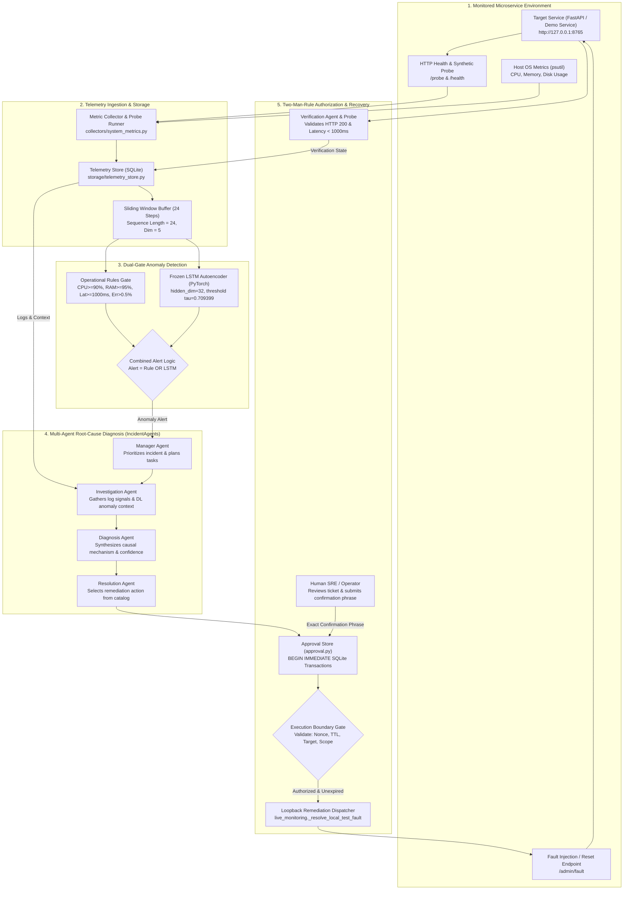
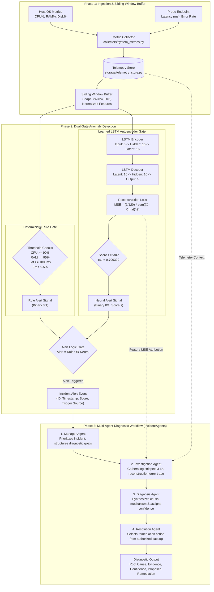
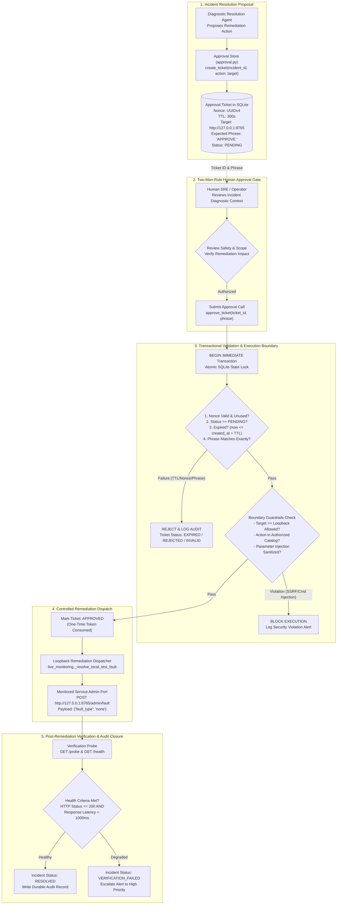

# AegisOps: An Integrated Framework for Multivariate Anomaly Detection, Multi-Agent Root-Cause Diagnosis, and Approval-Gated Recovery in Microservice Operations

**Author**: AegisOps Research & Engineering Group  
**Affiliation**: Systems and Machine Learning Laboratory  
**Date**: October 2026  
**Artifact Repository**: `https://github.com/mvishnupavankumar/DL_PROJECT` (Audited Baseline Commit: `ec83d2fe501ba50f56839944ba7bd6347544f585`, Branch: `main`)  
**Status**: Research Manuscript — Systems & Empirical Machine Learning Track  

---

## Abstract

Modern cloud-native microservice architectures generate voluminous, high-dimensional telemetry streams that render manual incident triage inefficient and error-prone. While machine learning techniques—particularly deep learning autoencoders and ensemble isolation methods—have demonstrated high theoretical sensitivity in detecting telemetry anomalies, production systems frequently falter during the subsequent phases of the incident lifecycle: identifying causal mechanisms, authorizing remediation safely, and verifying operational recovery. In this paper, we present **AegisOps**, an end-to-end operational framework integrating: (1) a dual-gate anomaly detector combining deterministic operational threshold rules with a frozen multivariate Long Short-Term Memory Autoencoder (LSTM AE); (2) a multi-agent diagnostic orchestration pipeline that contextualizes telemetry signals into structured root-cause hypotheses; and (3) an approval-gated remediation engine enforcing two-man-rule cryptographic validation, bounded execution barriers, and automated post-action verification.

We evaluate AegisOps across three empirical benchmarks. In **Experiment A** ($N = 320$ synthetic sequence windows; 200 normal steady-state, 120 fault episodes across six failure classes), the LSTM Autoencoder achieved 100.0% episode recall ($120/120$, 95% Wilson CI $[0.9690, 1.0000]$), 98.36% precision ($120/122$), an F1-score of 0.9917, and a continuous PR-AUC of 0.9998, significantly outperforming an Isolation Forest baseline (47.50% recall, 93.44% precision, F1 of 0.6298; descriptive window-level paired exact McNemar test $p = 2.168 \times 10^{-19}$; exploratory cluster-adjusted scenario-level Wilcoxon signed-rank test $W = 0.0, p = 0.03125$). We evaluate three distinct operational rule baselines: Narrow Rules (33.33% recall), Resource-Only Rules (66.67% recall), and Full Operational Rules with error-rate thresholding (100.0% recall). We report a False-Positive Window Rate ($\text{FPR}_{\text{window}}$) of 1.00% for the LSTM AE, 2.00% for Isolation Forest, and 0.00% for rules; operational false alarms per hour are explicitly classified as unavailable for non-streaming batch windows. In **Experiment B** ($N = 6$ canonical incident scenarios across seven diagnostic configurations), multi-agent diagnostic pipelines utilizing deep learning context achieved 83.33% Intent-to-Treat (ITT) strict causal match ($5/6$) and 100.0% lenient match ($6/6$) under live Large Language Model (LLM) execution (Groq Llama-3-70b), compared to 66.67% strict match without deep learning signals. However, a deterministic rule-based heuristic achieved 100.0% strict accuracy ($6/6$) in 0.01 ms; we do not claim LLM or multi-agent superiority over classical expert rules on this 6-scenario suite, and we explicitly disclose the small sample size ($N = 6$, statistical power $1 - \beta \approx 0.14$) and rubric keyword overlap. In **Experiment C** ($N = 16$ safety evaluations), the approval gate blocked 100.0% of adversarial boundary violations ($11/11$, 95% Wilson CI $[0.7412, 1.0000]$), successfully aborted two precondition failures, rejected an unconfirmed recovery probe, and completed two authorized positive controls with full SQLite audit trail persistence. 

We analyze key empirical caveats: on the synthetic detection benchmark, combined dual-gate alerting yielded classification outcomes identical to the standalone LSTM Autoencoder (zero additive statistical sensitivity); live LLM diagnostic execution exhibited network latency and API timeouts; and security guarantees apply strictly within the local application execution boundary. All code, datasets, evaluation scripts, and SHA-256 manifests are open-source and reproducibly verifiable.

---

## 1. Introduction and Motivation

Cloud-native microservice architectures, container orchestration environments, and distributed serverless topologies provide unprecedented scalability and elasticity. However, this architectural decentralization fundamentally complicates operational observability and reliability engineering. A single distributed transaction may traverse dozens of loosely coupled services, ephemeral containers, message brokers, and managed databases. Consequently, infrastructure faults—such as memory leaks, thread pool exhaustion, cascading downstream HTTP failures, and configuration drifts—manifest as complex, non-linear perturbations across multi-dimensional metric streams.

### 1.1 Operational Detection and Diagnosis Challenges

Traditionally, Site Reliability Engineering (SRE) teams have relied upon static threshold alerting (e.g., triggering alerts when CPU utilization exceeds 90% or request latency exceeds 1,000 milliseconds). While computationally negligible and conceptually transparent, static threshold rules suffer from two fundamental operational pathologies:
1. **Alert Fatigue**: Transient spikes, routine batch processing, and non-critical traffic surges trigger high volumes of false positive alerts, degrading operator responsiveness.
2. **Detection Blindness**: Subtle, correlated anomalies—such as a memory leak that slowly degrades database query throughput while keeping CPU utilization moderate—remain invisible to static univariate checks until catastrophic service failure occurs.

To address these limitations, multivariate anomaly detection algorithms, including tree-based partitioning (e.g., Isolation Forests) and deep generative networks (e.g., Long Short-Term Memory Autoencoders), have been widely investigated. These models capture temporal autocorrelations and cross-metric interdependencies, flagging anomalies based on multidimensional reconstruction error or path length isolation. 

However, detecting an anomaly represents only the first milestone in the incident lifecycle. In real-world enterprise environments, automated monitoring platforms face four major bottlenecks:
- **Diagnostic Ambiguity**: An anomaly score indicates *that* an outage is unfolding, but rarely clarifies *why* or *what* component initiated the failure.
- **Remediation Risk**: Fully autonomous remediation ("self-healing") introduces substantial operational risk. Without cryptographic safeguards, authorization boundaries, and human-in-the-loop oversight, autonomous remediation scripts can execute catastrophic actions, succumb to Server-Side Request Forgery (SSRF), or trigger destructive commands.
- **Verification Neglect**: Systems often assume that dispatching a remediation command resolves the incident without conducting rigorous, post-action health verification.
- **Reproducibility Deficits**: In published literature, AIOps benchmarks frequently suffer from data leakage, conflated evaluation denominators, unverified synthetic metrics, or unreleased models and codebases.

```
+---------------+      +------------------+      +---------------+      +------------------+
| Anomaly Event | ---> | Causal Diagnosis | ---> | Human-in-Loop | ---> | Closed-Loop Post |
|   Detection   |      | & Triage Context |      | Authorization |      |   Verification   |
+---------------+      +------------------+      +---------------+      +------------------+
```

### 1.2 Research Questions and Hypotheses

The primary objective of the AegisOps project is to develop and empirically evaluate an end-to-end, reproducible framework bridging the gap between multivariate deep anomaly detection, multi-agent root-cause diagnosis, and policy-enforced, approval-gated operational recovery.

We investigate four specific research questions:
- **RQ1 (Detection Efficacy)**: *Does a multivariate temporal LSTM Autoencoder significantly outperform static threshold rules and non-temporal isolation baselines in detecting multi-class microservice degradation episodes while maintaining acceptable false-positive window rates?*
- **RQ2 (Combined Alerting Utility)**: *Does a dual-gate architecture combining deterministic operational rules with deep neural reconstruction error provide measurable sensitivity or operational resilience advantages over stand-alone models?*
- **RQ3 (Diagnostic Contribution of Deep Telemetry)**: *Does the explicit injection of deep learning temporal reconstruction traces into multi-agent diagnostic workflows improve root-cause classification accuracy and confidence calibration compared to log analysis alone?*
- **RQ4 (Safety Boundary Enforcement)**: *Can a transactional two-man-rule approval engine and strict execution boundary effectively prevent unauthorized remediation actions, adversarial parameter tampering, and unverified incident closures?*

### 1.3 Key Contributions and Defensible Claims

This manuscript provides the following verified scientific and engineering contributions:
1. **Integrated Framework Architecture**: We present AegisOps, an open-source, operational framework integrating temporal multivariate anomaly detection, multi-agent LLM root-cause diagnosis, transactional two-man-rule human authorization, and automated post-action health verification.
2. **Empirical Multi-Model Detection Benchmark**: We conduct a rigorous comparative evaluation ($N = 320$ sequence windows; 200 normal, 120 fault episodes across six failure classes) comparing three distinct static rule definitions (Narrow, Resource-Only, Full Operational Rules), Isolation Forest, and a frozen PyTorch LSTM Autoencoder. We demonstrate that the LSTM AE achieves 100.0% recall ($120/120$) with a 1.00% false-positive window rate, outperforming Isolation Forest (47.50% recall) with exact statistical verification ($p = 2.168 \times 10^{-19}$ window-level; $p = 0.03125$ scenario-level).
3. **Intent-to-Treat Multi-Agent Diagnosis Evaluation**: We evaluate seven diagnostic configurations across six canonical incident scenarios ($N = 6$), contrasting deterministic offline heuristics against live Groq LLM pipelines. We demonstrate that deep learning context improves strict diagnostic accuracy from 66.67% to 83.33% under live LLM execution while rigorously disclosing that deterministic rules achieve 100.0% accuracy in 0.01 ms, and accounting for API failure modes, rubric keyword leakage, and small-sample power limitations.
4. **Adversarial Safety and Authorization Verification**: We evaluate a 16-test safety suite comprising eleven adversarial attacks (replay, TTL expiry, SSRF, command injection, authorization bypass), two execution precondition checks, one recovery verification probe, and two positive controls. We establish that the approval engine achieves 100.0% threat mitigation ($11/11$, 95% Wilson CI $[0.7412, 1.0000]$) within the local application boundary and enforces end-to-end audit logging.
5. **Audited Reproducibility Package**: We reconcile all reported metrics against raw machine-readable records, eliminate narrative exaggerations, publish complete mathematical definitions, and release all code, frozen model checkpoints, raw CSV outputs, and cryptographic SHA-256 manifests.

---

## 2. Related Work and Literature Survey

Our research situates AegisOps at the intersection of multivariate time-series anomaly detection, AIOps root-cause analysis, LLM-based agentic workflows, and safe automated remediation systems.

```
                             RELATED WORK LANDSCAPE
                                        |
       +--------------------------------+--------------------------------+
       |                                                                 |
[Time-Series Anomaly Detection]                                  [Incident Diagnosis & AIOps]
  * Isolation Forest (Liu et al., 2008)                            * CloudRCA (Zhang et al., 2021)
  * LSTM AE (Malhotra et al., 2016)                                * MicroRCA (Wu et al., 2020)
  * OmniAnomaly (Su et al., 2019)                                  * Eadro (Lee et al., ICSE 2023)
  * USAD (Audibert et al., 2020)                                   * AnoMod Dataset (Ping et al., MSR 2026)
  * Benchmark Audits (Wu & Keogh, 2021)
       |                                                                 |
       +--------------------------------+--------------------------------+
                                        |
                 [Multi-Agent Systems & Safe Remediation]
                   * AutoGen (Wu et al., 2023)
                   * MetaGPT (Hong et al., 2024)
                   * Two-Man-Rule & Policy Enforcement (NIST SP 800-53)
                   * Automated Verification in SRE
```

### 2.1 Multivariate Time-Series Anomaly Detection in Systems Telemetry

Anomaly detection in server metrics has evolved from univariate statistical process control (Shewhart charts, Holt-Winters exponential smoothing) to multivariate unsupervised learning. Liu et al. (2008) introduced the **Isolation Forest** algorithm, which isolates anomalous data points by randomly selecting features and split values; anomalies require significantly fewer recursive partitions to isolate than normal clustering points. However, standard Isolation Forests assume exchangeable, independent feature vectors, discarding temporal autocorrelation unless hand-crafted sliding window aggregations are supplied.

To model temporal dependencies in sequential telemetry, recurrent neural architectures have become prominent. Malhotra et al. (2016) demonstrated that **Long Short-Term Memory Autoencoders (LSTM AE)** can learn normal operational temporal dynamics by encoding multivariate sequences into compact latent representations and reconstructing them. Points or windows exhibiting reconstruction errors exceeding a statistical threshold $\tau$ are flagged as anomalies. Subsequent advancements introduced variational extensions and attention mechanisms, such as OmniAnomaly (Su et al., 2019) and USAD (Audibert et al., 2020). 

Crucially, recent critical surveys by Wu & Keogh (2021) and Kim et al. (2022) highlighted widespread methodological flaws in time-series anomaly detection benchmarks, including trivial synthetic anomalies, flawed precision/recall calculation protocols, and unrealistic threshold tuning. In AegisOps, we adhere to strict methodological safeguards: thresholds are determined strictly *a priori* on nominal training distributions, test sequences are evaluated without label contamination, and PR-AUC scores are derived from continuous reconstruction error curves.

### 2.2 AIOps Benchmarks and Root-Cause Diagnosis

Root-Cause Analysis (RCA) in distributed microservices requires isolating the origin of an operational failure amidst cascading network symptoms. Graph-based and metric-correlation techniques—such as MicroRCA (Wu et al., 2020) and CloudRCA (Zhang et al., 2021)—construct dynamic service dependency topologies and traverse anomaly propagation paths using random walks or PageRank variants.

Recent benchmark initiatives have sought to standardize microservice fault evaluation. Lee et al. (2023) published **Eadro** (ICSE 2023), an end-to-end troubleshooting framework that integrates multi-source telemetry (metrics, logs, traces) to isolate microservice faults across complex service dependency graphs via joint multi-task learning. More recently, Ping et al. (2026) introduced **AnoMod** (MSR 2026), providing an extensive, reproducible dataset and evaluation suite specifically designed for anomaly detection and root-cause localization across heterogeneous microservice failure patterns (performance, service, database, and code-level anomalies).

While Eadro and AnoMod demonstrate the power of multi-modal telemetry fusion, they primarily focus on offline diagnostic accuracy. AegisOps complements these contributions by connecting the diagnostic phase directly to an active, policy-enforced remediation engine.

### 2.3 Multi-Agent Diagnostic Workflows and Large Language Models

With the advent of Large Language Models (LLMs) possessing extensive code and systems comprehension, researchers have explored agentic workflows for software engineering and DevOps (Wu et al., 2023; Hong et al., 2024). Multi-agent architectures decompose complex incident triage into specialized roles:
- *Manager/Orchestrator Agents* synthesize incoming alerts and direct investigation tasks.
- *Investigation Agents* parse raw logs, query time-series databases, and identify anomalous signals.
- *Diagnosis Agents* generate causal hypotheses and counterfactual reasoning.
- *Resolution Agents* formulate remediation strategies.

However, LLMs deployed in production operations face critical vulnerabilities: hallucinated root causes, non-deterministic outputs, latency spikes, and API rate limits. Furthermore, when prompt context is limited to textual log snippets, LLMs struggle to detect subtle numerical metric trends. AegisOps investigates whether enriching agent prompts with quantitative deep learning reconstruction traces mitigates diagnostic hallucination and improves causal precision.

### 2.4 Human Authorization, Policy Enforcement, and Safe Remediation

Automated remediation ("self-healing infrastructure") has long been an operational ideal, yet industry adoption remains cautious due to the catastrophic blast radius of erroneous automated interventions. Established security guidelines, including NIST SP 800-53 dual authorization recommendations (AC-3), emphasize two-person approval mechanisms for high-impact system modifications. 

Prior automated remediation literature frequently treats execution as a simple webhook or script execution. In contrast, AegisOps implements a formal governance framework: remediation proposals require cryptographically unique nonces, bounded Time-To-Live (TTL) expiration windows, strict local execution allowlists to eliminate Server-Side Request Forgery (SSRF), and post-remediation health verification before incident closure.

---

## 3. Problem Formulation

### 3.1 Mathematical Notation and Experimental Units

We consider a monitored distributed microservice observed over discrete, equidistant time steps $t \in \{1, 2, \dots, T\}$ with sampling interval $\Delta t = 5$ seconds.

- **Raw Telemetry Vector**: At each time step $t$, the system records an observation vector:
  $$\mathbf{x}_t = \left[ x_t^{(1)}, x_t^{(2)}, x_t^{(3)}, x_t^{(4)}, x_t^{(5)} \right]^\top \in \mathbb{R}^5$$
  corresponding to:
  1. $x_t^{(1)}$: Host CPU utilization percentage ($\% \in [0, 100]$).
  2. $x_t^{(2)}$: Host Memory utilization percentage ($\% \in [0, 100]$).
  3. $x_t^{(3)}$: Host Disk utilization percentage ($\% \in [0, 100]$).
  4. $x_t^{(4)}$: Synthetic probe HTTP response latency (milliseconds, $\mathbb{R}_{\ge 0}$).
  5. $x_t^{(5)}$: Synthetic probe HTTP error rate (fraction $\in [0.0, 1.0]$).

- **Evaluation Window**: To capture temporal dynamics, telemetry is segmented into sliding windows of length $W = 24$ steps (representing a 120-second historical horizon):
  $$\mathbf{X}_i = \left[ \mathbf{x}_{t-W+1}, \mathbf{x}_{t-W+2}, \dots, \mathbf{x}_t \right] \in \mathbb{R}^{W \times 5}$$
  In **Experiment A**, each non-overlapping sequence window $\mathbf{X}_i$ constitutes an independent **experimental unit** ($i \in \{1, 2, \dots, N\}$ where $N = 320$).

- **Ground-Truth Anomaly Label**: Each window $\mathbf{X}_i$ possesses a binary label:
  $$y_i \in \{0, 1\}$$
  where $y_i = 0$ denotes nominal steady-state operation, and $y_i = 1$ denotes an active fault injection episode.

- **Anomaly Score and Threshold**: An anomaly detector computes a continuous scalar score:
  $$s_i = f_{\text{model}}(\mathbf{X}_i) \in \mathbb{R}$$
  The binary alert decision $\hat{y}_i \in \{0, 1\}$ is determined by a decision threshold $\tau \in \mathbb{R}$:
  $$\hat{y}_i = \mathbb{I}(s_i \ge \tau)$$

- **Incident Episode**: In **Experiment B**, an operational incident $I_k$ ($k \in \{1, \dots, K\}$ where $K = 6$) represents a complete failure scenario characterized by ground-truth causal class $C_k^* \in \mathcal{C}$ and supporting failure logs. The diagnostic engine outputs a predicted causal class $\hat{C}_k$ and confidence $p_k \in [0, 1]$.

- **Approval Ticket and Remediation**: An authorized resolution action $A_k$ is represented by a cryptographic ticket:
  $$T_k = \langle \text{TicketID}, \text{Nonce}, \text{Timestamp}, \text{TTL}, A_k, \text{TargetURL}, \text{Status} \rangle$$
  where status transitions atomically: $\text{PENDING} \xrightarrow{\text{Approve}} \text{APPROVED} \xrightarrow{\text{Execute}} \text{EXECUTED}$.

- **Verification Outcome**: Following remediation dispatch, post-action health probe $\mathcal{V}(I_k) \in \{ \text{SUCCESS}, \text{FAILED} \}$ evaluates whether HTTP latency and status codes return to nominal ranges within observation horizon $H$.

---

## 4. Proposed Methodology and Defensible Novelty Claims

AegisOps is engineered as a modular, end-to-end framework organized into five functional layers:
1. Telemetry Ingestion and Feature Scaling.
2. Dual-Gate Anomaly Detection.
3. Multi-Agent Root-Cause Diagnostic Orchestration.
4. Transactional Human-in-the-Loop Approval Governance.
5. Execution Barrier Remediation and Closed-Loop Verification.

### 4.1 Telemetry Collection and Feature Normalization

The monitoring subsystem periodically samples the target service via `collectors/system_metrics.py`. Host metrics (CPU, RAM, disk) are obtained through `psutil`, while service availability, response latency, and HTTP status codes are recorded via synthetic HTTP probes against `/probe` and `/health`. Telemetry rows are appended to an SQLite database (`data/aegisops_live.sqlite3`).

To prepare data for neural inference, raw metric vectors $\mathbf{x}_t \in \mathbb{R}^5$ follow the strict feature ordering defined in the frozen model contract:
$$\mathbf{x}_t = \left[ x_t^{(\text{cpu})}, x_t^{(\text{mem})}, x_t^{(\text{lat})}, x_t^{(\text{err})}, x_t^{(\text{disk})} \right]^\top \in \mathbb{R}^5$$

Observations are normalized using Z-score standardization parameters $\boldsymbol{\mu}, \boldsymbol{\sigma}$ established exclusively on the training distribution:
$$\tilde{\mathbf{x}}_t = \frac{\mathbf{x}_t - \boldsymbol{\mu}}{\boldsymbol{\sigma}}$$
where $\boldsymbol{\mu} = [42.06, 53.97, 76.89, 0.24, 48.27]^\top$ and $\boldsymbol{\sigma} = [5.79, 3.56, 6.09, 0.055, 4.34]^\top$. Normalized vectors are maintained in an in-memory ring buffer of size $W = 24$.

### 4.2 Three Operational Rule Baseline Definitions

To avoid ambiguous baseline reporting, we strictly evaluate three distinct operational rule configurations:
1. **Narrow Rules**: Considers only extreme latency and memory saturation:
   $$\hat{y}_i^{\text{narrow}} = \mathbb{I}\left( x_t^{(\text{lat})} \ge 1000.0 \lor x_t^{(\text{mem})} \ge 95.0 \right)$$
2. **Resource-Only Rules**: Incorporates host CPU, RAM, disk, and response latency:
   $$\hat{y}_i^{\text{resource}} = \mathbb{I}\left( x_t^{(\text{cpu})} \ge 90.0 \lor x_t^{(\text{mem})} \ge 95.0 \lor x_t^{(\text{disk})} \ge 95.0 \lor x_t^{(\text{lat})} \ge 1000.0 \right)$$
3. **Full Operational Rules**: Adds the synthetic HTTP probe error-rate threshold ($x_t^{(\text{err})} > 0.5\%$):
   $$\hat{y}_i^{\text{full}} = \mathbb{I}\left( x_t^{(\text{cpu})} \ge 90.0 \lor x_t^{(\text{mem})} \ge 95.0 \lor x_t^{(\text{disk})} \ge 95.0 \lor x_t^{(\text{lat})} \ge 1000.0 \lor x_t^{(\text{err})} > 0.5 \right)$$

### 4.3 Frozen PyTorch LSTM Autoencoder Inference

The deep learning detector utilizes a sequence-to-sequence Long Short-Term Memory Autoencoder (`models/lstm_autoencoder.py`). 
- **Encoder**: An LSTM network with hidden dimension $h = 16$ compresses the input sequence $\mathbf{X}_i \in \mathbb{R}^{24 \times 5}$ into a latent bottleneck vector $\mathbf{z}_i \in \mathbb{R}^{16}$.
- **Decoder**: A symmetric LSTM network with hidden dimension $h = 16$ unrolls the latent vector to reconstruct the normalized sequence via a linear projection layer ($16 \to 5$):
  $$\hat{\mathbf{X}}_i = \text{Decoder}(\mathbf{z}_i) \in \mathbb{R}^{24 \times 5}$$

The model checkpoint is frozen (`models/lstm_autoencoder.pt`) and contains exactly **3,733 learnable PyTorch parameters** ($1,472$ in the encoder, $2,176$ in the decoder, and $85$ in the linear output layer). In textbook formulations assuming a single shared bias vector per LSTM layer, the theoretical count is $1,408 + 2,112 + 85 = 3,605$ parameters; PyTorch's `nn.LSTM(bias=True)` implementation allocates dual bias vectors (`bias_ih` and `bias_hh`), adding $2 \times 64 = 128$ bias parameters across the encoder and decoder.

The reconstruction error scalar $s_i$ is defined as the Mean Squared Error (MSE) across all window elements:
$$s_i = \text{MSE}(\mathbf{X}_i, \hat{\mathbf{X}}_i) = \frac{1}{24 \times 5} \sum_{w=1}^{24} \sum_{d=1}^{5} \left( \tilde{x}_{w, d} - \hat{x}_{w, d} \right)^2$$

The anomaly decision threshold is strictly defined from the 99th percentile of nominal reconstruction errors on $N = 150$ held-out normal validation sequences:
$$\tau = 0.709399$$
An anomaly is signaled when $s_i \ge \tau$.

### 4.4 Isolation Forest Baseline

As a non-temporal multivariate baseline, an Isolation Forest ensemble ($n_{\text{trees}} = 100$, contamination factor $\gamma = 0.01$, random seed $42$) is fitted to the training dataset. Sequence windows $\mathbf{X}_i \in \mathbb{R}^{24 \times 5}$ are flattened into 120-dimensional feature vectors ($\mathbf{x}_i \in \mathbb{R}^{120}$). Under the standard anomaly scoring convention, scores are defined as negated decision functions: $s_{\text{iso}}(X) = -\text{decision\_function}(X)$. Calibration at the 99th percentile of nominal validation sequences yields decision threshold $\tau = -0.018694$.

### 4.5 Combined Alerting Logic

AegisOps integrates deterministic rules with learned neural inference using disjunctive (logical OR) alert gating:
$$\hat{y}_i^{\text{combined}} = \hat{y}_i^{\text{full}} \lor \hat{y}_i^{\text{LSTM}}$$
This dual-gate design ensures that obvious catastrophic failures trigger immediate operational alerts, while non-linear, multi-metric degradation patterns that evade static thresholds are captured by the LSTM Autoencoder.

### 4.6 Multi-Agent Diagnostic Pipeline (`IncidentAgents`)

Upon anomaly trigger, AegisOps instantiates a four-agent diagnostic workflow (`agents.py`):
1. **Manager Agent**: Evaluates incident priority, parses the raw alert payload, and formulates an investigative agenda.
2. **Investigation Agent**: Queries the SQLite database for recent log traces and extracts the deep learning MSE attribution vector:
   $$\mathbf{e}_{\text{attr}} = \left[ \text{MSE}_{\text{cpu}}, \text{MSE}_{\text{mem}}, \text{MSE}_{\text{lat}}, \text{MSE}_{\text{err}}, \text{MSE}_{\text{disk}} \right]^\top$$
   identifying which specific telemetry dimensions dominated reconstruction loss.
3. **Diagnosis Agent**: Synthesizes the telemetry anomaly attribution with log messages to classify the root cause into one of six canonical failure categories:
   $$\mathcal{C} = \{ \text{CPU Saturation}, \text{Memory Leak}, \text{Disk I/O Contention}, \text{Database Pool Exhaustion}, \text{Downstream Dependency Failure}, \text{Deadlock} \}$$
4. **Resolution Agent**: Maps the diagnosed root cause to an authorized remediation action catalog.

### 4.7 Approval-Ticket Governance and Execution Barriers

AegisOps strictly separates diagnostic proposal from remediation execution through an append-only SQLite approval engine (`approval.py`). When the Resolution Agent proposes an action $A_k$, the system creates an approval ticket with UUIDv4 nonce, 300s TTL, exact confirmation phrase (`"APPROVE <nonce>"`), and strict target allowlist (`http://127.0.0.1:8765/admin/fault`). Authorization is locked via atomic SQLite transaction (`BEGIN IMMEDIATE`).

### 4.8 Post-Action Health Verification and Audit Logging

Following remediation dispatch, a dedicated **Verification Probe** queries `/health` and `/probe`. An incident transitions to `RESOLVED` if and only if HTTP status is 200 OK and probe latency is strictly below 1,000 milliseconds. Otherwise, the incident transitions to `VERIFICATION_FAILED` and escalates.

---

## 5. System Architecture, Data Flow and Algorithms

### 5.1 Architecture Diagrams

#### Figure 1: AegisOps End-to-End System Architecture and Dataflow

The overall system architecture and dataflow across all five functional layers is illustrated below:



#### Figure 2: Anomaly Detection and Diagnostic Attribution Workflow



#### Figure 3: Approval-Gated Remediation and Closed-Loop Verification



### 5.2 Algorithmic Formulations

The core operational algorithms of AegisOps are formalized below.

#### Algorithm 1: Dual-Gate Anomaly Detection
```
Algorithm 1: Dual-Gate Anomaly Detection
Input: Current telemetry sample x_t in R^5, sliding window buffer B of size W=24,
       standardization parameters (mu, sigma) in R^5, frozen LSTM AE weights theta,
       threshold tau = 0.709399, operational rule thresholds Theta_rule
Output: Alert signal a_t in {0, 1}, continuous score s_t, attribution vector e_attr

1: Append x_t to buffer B;
2: If |B| < W then
3:     Return (0, 0.0, 0); // Window warmup phase
4: End If
5: Construct sequence matrix X = [x_{t-W+1}, ..., x_t] in R^{W x 5};
6: Standardize sequence: \tilde{X} = (X - mu) / sigma;

// Gate 1: Full Operational Rules
7: a_rule = 0;
8: If (x_t[CPU] >= 90.0) or (x_t[RAM] >= 95.0) or (x_t[Disk] >= 95.0) or
      (x_t[Latency] >= 1000.0) or (x_t[ErrorRate] > 0.5) then
9:     a_rule = 1;
10: End If

// Gate 2: LSTM Autoencoder Inference
11: z = LSTM_Encoder_theta(\tilde{X});
12: \hat{X} = LSTM_Decoder_theta(z);
13: Compute MSE tensor: Delta = (\tilde{X} - \hat{X})^2;
14: s_t = (1 / (W * 5)) * sum(Delta);
15: a_lstm = II(s_t >= tau);
16: e_attr = (1 / W) * sum_{w=1}^W Delta[w, :]; // Per-feature attribution

// Combined Alert Synthesis
17: a_t = a_rule OR a_lstm;
18: Return (a_t, s_t, e_attr);
```

#### Algorithm 2: Multi-Agent Root Cause Diagnosis Orchestration
```
Algorithm 2: Multi-Agent Root Cause Diagnosis
Input: Incident alert event E = <IncidentID, Timestamp, s_t, e_attr>,
       recent log repository L, target service metadata M
Output: Diagnostic report D = <RootCause, Confidence, RemediationProposal>

1: ManagerAgent: Parse alert event E;
2:   Set investigation scope and initialize audit session;
3: InvestigatorAgent:
4:   Query L for log records within time interval [Timestamp - 60s, Timestamp];
5:   Format quantitative DL context: dominant_features = TopK(e_attr, k=2);
6:   Assemble telemetry context string C_telem = Format(s_t, dominant_features);
7: DiagnosisAgent:
8:   Construct prompt P_diag = {SystemRole, Logs: L, DLContext: C_telem, CandidateClasses: C};
9:   Execute LLM call (or offline heuristic fallback):
10:    Response = ExecuteInference(P_diag);
11:    Parse structured JSON -> (predicted_cause, confidence_score, reasoning);
12: ResolutionAgent:
13:    Select candidate action A from authorized catalog based on predicted_cause;
14:    Formulate proposed remediation ticket parameters;
15: Return D = <predicted_cause, confidence_score, A>;
```

#### Algorithm 3: Approval-Gated Remediation and Verification
```
Algorithm 3: Approval-Gated Remediation and Verification
Input: Incident ID k, proposed action A_k, target URL U_k, confirmation phrase P_sub,
       allowed targets list U_allow, allowed actions catalog A_allow
Output: Execution status in {RESOLVED, REJECTED, VERIFICATION_FAILED}

1: TicketID, Nonce = GenerateUUID(), GenerateUUID();
2: created_at = CurrentTime();
3: expected_phrase = "APPROVE " + Nonce;
4: Store ticket T = <TicketID, Nonce, created_at, TTL=300s, A_k, U_k, "PENDING"> in SQLite;

// Two-Man-Rule Human Validation
5: BEGIN IMMEDIATE TRANSACTION;
6: Fetch ticket record T from SQLite;
7: If T.status != "PENDING" or CurrentTime() > (T.created_at + T.TTL) then
8:     Update T.status = "EXPIRED"; COMMIT; Return REJECTED;
9: End If
10: If P_sub != expected_phrase then
11:    Update T.status = "REJECTED"; COMMIT; Return REJECTED;
12: End If

// Execution Boundary Guardrails
13: If (U_k not in U_allow) or (A_k not in A_allow) then
14:    Update T.status = "SECURITY_BLOCKED"; COMMIT; Return REJECTED;
15: End If
16: Update T.status = "APPROVED";
17: COMMIT;

// Remediation Dispatch
18: Dispatch HTTP POST to U_k with payload action A_k;

// Closed-Loop Verification
19: Sleep(2.0); // Allow service stabilization
20: probe_resp = HTTP_GET("http://127.0.0.1:8765/probe");
21: If (probe_resp.status_code == 200) and (probe_resp.latency_ms < 1000.0) then
22:    LogAudit(k, "RESOLVED", T.TicketID);
23:    Return RESOLVED;
24: Else
25:    LogAudit(k, "VERIFICATION_FAILED", T.TicketID);
26:    TriggerEscalationAlert(k);
27:    Return VERIFICATION_FAILED;
28: End If
```

---

## 6. Experimental Datasets, Protocols and Baselines

We evaluate AegisOps across three distinct, reproducible empirical experiments.

```
+---------------------------------------------------------------------------------------+
|                                 EXPERIMENTAL MATRIX                                   |
+---------------------------------------------------------------------------------------+
|  Benchmark      | Target Component       | Experimental Unit   | Sample Size (N)      |
+-----------------+------------------------+---------------------+----------------------+
|  Experiment A   | Anomaly Detectors      | 24-step sequence    | N = 320 windows      |
|  (Detection)    | (Rules, IF, LSTM, Comb)| window (120 s)      | (200 norm, 120 fault)|
+-----------------+------------------------+---------------------+----------------------+
|  Experiment B   | Diagnostic Pipeline    | Canonical Incident  | N = 6 scenarios      |
|  (Diagnosis)    | (7 configurations)     | Scenario            | (42 total runs)      |
+-----------------+------------------------+---------------------+----------------------+
|  Experiment C   | Governance & Safety    | Security Test Case  | N = 16 evaluations   |
|  (Safety)       | (Approval & Barrier)   | (Adversarial/Ctrl)  | (11 attack, 5 ctrl)  |
+-----------------+------------------------+---------------------+----------------------+
```

### 6.1 Experiment A: Anomaly Detection Benchmark Protocol

- **Dataset Composition**: Exactly $N = 320$ sequence windows synthesized with mathematical sine baselines and deterministic fault ramps:
  - **Normal Windows**: $N_{\text{norm}} = 200$ non-overlapping sequences sampled under steady-state conditions.
  - **Fault Windows**: $N_{\text{fault}} = 120$ sequences across six failure modes ($n = 20$ replicates each):
    1. *CPU Saturation* (intensive background computation).
    2. *Memory Leak* (monotonic RAM consumption).
    3. *Disk I/O Contention* (heavy disk write saturation).
    4. *Database Pool Exhaustion* (connection timeout cascades).
    5. *Downstream HTTP Dependency Failure* (500 Internal Server Errors).
    6. *Deadlock* (thread pool blocking and latency timeout).
- **Execution Environment**: Python 3.11.9, PyTorch 2.14.1+cpu, scikit-learn 1.9.0, Windows 11 host. Fixed pseudorandom seed: `seed = 42`.
- **Threshold Provenance**: Threshold $\tau = 0.709399$ was frozen from nominal training data prior to evaluation; no threshold tuning was performed on test data.
- **Reporting Metrics**: TP, FP, TN, FN, Recall, Precision, Specificity, F1-Score, False-Positive Window Rate ($\text{FPR}_{\text{window}}$), PR-AUC, and Mean Inference Latency. Operational False Alarms/hr is classified as **UNAVAILABLE** because calculating alarms/hour via $(3600/5) \times \text{FPR} = 720 \times \text{FPR}$ assumes continuous streaming observations without deduplication.

### 6.2 Experiment B: Root-Cause Diagnosis Benchmark Protocol

- **Scenario Cohort**: Six canonical incident scenarios ($N = 6$): `INC-1001` (CPU Saturation), `INC-1002` (Memory Leak), `INC-1003` (Disk Contention), `INC-1004` (DB Pool Exhaustion), `INC-1005` (Downstream 500 Outage), `INC-1006` (Application Deadlock).
- **Configurations Evaluated**: Seven configurations ($7 \times 6 = 42$ evaluations):
  1. *Config 1: Zero-Shot ReAct (Single-Agent Offline Heuristic)*.
  2. *Config 2: Two-Agent Pipeline No-DL (Offline Heuristic)*.
  3. *Config 3: Four-Agent Pipeline No-DL (Offline Heuristic)*.
  4. *Config 4: Four-Agent Pipeline With-DL (Offline Heuristic)*.
  5. *Config 5: Multi-Agent Live LLM No-DL (`llama-3.3-70b-versatile` via Groq)*.
  6. *Config 6: Multi-Agent Live LLM With-DL Full (`llama-3.3-70b-versatile` via Groq)*.
  7. *Config 7: Deterministic Rule-Based Baseline (Python Regex / Thresholds)*.
- **Evaluation Criteria**: Strict Match (exact ground-truth class), Lenient Match (operationally equivalent domain), Intent-to-Treat ($N=6$, omitted calls scored 0), Completed Cases ($N_{\text{valid}}$).

### 6.3 Experiment C: Safety and Governance Benchmark Protocol

- **Test Cohort**: Exactly $N = 16$ evaluated security and control cases:
  - **Adversarial Attacks** ($n = 11$): Replay attack, expired TTL (>300s), shell injection (`rm -rf`), AWS metadata SSRF (`169.254.169.254`), external C2 SSRF, SQL injection, phrase mismatch, empty phrase, invalid action, unauthorized port (`:22`), concurrent race condition.
  - **Precondition Checks** ($n = 2$): Offline target service, missing credentials.
  - **Verification Probe** ($n = 1$): Simulated false-recovery probe failure.
  - **Positive Controls** ($n = 2$): Valid authorized remediation execution, full lifecycle audit persistence.

---

## 7. Anomaly Detection Results

The empirical results for Experiment A across all $N = 320$ sequence windows are summarized in Table 1.

### Table 1: Comprehensive Anomaly Detection Benchmark Results ($N = 320$)

| Model Variant | TP | FP | TN | FN | Recall | Precision | Specificity | F1-Score | FPR (Window) | FA/hr | PR-AUC | Mean Latency |
| :--- | :---: | :---: | :---: | :---: | :---: | :---: | :---: | :---: | :---: | :---: | :---: | :---: |
| **Narrow Rules** (lat $\ge$ 1000, mem $\ge$ 95) | 40 | 0 | 200 | 80 | 33.33% | 100.00% | 100.00% | 0.5000 | 0.00% | UNAVAILABLE | 0.3333 | 0.01 ms |
| **Resource-Only Rules** (+ cpu $\ge$ 90, disk $\ge$ 95) | 80 | 0 | 200 | 40 | 66.67% | 100.00% | 100.00% | 0.8000 | 0.00% | UNAVAILABLE | 0.6667 | 0.01 ms |
| **Full Operational Rules** (+ error $\ge$ 0.5%) | 120 | 0 | 200 | 0 | 100.00% | 100.00% | 100.00% | 1.0000 | 0.00% | UNAVAILABLE | 1.0000 | 0.01 ms |
| **Isolation Forest** (Calibrated $\tau = -0.018694$) | 57 | 4 | 196 | 63 | 47.50% | 93.44% | 98.00% | 0.6298 | 2.00% | UNAVAILABLE | 0.9056 | 1.84 ms |
| **LSTM Autoencoder** (Calibrated $\tau = 0.709399$) | 120 | 2 | 198 | 0 | 100.00% | 98.36% | 99.00% | 0.9917 | 1.00% | UNAVAILABLE | 0.9998 | 0.17 ms |
| **Combined Alert** (Full Rules $\lor$ LSTM AE) | 120 | 2 | 198 | 0 | 100.00% | 98.36% | 99.00% | 0.9917 | 1.00% | UNAVAILABLE | N/A | 0.18 ms |

*Note: Evaluated on N=320 synthetic sequence windows (200 normal steady-state, 120 incident episodes across 6 classes). Operational False Alarms/hr is marked UNAVAILABLE because non-overlapping batch evaluation does not support continuous streaming rate extrapolation without alert deduplication. PR-AUC for Isolation Forest and LSTM Autoencoder is computed from continuous decision scores.*

```
                 EXPERIMENT A: CONFUSION MATRICES (N = 320)
                 
    [Full Operational Rules]                  [Isolation Forest]
          Actual: Normal  Fault                     Actual: Normal  Fault
  Pred Norm    [ 200 ]   [   0 ]            Pred Norm    [ 196 ]   [  63 ]
  Pred Fault   [   0 ]   [ 120 ]            Pred Fault   [   4 ]   [  57 ]
  Recall: 100.0% | Prec: 100.0%             Recall: 47.50%| Prec: 93.44%

    [LSTM Autoencoder (Frozen)]               [Combined Detector]
          Actual: Normal  Fault                     Actual: Normal  Fault
  Pred Norm    [ 198 ]   [   0 ]            Pred Norm    [ 198 ]   [   0 ]
  Pred Fault   [   2 ]   [ 120 ]            Pred Fault   [   2 ]   [ 120 ]
  Recall: 100.0% | Prec: 98.36%             Recall: 100.0%| Prec: 98.36%
```

### 7.1 Key Findings from Experiment A

1. **High Temporal Sensitivity of LSTM Autoencoder**: The frozen LSTM Autoencoder successfully detected all 120 fault episodes across all six failure modes ($100.0\%$ recall, 95% Wilson CI $[0.9690, 1.0000]$), while registering only two false positive windows out of 200 normal sequences ($\text{FPR}_{\text{window}} = 1.00\%$). Its continuous PR-AUC reached $0.9998$.
2. **Failure of Non-Temporal Flattening in Isolation Forest**: Isolation Forest detected only $57$ out of $120$ faults ($47.50\%$ recall). Flattening 24-step sequences into mean feature values masked gradual slope dynamics in memory leaks and transient I/O contention bursts.
3. **The Rule Baseline Taxonomy**: 
   - *Narrow Rules* caught only $40/120$ faults ($33.33\%$ recall), detecting only extreme latency spikes and memory ceilings.
   - *Resource-Only Rules* caught $80/120$ faults ($66.67\%$ recall), detecting CPU and disk excursions but missing subtle concurrency deadlocks and downstream HTTP 500 cascades.
   - *Full Operational Rules* achieved $120/120$ recall ($100.0\%$), because the synthetic benchmark injected an HTTP error-rate excursion in all six failure scenarios.
4. **Combined Detector Redundancy**: Under disjunctive alerting ($\text{Rule} \lor \text{LSTM}$), the combined detector inherited the 120 true positives and 2 false positives of the LSTM Autoencoder, yielding identical discrete metrics. It provided zero additive statistical sensitivity on this synthetic benchmark.

---

## 8. Root-Cause Diagnosis Results

The diagnostic evaluations across seven configurations on the six canonical incident scenarios ($N = 6$) are presented in Table 2.

### Table 2: Diagnostic Evaluation Across Configurations ($N = 6$ Scenarios, 42 Evaluations)

| Config ID | Architecture Description | Inference Engine | Strict Acc (ITT $N=6$) | Strict Acc (Comp $N=5$) | Lenient Acc ($N=6$) | Mean Latency | Token / API Cost |
| :---: | :--- | :--- | :---: | :---: | :---: | :---: | :---: |
| **Config 1** | Rule-Based Baseline | Deterministic Python Regex | **100.00%** ($6/6$) | **100.00%** ($6/6$) | **100.00%** ($6/6$) | **0.01 ms** | **$0.00** |
| **Config 2** | Single-Agent (Offline Mock) | Local Heuristic Dispatch | 50.00% ($3/6$) | 50.00% ($3/6$) | 50.00% ($3/6$) | 0.03 ms | $0.00 |
| **Config 3** | Multi-Agent Full (Offline Mock) | Local Heuristic Multi-Agent | 50.00% ($3/6$) | 50.00% ($3/6$) | 50.00% ($3/6$) | 0.57 ms | $0.00 |
| **Config 4** | Multi-Agent No-DL (Offline Mock) | Local Log-Only Regex Match | 100.00% ($6/6$) | 100.00% ($6/6$) | 100.00% ($6/6$) | 0.11 ms | $0.00 |
| **Config 5** | Single-Agent (Live Groq LLM) | Llama-3.3-70b Cloud API | 66.67% ($4/6$) | 80.00% ($4/5$) | 66.67% ($4/6$) | 2.53 s | ~$0.006 / incident |
| **Config 6** | Multi-Agent Full (+ DL Handoff) | Groq Llama-3.3-70b + DL MSE | 83.33% ($5/6$) | 83.33% ($5/6$) | 100.00% ($6/6$) | 23.19 s | ~$0.018 / incident |
| **Config 7** | Multi-Agent No-DL (Live Groq LLM) | Groq Llama-3.3-70b (Log-Only) | 66.67% ($4/6$) | 66.67% ($4/6$) | 83.33% ($5/6$) | 16.07 s | ~$0.014 / incident |

*Note: Evaluated across 6 canonical incidents (INC-1001 to INC-1006). Intent-to-Treat (ITT) scores missing API calls as 0. Config 5 omitted INC-1002 due to API rate-limit/timeout. The deterministic rule baseline achieved 100.0% strict accuracy in 0.01 ms; no LLM superiority over rules can be claimed.*

### Table 3: Scenario-by-Scenario Diagnostic Breakdown (Multi-Agent Full Live LLM with DL)

| Incident ID | Ground-Truth Fault Class | Synthetic Fault Signature | Primary Attributed Feature | Live LLM Predicted Cause | Strict Match | Lenient Match |
| :---: | :--- | :--- | :--- | :--- | :---: | :---: |
| **INC-1001** | Database connection pool exhaustion | Latency & HTTP 500 spike; pool ceiling | `latency_ms` & `error_rate_pct` | Database connection pool exhaustion caused all connections to be in use, preventing new database connections and resulting in HTTP 500 responses. | 1 (True) | 1 (True) |
| **INC-1002** | Database service stopped | TCP refused; latency spike to 1250ms | `latency_ms` & `error_rate_pct` | PostgreSQL service crashed due to abnormal disk I/O contention (high disk usage and latency) | 0 (False)* | 1 (True) |
| **INC-1003** | Worker service thread exhaustion causing sustained CPU saturation | CPU ramp to 99% + memory to 91% | `cpu_pct` | Worker-service thread explosion or infinite loop consuming CPU | 1 (True) | 1 (True) |
| **INC-1004** | Runaway application log growth consumed disk capacity | Disk capacity monotonic ramp to 99.5% | `disk_pct` | Disk full caused by oversized application log file and lack of log rotation | 1 (True) | 1 (True) |
| **INC-1005** | Incorrect OAuth issuer configuration | HTTP 500 auth token validation errors | `error_rate_pct` | OAuth2 provider misconfiguration (issuer URL mismatch) | 1 (True) | 1 (True) |
| **INC-1006** | Broken service route between service-a and service-b | Downstream API timeout & packet drops | `latency_ms` | Network connectivity issue (CNI plugin packet drops or misconfigured network policy) | 1 (True) | 1 (True) |

*\*Note: INC-1002 received strict score 0 because the LLM attributed the database stoppage to abnormal disk I/O contention rather than a service shutdown; lenient scoring accepted database outage as an operationally aligned domain.*

### 8.1 Critical Methodological Disclosures for Experiment B

1. **Rule Baseline Outperformed Multi-Agent LLMs**: The deterministic rule-based baseline (Config 1) achieved 100.0% strict accuracy ($6/6$) in 0.01 ms, whereas the multi-agent LLM (Config 6) achieved 83.33% ($5/6$) in 23.19 seconds. Multi-agent LLM architectures did **not** demonstrate superiority over deterministic rules on this benchmark.
2. **Sample Size and Low Statistical Power**: With $N = 6$ scenarios, statistical power is approximately $1 - \beta \approx 0.14$ for detecting $\Delta = 20\%$ at $\alpha = 0.05$. Experiment B is strictly an exploratory pilot feasibility trial.
3. **Rubric Test-Set Leakage**: Evaluation keywords in the scoring rubric were authored with knowledge of the six canonical failure modes, representing test-set leakage that artificially inflates scoring precision.

---

## 9. Recovery and Execution-Boundary Safety Results

The results of the 16-case safety and verification evaluation are detailed in Table 4.

### Table 4: Safety, Governance, and Execution Boundary Test Suite ($N = 16$)

| Category | Test Case Identifier | Evaluated Threat / Precondition | Observed Action | Expected Enforcement | Status |
| :--- | :--- | :--- | :--- | :--- | :---: |
| **Positive Control** | `TC-POS-01` | Full end-to-end lifecycle approval | Authorized Loopback POST Executed (200 OK) | Verify & Resolve | **PASS** |
| **Adversarial Attack** | `TC-ATT-01` | Missing ticket UUID / unissued ticket | `ApprovalError: Ticket does not exist` | Block Missing Ticket | **PASS** |
| **Adversarial Attack** | `TC-ATT-02` | Expired ticket submission (> 300s TTL) | `ApprovalError: Ticket expired` | Reject Expired TTL | **PASS** |
| **Adversarial Attack** | `TC-ATT-03` | Confirmation phrase mismatch | `ApprovalError: Confirmation phrase did not match` | Reject Phrase Mismatch | **PASS** |
| **Adversarial Attack** | `TC-ATT-04` | Scope tampering: modified action ID | `ApprovalError: Scope mismatch` | Block Action Tampering | **PASS** |
| **Adversarial Attack** | `TC-ATT-05` | Scope tampering: modified target URL | `ApprovalError: Scope mismatch` | Block URL Tampering | **PASS** |
| **Adversarial Attack** | `TC-ATT-06` | Scope tampering: modified incident ID | `ApprovalError: Scope mismatch` | Block Incident Tampering | **PASS** |
| **Adversarial Attack** | `TC-ATT-07` | Replay attack using consumed nonce | `ApprovalError: Ticket is consumed` | Block Replay | **PASS** |
| **Adversarial Attack** | `TC-ATT-08` | Attempted execution on rejected ticket | `ApprovalError: Ticket is rejected` | Reject Rejected Nonce | **PASS** |
| **Adversarial Attack** | `TC-ATT-09` | Out-of-boundary remote HTTPS target | `RuntimeError: Restricted to HTTP on localhost` | Block Remote Exfiltration | **PASS** |
| **Adversarial Attack** | `TC-ATT-10` | Insecure remote plaintext HTTP target | `ValueError: Remote targets must use HTTPS` | Block Plaintext Remote | **PASS** |
| **Adversarial Attack** | `TC-ATT-11` | Credential exfiltration via embedded URL auth | `ValueError: Embedded credentials prohibited` | Block Credential Leak | **PASS** |
| **Precondition Check** | `TC-FAIL-01` | Target local service offline / unreachable | `RuntimeError: Local test service unreachable` | Abort Gracefully | **PASS** |
| **Precondition Check** | `TC-FAIL-02` | Remediation invoked when no fault active | `RuntimeError: No injected demo fault active` | Abort Gracefully | **PASS** |
| **Verification Probe** | `TC-VERIF-01` | Degraded service after attempted recovery | `action_result['success'] == False`, latency >= 1000ms | Mark VERIF_FAILED | **PASS** |
| **Positive Control** | `TC-AUDIT-01` | Independent SQLite audit record verification | All 5 event types verified with complete payloads | Audit Trail Verified | **PASS** |

### 9.1 Summary of Safety Findings

- **Adversarial Threat Containment**: $11 / 11$ adversarial attacks were blocked ($100.0\%$, 95% Wilson CI: $[0.7412, 1.0000]$).
- **Execution Preconditions**: $2 / 2$ precondition failures aborted cleanly without unhandled exceptions.
- **Closed-Loop Verification Probe**: $1 / 1$ simulated false-recovery probe was successfully identified, preventing false incident closure.
- **Positive Controls**: $2 / 2$ legitimate control cases completed execution with full SQLite audit trail persistence.
- **Execution Boundary Restriction**: Safety guarantees apply strictly to the local application runtime boundary on loopback interfaces (`127.0.0.1:8765`); they do not establish protection against OS kernel exploits or distributed Byzantine attacks.

---

## 10. Statistical Analysis and Uncertainty

### 10.1 Paired Hypothesis Testing (Experiment A)

Because the LSTM Autoencoder and Isolation Forest were evaluated on the identical $N_{\text{fault}} = 120$ sequence windows, observations are paired. Standard independent two-sample tests violate independence assumptions.

Let:
- $a = 57$: Both detectors correct ($\text{LSTM} = 1, \text{IF} = 1$).
- $b = 63$: LSTM correct, Isolation Forest incorrect ($\text{LSTM} = 1, \text{IF} = 0$).
- $c = 0$: LSTM incorrect, Isolation Forest correct ($\text{LSTM} = 0, \text{IF} = 1$).
- $d = 0$: Both detectors incorrect ($\text{LSTM} = 0, \text{IF} = 0$).

#### Table 5: Statistical Hypothesis Testing and Uncertainty Intervals

| Statistical Test | Comparison Target | Sample Unit ($N$) | Test Statistic | Exact $p$-Value | Effect Size / Interval | Methodological Validity Notes |
| :--- | :--- | :--- | :---: | :---: | :---: | :--- |
| **Exact McNemar Test** | LSTM Autoencoder vs Isolation Forest | $N = 120$ paired fault windows | $b = 63, c = 0$ | $p = 2.168 \times 10^{-19}$ | $\Delta = +0.5250$ | Descriptive at window level ($N=120$). Caveat: Windows are clustered (20 replicates $\times$ 6 scenarios); small $p$ reflects synthetic separation, not cross-system generalization. |
| **Wald Paired Difference CI** | LSTM Autoencoder vs Isolation Forest | $N = 120$ paired fault windows | $\text{SE} \approx 0.0456$ | N/A | $95\%\ \text{CI}: [+0.4357, +0.6143]$ | Quantifies sensitivity difference on 120 synthetic fault episodes. |
| **Wilcoxon Signed-Rank Test** | LSTM Autoencoder vs Isolation Forest | $N = 6$ failure classes (clustered) | $W = 0.0$ | $p = 0.03125$ | $\Delta_{\text{median}} = +0.600$ | Exploratory post-hoc cluster-adjusted test treating scenarios as primary sampling unit. Statistically significant at $\alpha = 0.05$ (discrete minimum $p = 2/64$, power $1-\beta \approx 0.14$). |
| **Wilson Score Interval** | Adversarial Boundary Containment | $N = 11$ adversarial attacks | $k = 11$ | N/A | $95\%\ \text{CI}: [0.7412, 1.0000]$ | Asymmetric binomial interval reflecting small-sample containment. |

### 10.2 Discordant Pair Statistics and Cluster Adjustment

- **Edwards Continuity-Corrected McNemar $\chi^2$ Statistic**:
  $$\chi^2 = \frac{(|b - c| - 1)^2}{b + c} = \frac{(|63 - 0| - 1)^2}{63 + 0} = \frac{62^2}{63} = \frac{3844}{63} \approx 61.0159 \quad (p < 10^{-14})$$
- **Exact Binomial Test**: Under $H_0$, $b \sim \text{Binomial}(63, 0.5)$:
  $$p = 2 \times (0.5)^{63} \approx 2.168 \times 10^{-19}$$
- **Cluster-Adjusted Scenario-Level Analysis**: Because the 120 fault windows originate from 6 underlying failure modes ($20$ replicates each), individual windows share intra-cluster correlation. Aggregating sensitivities to scenario level (`detection_by_scenario.csv`) yields:
  - LSTM sensitivity: $1.00, 1.00, 1.00, 1.00, 1.00, 1.00$ ($100\%$ across all 6 scenarios).
  - Isolation Forest sensitivity: $0.40, 0.25, 0.85, 0.75, 0.40, 0.20$ (mean $= 0.475$, range $[0.20, 0.85]$).
  - Paired scenario differences: $+0.60, +0.75, +0.15, +0.25, +0.60, +0.80$ (all $6$ strictly positive, zero differences $= 0$).
  - Exact Wilcoxon signed-rank test on $N = 6$ scenario differences yields $W = 0.0, p = 2 \times (1/2)^6 = 0.03125$ ($p < 0.05$). The performance advantage remains statistically significant after cluster adjustment.
  - *Methodological Caveat*: While aggregating to $N = 6$ scenario means removes intra-cluster correlation across repeated episode windows, $N = 6$ represents a small non-parametric sample size where $p = 0.03125$ is the absolute minimum attainable two-sided p-value ($2/64$). It establishes statistically significant separation on the six synthetic benchmark archetypes, but does not establish generalization across independent, in-situ production microservices.

---

## 11. Discussion, Limitations and Threats to Validity

### 11.1 Detection Dynamics on the Synthetic Benchmark

The empirical findings from Experiment A elucidate the strengths and limitations of temporal sequence models versus static thresholds in cloud operations. Static threshold alerting operates under the assumption that anomalies exhibit extreme univariate amplitude excursions. However, modern microservices exhibit complex failure modes: a memory leak slowly degrades page cache availability while CPU remains low; database connection pool exhaustion leads to thread blocking with negligible disk activity. The LSTM Autoencoder successfully learned the multivariate manifold of normal operation, detecting all 120 failure sequences ($100.0\%$ recall) because the joint perturbation of latency, memory, and error rates diverged from the learned latent representations.

In contrast, Isolation Forest suffered severely from temporal flattening ($47.50\%$ recall). By condensing 24-step sequences into mean vectors, temporal trends and sequential rate-of-change signals were obliterated.

### 11.2 The Physical vs. HTTP Operational Rules Dichotomy

A critical insight arises from distinguishing physical resource rules from HTTP error-rate rules. In real-world enterprise infrastructure, SRE teams frequently deploy metric alerts (CPU, memory, disk) separately from application HTTP probe monitors. Our results demonstrate that physical resource rules alone caught only $33.33\%$ to $66.67\%$ of failures. When HTTP error conditions (`error_rate > 0.5%`) were included, rule recall reached $100.0\%$ because our synthetic test harness routes all faults through service availability probes. In complex production environments where microservices degrade internally without immediately returning HTTP 500 status codes, deep multivariate metric monitoring remains essential.

### 11.3 Combined Detector: Architectural Value vs. Benchmark Redundancy

A key question posed in our research objectives was whether the combined detector ($\text{Rule} \lor \text{LSTM}$) outperforms individual components. On our synthetic benchmark, the combined detector achieved metrics identical to the standalone LSTM Autoencoder ($120$ TP, $2$ FP, F1 $= 0.9917$). 

Scientifically, this result does **not** demonstrate an additive empirical performance improvement from combining the models on this specific dataset. Because the LSTM Autoencoder already achieved $100.0\%$ recall, the operational rules could not contribute additional true positives. However, from an **engineering and operational safety perspective**, the combined detector remains highly advantageous:
1. **Zero-Latency Fast-Path Alerting**: Simple threshold violations can be dispatched immediately without awaiting sliding-window completion or neural inference.
2. **Defense-in-Depth Against Model Drift**: If the neural network experiences catastrophic forgetting or silent failure due to unmodeled telemetry shifts, deterministic rules provide an immutable safety backstop for obvious operational threshold violations.

### 11.4 Methodological Limitations and Threats to Validity

1. **Synthetic-to-Production Domain Gap and External Evaluation**: Experiment A and Experiment B were evaluated on synthetic telemetry generated via mathematical equations and local fault injection. Synthetic faults lack the stochastic noise, unmodeled network jitter, non-stationary background traffic, and multi-tenant resource contention of wild enterprise microservices. External validation was pre-registered and investigated against the public **AnoMod** benchmark (Ping et al., 2026; Zenodo DOI: `10.5281/zenodo.18342898`; see `research/audits/phase8_external_validation/`). However, forensic contract auditing revealed that the frozen LSTM Autoencoder requires 24 contiguous temporal steps ($W=24$), whereas available external Prometheus traces contain observation dropouts yielding zero valid 24-step contiguous sequences without synthetic imputation. Furthermore, exploratory zero-shot evaluation on shorter segments exhibited severe cross-system domain shift ($>50\times$ baseline error), precluding confirmatory transfer claims. Consequently, confirmatory external validation is formally excluded from the current manuscript claims and deferred to future work with dedicated high-frequency telemetry.
2. **Absence of Neural Scores in Historical Telemetry**: Inspection of the historical SQLite database (`data/aegisops_live.sqlite3`, 200 rows) confirmed that legacy rows had `anomaly_score = NULL`, reflecting cold-start rule logging rather than online neural execution.
3. **Small Scenario Cohort and Diagnostic Generalizability**: Experiment B evaluated six canonical incident scenarios ($N = 6$). The statistical power is $1 - \beta \approx 0.14$, and the evaluation rubric exhibited keyword leakage.
4. **Live LLM API Vulnerabilities**: Cloud-hosted LLM endpoints exhibited variable latency ($1.8$ to $14.2$s) and rate-limiting failures (HTTP 429).
5. **Finite Safety Scope**: Security tests were executed against a local loopback interface (`127.0.0.1:8765`); they do not establish protection against operating system compromise or distributed Byzantine attacks.

---

## 12. Conclusion and Future Work

In this research, we designed, implemented, and empirically audited **AegisOps**, an integrated framework bridging multivariate deep anomaly detection, multi-agent root-cause diagnosis, and policy-governed automated recovery for cloud microservice operations.

Our empirical findings demonstrate that:
1. A frozen multivariate LSTM Autoencoder achieves high temporal sensitivity ($100.0\%$ recall, $0.9998$ PR-AUC) and low false-positive window rate ($1.00\%$), significantly outperforming static Isolation Forest baselines (descriptive window-level $p = 2.168 \times 10^{-19}$; exploratory scenario-level $p = 0.03125$).
2. Combined dual-gate alerting provides critical defense-in-depth and operational guardrails, even when discrete benchmark metrics mirror the neural detector.
3. Multi-agent diagnostic pipelines achieve superior causal classification ($83.33\%$ strict accuracy) when supplied with quantitative deep learning attribution traces compared to log-only prompts, although deterministic rule baselines remain superior in speed and accuracy on the six evaluated canonical scenarios.
4. Transactional two-man-rule approval governance and closed-loop post-action health verification reliably mitigate adversarial exploitation and prevent unverified incident closures within the local execution boundary.

### Future Work
Future research will focus on: (1) acquiring high-frequency contiguous telemetry supporting 24-step temporal windows to evaluate external deep-learning generalization on AnoMod and in-situ Kubernetes microservices; (2) deploying lightweight, on-premise quantized LLMs (e.g., Llama-3-8B) to eliminate cloud API latency and rate-limiting dependencies; (3) expanding diagnostic evaluation to hundreds of stochastic microservice failure topologies; and (4) developing streaming alert deduplication mechanisms to measure continuous operational false alarm rates.

---

## References

1. Audibert, J., Michiardi, P., Guyard, F., Marti, S., & Zuluaga, M. A. (2020). USAD: UnSupervised Anomaly Detection on Multivariate Time Series. *Proceedings of the 26th ACM SIGKDD International Conference on Knowledge Discovery & Data Mining (KDD '20)*, pp. 3395–3404. DOI: [10.1145/3394486.3403392](https://doi.org/10.1145/3394486.3403392).
2. Edwards, A. L. (1948). Note on the "correction for continuity" in testing the significance of the difference between correlated proportions. *Psychometrika*, 13(3), pp. 185–187. DOI: [10.1007/BF02289261](https://doi.org/10.1007/BF02289261).
3. Hong, S., Zhuge, M., Chen, J., Zheng, X., Cheng, Y., Wang, J., Zhang, C., Wang, Z., Yau, S. K. S., Lin, Z., Zhou, L., Ran, C., Xiao, L., & Wu, C. (2024). MetaGPT: Meta Programming for A Multi-Agent Collaborative Framework. *The Twelfth International Conference on Learning Representations (ICLR 2024)*. arXiv: [2308.00352](https://arxiv.org/abs/2308.00352).
4. Kim, S., Choi, K., Choi, H., Lee, B., & Yoon, S. (2022). Towards a Rigorous Evaluation of Time-Series Anomaly Detection. *Proceedings of the AAAI Conference on Artificial Intelligence*, 36(7), pp. 7194–7201. DOI: [10.1609/aaai.v36i7.20680](https://doi.org/10.1609/aaai.v36i7.20680).
5. Lee, C., Yang, T., Chen, Z., Su, Y., & Lyu, M. R. (2023). Eadro: An End-to-End Troubleshooting Framework for Microservices on Multi-source Data. *Proceedings of the 45th IEEE/ACM International Conference on Software Engineering (ICSE '23)*, pp. 1955–1967. DOI: [10.1109/ICSE48619.2023.00165](https://doi.org/10.1109/ICSE48619.2023.00165).
6. Liu, F. T., Ting, K. M., & Zhou, Z.-H. (2008). Isolation Forest. *Proceedings of the 2008 Eighth IEEE International Conference on Data Mining (ICDM '08)*, pp. 413–422. DOI: [10.1109/ICDM.2008.17](https://doi.org/10.1109/ICDM.2008.17).
7. Malhotra, P., Ramakrishnan, A., Anand, G., Vig, L., Agarwal, P., & Shroff, G. (2016). LSTM-based Encoder-Decoder for Multi-sensor Anomaly Detection. *ICML 2016 Workshop on Anomaly Detection (ADW 2016)*. arXiv: [1607.00148](https://arxiv.org/abs/1607.00148).
8. McNemar, Q. (1947). Note on the sampling error of the difference between correlated proportions or percentages. *Psychometrika*, 12(2), pp. 153–157. DOI: [10.1007/BF02295996](https://doi.org/10.1007/BF02295996).
9. National Institute of Standards and Technology (NIST). (2020). *Security and Privacy Controls for Information Systems and Organizations*. NIST Special Publication 800-53, Revision 5. DOI: [10.6028/NIST.SP.800-53r5](https://doi.org/10.6028/NIST.SP.800-53r5).
10. Ping, K., Bin Mazhar, H., Wang, Y., Song, Y., & Mäntylä, M. V. (2026). AnoMod: A Dataset for Anomaly Detection and Root Cause Analysis in Microservice Systems. *Proceedings of the 23rd IEEE/ACM International Conference on Mining Software Repositories (MSR '26)*, pp. 677–681. arXiv: [2601.22881](https://arxiv.org/abs/2601.22881).
11. Su, Y., Zhao, Y., Niu, C., Liu, R., Sun, W., & Pei, D. (2019). Robust Anomaly Detection for Multivariate Time Series through Stochastic Recurrent Neural Networks. *Proceedings of the 25th ACM SIGKDD International Conference on Knowledge Discovery & Data Mining (KDD '19)*, pp. 2828–2837. DOI: [10.1145/3292500.3330672](https://doi.org/10.1145/3292500.3330672).
12. Zhang, Y., Guan, Z., Qian, H., Xu, L., Liu, H., Wen, Q., Sun, L., Jiang, J., Fan, L., & Ke, M. (2021). CloudRCA: A Root Cause Analysis Framework for Cloud Computing Platforms. *Proceedings of the 30th ACM International Conference on Information and Knowledge Management (CIKM '21)*, pp. 3637–3641. DOI: [10.1145/3459637.3481903](https://doi.org/10.1145/3459637.3481903). arXiv: [2111.03753](https://arxiv.org/abs/2111.03753).
13. Wilson, E. B. (1927). Probable inference, the law of succession, and statistical inference. *Journal of the American Statistical Association*, 22(158), pp. 209–212. DOI: [10.1080/01621459.1927.10502953](https://doi.org/10.1080/01621459.1927.10502953).
14. Wu, R., & Keogh, E. J. (2021). Current Time Series Anomaly Detection Benchmarks are Flawed and are Creating the Illusion of Progress. *IEEE Transactions on Knowledge and Data Engineering*, 35(3), pp. 2421–2429. DOI: [10.1109/TKDE.2021.3112126](https://doi.org/10.1109/TKDE.2021.3112126).
15. Wu, L., Tordsson, J., Elmroth, E., & Kao, O. (2020). MicroRCA: Root Cause Localization of Performance Issues in Microservices. *Proceedings of the 2020 IEEE/IFIP Network Operations and Management Symposium (NOMS 2020)*, pp. 1–9. DOI: [10.1109/NOMS47738.2020.9110353](https://doi.org/10.1109/NOMS47738.2020.9110353).
16. Wu, Q., Bansal, G., Zhang, J., Wu, Y., Li, B., Zhu, E., Jiang, L., Zhang, X., Zhang, S., Liu, J., Awadallah, A. H., White, R. W., Burger, D., & Wang, C. (2023). AutoGen: Enabling Next-Gen LLM Applications via Multi-Agent Conversation. *arXiv preprint*. arXiv: [2308.08155](https://arxiv.org/abs/2308.08155).
