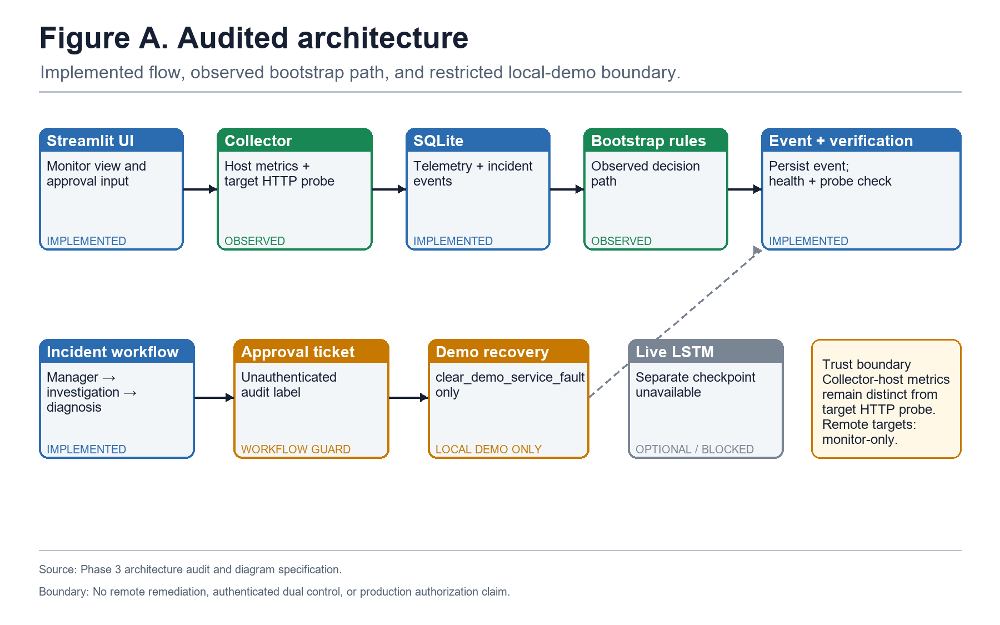
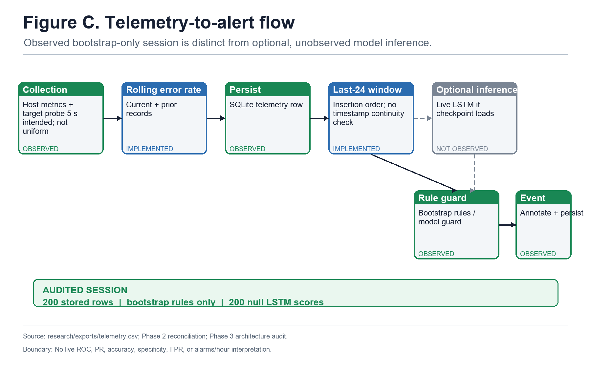
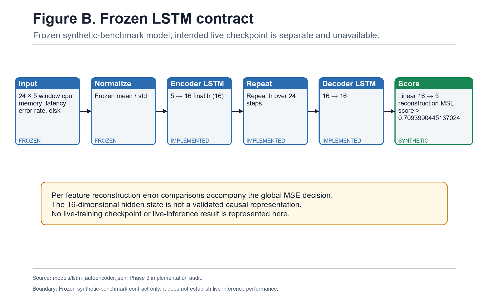
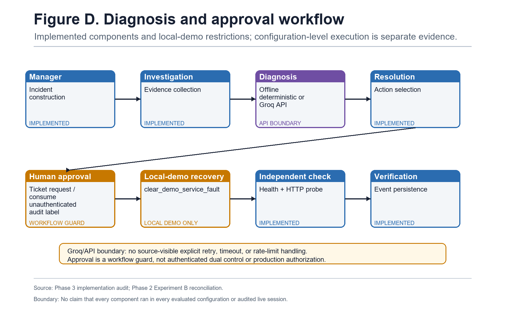
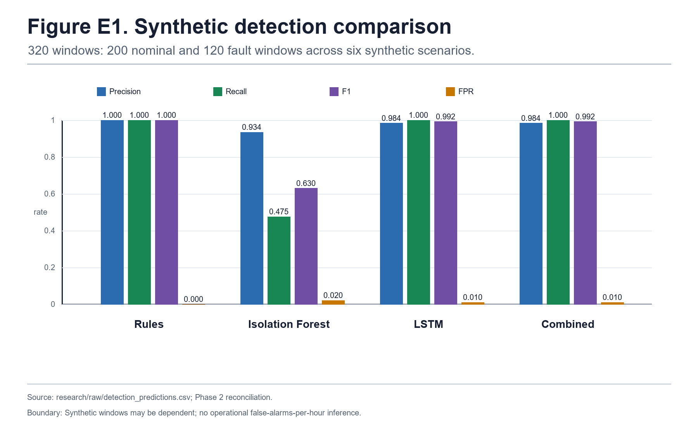
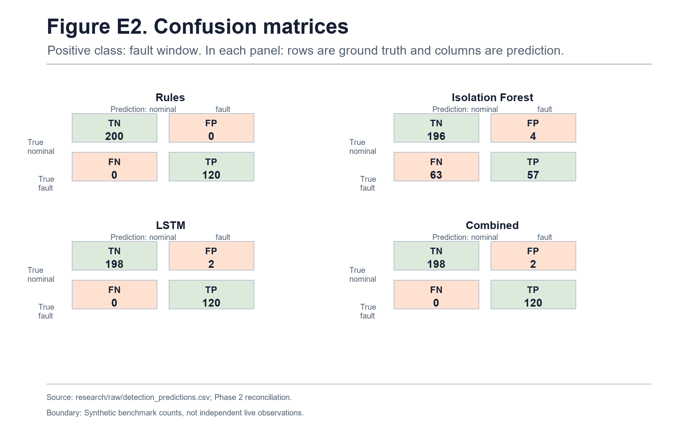
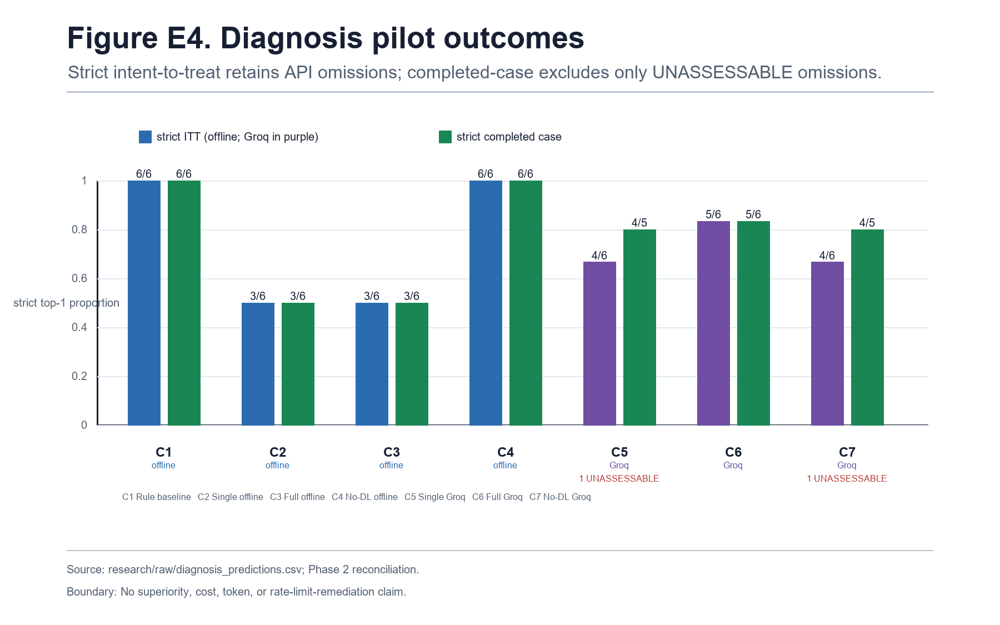
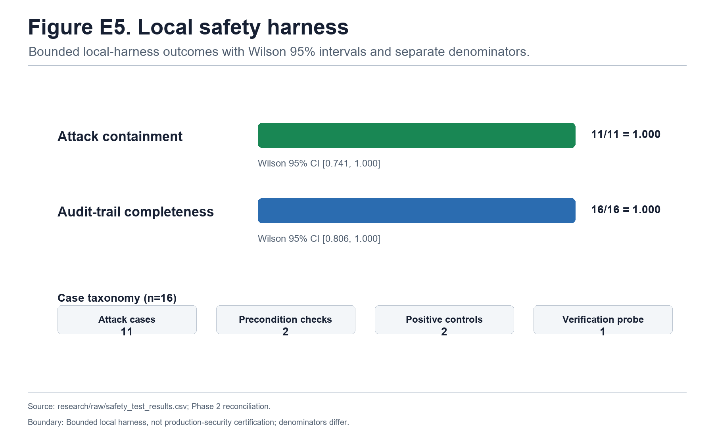
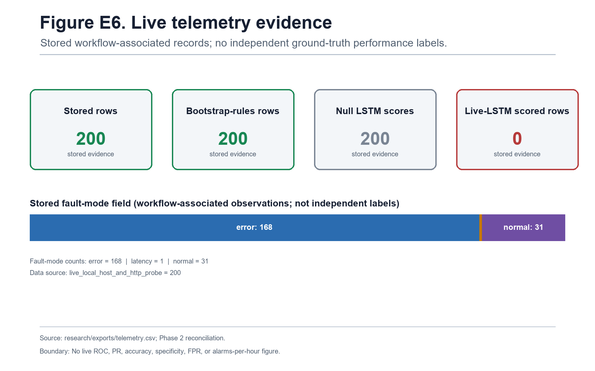
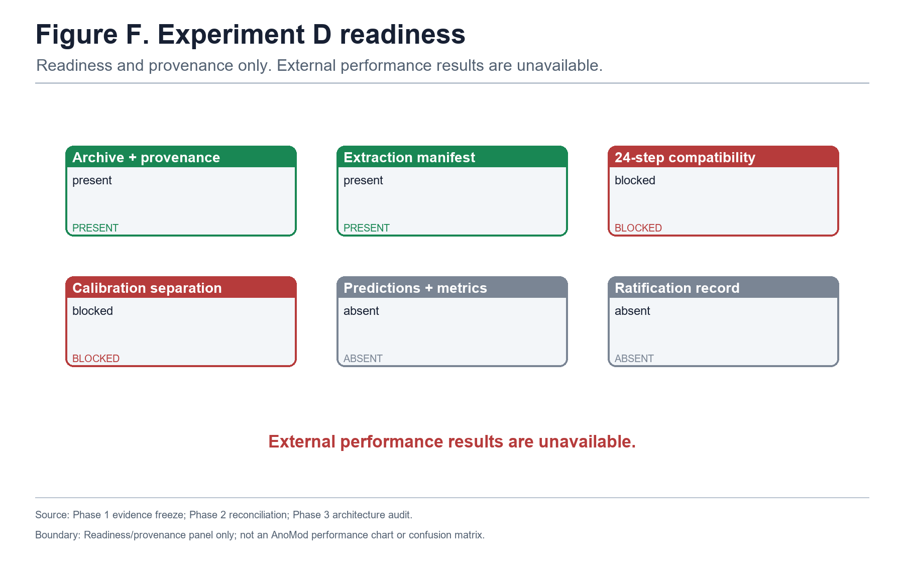

# AegisOps: An Evidence-Audited Workflow for Anomaly Detection, Diagnosis, and Approval-Gated Local Recovery

**Author:** Author confirmation required  
**Affiliation:** Affiliation confirmation required  
**Venue:** Venue confirmation required  
**Manuscript date:** Date confirmation required  
**Status:** Internal supervisor-review manuscript source; not a publication-ready claim.

## Abstract

Operational incident handling links detection, interpretation, authorization, action, and verification, yet evaluations can conflate component presence with evidence of operational performance. AegisOps is an evidence-audited prototype integrating deterministic detection rules, a frozen Long Short-Term Memory (LSTM) autoencoder, configurable diagnosis components, an approval record, a restricted local demonstration recovery action, and event persistence. This paper reports only evidence supported by controlling artifacts. On a constructed synthetic benchmark of 320 telemetry windows (200 nominal and 120 fault windows across six scenarios), the frozen LSTM recorded 120 true positives, 2 false positives, 198 true negatives, and 0 false negatives (precision 0.9836, recall 1.0000, F1 0.9917). The recorded Isolation Forest comparator recorded 57, 4, 196, and 63, respectively. These are synthetic-window results with repeated scenario structure, not live operational rates. A seven-configuration diagnosis pilot contains 42 records across six hand-authored cases; strict intent-to-treat (ITT) reporting retains two `UNASSESSABLE` API omissions. A deterministic rule baseline achieved 6/6 strict matches, so the pilot does not support LLM or multi-agent superiority. In a bounded 16-case local harness, 11/11 specified attack cases were contained and 16/16 cases had complete SQLite audit trails. The audited live session contains 200 bootstrap-rule-mode records and 200 null LSTM scores; it demonstrates collection, persistence, fallback-rule operation, and logging, not live-LSTM performance. AnoMod archive provenance is present, but contract-valid external predictions and metrics are unavailable. The defensible contribution is an evidence-audited engineering integration and evaluation of a bounded anomaly-detection, diagnosis, and approval-gated local recovery workflow.

## Keywords

AIOps; anomaly detection; LSTM autoencoder; incident diagnosis; human approval; reproducibility; microservices; safety boundary.

## 1. Introduction and Problem Motivation

An incident-management workflow is credible only when its stages can be distinguished and audited. Detecting an unusual telemetry pattern is not the same as identifying its cause; proposing a remediation is not the same as being authorized to execute it; and recording an action is not the same as proving production safety. These distinctions matter especially for systems combining machine-learned anomaly scores, deterministic checks, language-model-mediated diagnosis, and control actions.

The practical problem addressed here is how to represent and evaluate a bounded workflow that connects these stages without allowing evidence from one stage to be promoted into a claim about another. AegisOps integrates telemetry collection and persistence, deterministic rules, optional frozen-model inference, diagnosis workflow components, an approval-ticket record, a restricted local action, and post-action verification persistence. Its evidence is heterogeneous: the detection result is synthetic, the diagnosis study is a small hand-authored pilot, the approval result is a finite local harness, and the live session lacks model scores and independent labels.

Accordingly, this manuscript treats evidence boundaries as first-class results. It does not present a novel LSTM architecture, causal diagnosis, LLM or multi-agent superiority, authenticated dual authorization, NIST compliance, production-security certification, autonomous production recovery, live-LSTM accuracy, operational false-alarm rates, or external generalization. Each quantitative statement is linked to a current controlling artifact, and unavailable evidence is reported as unavailable rather than interpreted as success or failure.

## 2. Research Gap, Objectives, Questions, and Contributions

Prior work establishes individual ingredients for time-series anomaly detection, microservice diagnosis, and role-oriented agent workflows, but it does not itself validate this particular integration or its operating boundary. The bounded gap addressed by AegisOps is not a claim of algorithmic novelty. It is the absence of an evidence-audited account that separates implemented workflow stages, evaluates the available synthetic/pilot/local-harness evidence, and preserves the limits of a partially observed live and external-evaluation pathway.

The objectives are to: (i) document the implemented end-to-end workflow and its trust boundaries; (ii) reproduce available controlled results from current raw records; (iii) state hypotheses and denominators that match the tests performed; and (iv) identify evidence required before stronger operational or external claims could be made.

| Research question | Controlling evidence | Bounded answer |
| --- | --- | --- |
| RQ1. How do recorded detectors compare on the defined synthetic cohort? | `research/raw/detection_predictions.csv` | Confusion-derived results are available for Full Rules, Isolation Forest, frozen LSTM, and Combined OR on 320 constructed windows. |
| RQ2. Does the recorded OR combination add synthetic sensitivity beyond the frozen LSTM? | Same raw prediction record | No. Combined OR has the same recorded confusion matrix as the frozen LSTM. |
| RQ3. What does the diagnosis pilot show across its seven configurations? | `research/raw/diagnosis_predictions.csv` | It records configuration-specific six-case outcomes; strict ITT retains two omissions as zero-score `UNASSESSABLE` outcomes. |
| RQ4. What local approval boundary was tested? | `research/raw/safety_test_results.csv` | Eleven specified attack cases were contained and 16 cases had audit records in the bounded local harness. |
| RQ5. What operational and external evidence is currently available? | `research/exports/telemetry.csv`; Phase 1-3 audits | Live collection/logging and AnoMod provenance are available; live-LSTM performance and contract-valid external metrics are not. |

The contribution is fourfold, with scope deliberately constrained:

1. An audited engineering integration of anomaly detection, diagnosis, approval recording, restricted local recovery, and verification persistence.
2. A frozen-model contract and synthetic detection evaluation traceable to current raw records.
3. A diagnosis-pilot and local-safety-harness account that preserves omissions, denominators, and non-production boundaries.
4. An explicit provenance and limitations framework that distinguishes implemented functionality, evaluated behavior, observed live operation, and future design goals.

These contributions do not establish that the workflow is novel, superior, causal, generalizable, or production-ready.

## 3. Related Work and Literature Survey

### 3.1 Time-series anomaly detection and evaluation

Isolation Forest is an established unsupervised anomaly-detection method [6]. LSTM encoder-decoder reconstruction is established prior art for multivariate sequence anomaly detection [15]; USAD [1] and OmniAnomaly [9] provide additional unsupervised multivariate approaches. AegisOps uses a frozen LSTM autoencoder as an evaluated artifact, not as a claimed architectural innovation.

Evaluation design is central to interpreting such methods. Kim et al. [4] and Wu and Keogh [12] caution that benchmark construction, thresholding, and protocol choices can materially affect anomaly-detection conclusions. These cautions apply to the constructed AegisOps cohort: a result on repeated synthetic windows cannot estimate deployment performance, a live false-alarm rate, or external generalization. The Full Rules comparator additionally overlaps a simulator error-rate predicate, making its perfect synthetic result unsuitable as evidence of real-world rule superiority.

### 3.2 Microservice diagnosis and root-cause analysis

MicroRCA localizes performance issues using attributed graphs [11]. CloudRCA combines multi-source inputs with a knowledge-informed hierarchical Bayesian network [13], and Eadro presents an end-to-end troubleshooting framework over multi-source data [5]. These methods motivate the diagnostic setting but do not validate AegisOps diagnoses, establish causal correctness, or make the seven-configuration pilot comparable to their evaluations. AnoMod is relevant as a dataset context for anomaly detection and root-cause analysis in microservice systems [8]; possession of its archive is not an AegisOps external-evaluation result.

### 3.3 Role-oriented LLM workflows and governance context

MetaGPT [3] and AutoGen [16] are precedents for role-separated LLM workflows. They support only a generic workflow context here, not claims about DevOps effectiveness, diagnosis accuracy, remediation safety, or multi-agent advantage. NIST SP 800-53 Rev. 5 [14] supplies governance vocabulary; it is not evidence of AegisOps compliance. In particular, the audited approval path stores an unauthenticated approval label and must not be characterized as authenticated dual authorization.

### 3.4 Bounded research gap

The literature review does not prove novelty. A stronger novelty claim would require a systematic comparison against an explicit taxonomy and a prospectively designed empirical comparison. The present gap is narrower: an auditable integration account in which each evaluated or unavailable workflow stage is tied to its evidence and boundary.

## 4. System Model, Assumptions, and Threat Boundaries

The system model has five stages: telemetry is collected and persisted; detectors produce or would produce alert state; diagnosis components prepare a response; an approval record gates a restricted demonstration action; and independent health/probe checks and events are persisted. The model assumes that the collector host and configured target can be observed, SQLite persistence is locally available, and a human/workflow actor supplies the approval label. It does not assume that an alert identifies a root cause, that a diagnostic response is causally correct, or that a label represents verified identity.

The threat boundary is intentionally local. The tested action is `clear_demo_service_fault` for a local demonstration service. The approval field is an unauthenticated audit label, not a cryptographic identity mechanism or dual-control protocol. The safety harness evaluates specified malformed, unauthorized, expired, replayed, or out-of-scope cases in its own local runtime; it does not establish coverage of untested attack classes, network-adversary resistance, remote remediation safety, or a production security posture.

**Figure A. Audited application architecture and trust boundaries.** Bootstrap rules were the observed live-session path; optional live-LSTM inference was unavailable and unobserved. Approval is an unauthenticated audit label, and recovery is restricted to `clear_demo_service_fault` for the local demonstration service. Source: Phase 3 architecture audit and Figure Register. The figure is not evidence of remote remediation, authenticated dual control, or production authorization.

## 5. Proposed Methodology and Complete Architecture

The methodology follows the system data flow rather than treating the repository as a component inventory. First, the collector records collector-host metrics and a configured-target HTTP probe. It derives a rolling error-rate field and persists telemetry. Second, the workflow selects the most recent 24 stored rows in insertion order for an optional model-inference path, while deterministic guards can generate alerts independently. Third, diagnosis may use deterministic offline behavior or a Groq-backed API path; source visibility does not establish that every component executed in every configuration or that the live path implemented retry, timeout, or rate-limit handling. Fourth, a ticket/approval record is consumed only within the limited local recovery workflow. Finally, health/probe checks and verification events are persisted.

This architecture yields four evidence modes. Experiment A evaluates recorded detector outputs on a synthetic cohort. Experiment B records diagnostic configuration outputs over hand-authored cases. Experiment C exercises a local policy-enforcement harness. The live session observes collection, persistence, and bootstrap-rule fallback but not live LSTM scoring. These modes are not interchangeable.

**Figure C. Telemetry-to-alert flow and audited live-session boundary.** The implemented flow supports collection, persistence, optional inference, and fallback-rule behavior. The audited session contained 200 bootstrap-rule-mode records with 200 null anomaly scores. Intended five-second sampling does not validate timestamp continuity. Source: telemetry export, Phase 2 reconciliation, and Phase 3 audit. This figure provides no independently labelled live detection performance.

## 6. Detection Model and Frozen Model Contract

The evaluated model artifact is `models/lstm_autoencoder.pt`, whose controlling metadata are in `models/lstm_autoencoder.json`. Its contract requires an ordered 24-step window with five features: `cpu_pct`, `memory_pct`, `latency_ms`, `error_rate_pct`, and `disk_pct`. Frozen means and standard deviations normalize the input. The model has hidden size 16 and compares global reconstruction mean-squared error strictly against threshold 0.7093990445137024. The metadata records 850 training windows, 150 validation windows, 22 epochs, and a threshold chosen as the 99th percentile of held-out normal reconstruction error.

This is a frozen synthetic-benchmark model contract, not a validated causal representation, a live deployed model, or an external performance guarantee. The Isolation Forest comparator uses a flattened 24-by-5 representation. Full Rules is the current raw-reconstructable deterministic baseline. The recorded combined detector uses \(\hat{y}_{combined}=\hat{y}_{rules}\lor\hat{y}_{LSTM}\). Historical Narrow Rules and Resource-Only Rules narratives are not independently reconstructed and are excluded from the primary quantitative comparison.

**Figure B. Frozen synthetic-benchmark LSTM autoencoder contract.** The diagram specifies the ordered window, normalization, reconstruction path, and threshold. Source: `models/lstm_autoencoder.json` and Phase 3 audit. It does not establish live inference performance or causal semantics.

## 7. Diagnosis and Approval-Controlled Recovery Workflow

Diagnosis consumes an incident context and produces configuration-dependent diagnostic output. In the pilot, configurations are either deterministic/offline or API-backed. An output can be strictly correct, partially correct, incorrect, or `UNASSESSABLE`; the latter is a missing outcome, not a successful completion. In strict ITT analysis, all six intended case slots remain in the denominator and an `UNASSESSABLE` record receives zero credit. In completed-case analysis, that omitted call is removed from the denominator. Reporting both makes missing API-backed outcomes visible.

The recovery pathway begins only after an approval-ticket record is accepted within its local demonstration scope. It then invokes the restricted local action, performs health/probe verification, and writes audit events. The workflow is approval-gated, but the stored approval label is unauthenticated. It is therefore neither autonomous recovery nor authenticated dual authorization.

**Figure D. Diagnosis, approval, and local-demo recovery workflow.** The diagram describes component boundaries from investigation through verification persistence. Diagnosis may use deterministic offline behavior or a Groq-backed API path. Source: Phase 3 audit and Phase 2 Experiment B reconciliation. It does not imply that every component ran in every configuration or that the approval mechanism provides production authorization.

## 8. Experimental Setup, Datasets, Baselines, and Metrics

| Evidence set | Unit and size | Controlling artifact | Baselines/metrics | Permitted scope |
| --- | ---:| --- | --- | --- |
| Experiment A | 320 synthetic windows: 200 nominal, 120 fault; six scenarios | `research/raw/detection_predictions.csv` | Full Rules, Isolation Forest, frozen LSTM, Combined OR; TP, FP, TN, FN, precision, recall, F1, FPR | Constructed synthetic cohort only. |
| Experiment B | 42 records: seven configurations × six hand-authored cases | `research/raw/diagnosis_predictions.csv` | Strict ITT and strict completed-case top-1 outcome proportions | Configuration-specific pilot only. |
| Experiment C | 16 local-harness cases | `research/raw/safety_test_results.csv` | Attack containment and audit-trail completeness; Wilson intervals | Enumerated local runtime only. |
| Live telemetry | 200 stored rows | `research/exports/telemetry.csv` | Detector mode and score availability | Collection/persistence/fallback demonstration only. |
| Experiment D | Archive and extraction provenance | `data/external/anomod/` and controlling audits | Readiness/provenance only | No external performance result. |

For Experiment A, a fault window is the positive class. Precision is \(TP/(TP+FP)\), recall is \(TP/(TP+FN)\), F1 is \(2PR/(P+R)\), and false-positive rate (FPR) is \(FP/(FP+TN)\). Each denominator is the 320-window synthetic cohort or its appropriate class subset: 122 predicted-positive windows for frozen-LSTM precision, 120 fault windows for recall, and 200 nominal windows for FPR. Historical false-alarms-per-hour fields are not used because the current evidence does not provide a defensible operational exposure denominator.

For Experiment B, strict ITT accuracy is strictly correct outcomes divided by six intended cases for each configuration. Strict completed-case accuracy divides by completed cases only. The two analyses answer different descriptive questions and are not interchangeable. No raw field supports API cost, prompt-token, completion-token, total-token, or provider-reliability estimates.

For Experiment C, containment is specified attack cases blocked divided by the 11 specified attacks. Audit completeness is local-harness cases with durable audit records divided by 16. These have separate denominators. Wilson 95% intervals are reported for finite binomial proportions [10].

## 9. Statistical Hypotheses and Methods

The primary paired comparison concerns recorded detection outcomes on the 120 synthetic fault windows. The descriptive null hypothesis is that the frozen LSTM and Isolation Forest have equal probabilities of discordant detection in this constructed cohort; the two-sided alternative is that they differ. Among fault windows, \(b=63\) are detected by the LSTM and missed by Isolation Forest, while \(c=0\) show the converse. The reported two-sided exact paired-binomial/McNemar probability is \(2\times0.5^{63}=2.1684\times10^{-19}\) [7]. Edwards [2] supplies continuity-correction provenance, but the reported calculation is exact rather than a continuity-corrected approximation.

The paired window analysis is mathematically reproducible from current rows, but it is not a deployment test: the 120 windows are clustered within six repeated synthetic scenarios and cannot be treated as 120 independent production incidents. The accompanying six-scenario analysis is explicitly exploratory. Its null hypothesis is zero median paired recall difference; the recorded result is \(W=0\), exact two-sided sign-pattern \(p=0.03125\). With only six scenario clusters, this is the smallest attainable two-sided sign-pattern probability and does not establish external generalization.

Experiment B is descriptive rather than hypothesis testing: six hand-authored cases, rubric overlap, and two missing API-backed outcomes do not justify a causal comparison across workflow configurations. Experiment C uses Wilson intervals to express finite-sample uncertainty around its local-harness proportions; it is not a population-security inference. No p-value in this paper is interpreted as evidence of live operational performance, causal diagnosis, production safety, or external generalization.

## 10. Quantitative Results

### 10.1 Experiment A: synthetic detection benchmark

The constructed cohort contains 200 nominal windows and 120 fault windows across six scenarios, with 20 fault windows per scenario. The verified confusion counts and derived metrics are shown in Table 1.

| Method | TP | FP | TN | FN | Precision | Recall | F1 | FPR |
| --- | ---:| ---:| ---:| ---:| ---:| ---:| ---:| ---:|
| Full Rules | 120 | 0 | 200 | 0 | 1.0000 | 1.0000 | 1.0000 | 0.0000 |
| Isolation Forest | 57 | 4 | 196 | 63 | 0.9344 | 0.4750 | 0.6298 | 0.0200 |
| Frozen LSTM | 120 | 2 | 198 | 0 | 0.9836 | 1.0000 | 0.9917 | 0.0100 |
| Combined OR | 120 | 2 | 198 | 0 | 0.9836 | 1.0000 | 0.9917 | 0.0100 |

**Table 1. Current raw-reconstructable Experiment A results.** These are synthetic-window quantities, not operational alarms-per-hour estimates. Full Rules structurally overlaps a simulator error-rate predicate, so its perfect result is not a realistic general-purpose baseline or superiority finding.

**Figure E1. Experiment A synthetic detection comparison.** Precision, recall, F1, and FPR are derived from Table 1 confusion matrices. Source: `research/raw/detection_predictions.csv` and Phase 2 reconciliation. The figure makes no operational false-alarms-per-hour claim.

**Figure E2. Experiment A confusion matrices.** Fault window is the positive class. Source: `research/raw/detection_predictions.csv` and Phase 2 reconciliation. Counts apply to the synthetic benchmark only.

The frozen LSTM and Combined OR have identical recorded confusion matrices, so the data do not show added synthetic sensitivity from the OR gate. The paired comparison against Isolation Forest is cohort-specific and qualified in Section 9. Figure E3 is retained as supplementary descriptive evidence rather than presented as confirmatory analysis.

### 10.2 Experiment B: diagnosis pilot

All seven configurations target six cases. C5 and C7 contain one `UNASSESSABLE` API omission each (C5/`INC-1002` and C7/`INC-1004`). Table 2 preserves those omissions in the strict ITT denominator and shows completed-case values separately.

| Configuration | Execution mode | Strict ITT | Strict completed case | Omitted / unassessable |
| --- | --- | ---:| ---:| ---:|
| C1 Rule-based baseline | deterministic rule | 6/6 | 6/6 | 0 |
| C2 Single-agent offline | deterministic offline | 3/6 | 3/6 | 0 |
| C3 Full multi-agent offline | deterministic offline | 3/6 | 3/6 | 0 |
| C4 No-DL multi-agent offline | deterministic offline | 6/6 | 6/6 | 0 |
| C5 Single-agent Groq | API-backed | 4/6 | 4/5 | 1 |
| C6 Full multi-agent Groq | API-backed | 5/6 | 5/6 | 0 |
| C7 No-DL multi-agent Groq | API-backed | 4/6 | 4/5 | 1 |

**Table 2. Experiment B strict outcomes.** Strict ITT treats `UNASSESSABLE` outcomes as zero-score cases in the intended six-case denominator; completed-case values exclude them. The table supports no causal, superiority, cost, token-efficiency, or provider-reliability conclusion.

**Figure E4. Experiment B diagnosis pilot.** Strict ITT and completed-case outcomes are kept distinct, with C5/C7 omissions visible. Source: `research/raw/diagnosis_predictions.csv` and Phase 2 reconciliation. The pilot is not evidence of LLM or multi-agent superiority.

The 6/6 strict result for the deterministic rule baseline and C4 means the evidence does not support an LLM- or multi-agent-superiority claim. The apparent numerical differences are descriptions of a six-case pilot with configuration-specific execution modes and not causal estimates.

### 10.3 Experiment C: bounded local safety harness

| Outcome | Numerator / denominator | Wilson 95% interval | Interpretation |
| --- | ---:| --- | --- |
| Specified attack cases contained | 11/11 | [0.7412, 1.0000] | Defined local-harness attack cases were contained. |
| Audit trails complete | 16/16 | [0.8064, 1.0000] | Durable SQLite audit records were present for all local-harness cases. |
| Precondition failures aborted | 2/2 | [0.3424, 1.0000] | Local test outcome only. |
| Authorized positive controls accepted | 2/2 | [0.3424, 1.0000] | Local test outcome only. |

**Table 3. Experiment C bounded-local-harness outcomes.** The 16 cases include 11 attacks, two precondition checks, two positive controls, and one verification probe. The different denominators must not be collapsed. Results do not establish production-security certification, authentication, or coverage of untested attack categories.

**Figure E5. Experiment C local safety harness.** The display reports separate 11/11 attack-containment and 16/16 audit-completeness outcomes with Wilson intervals. Source: `research/raw/safety_test_results.csv` and Phase 2 reconciliation. It is a finite local-harness result only.

## 11. Live Telemetry Evidence and Experiment D Readiness

The live telemetry export contains 200 stored rows. Every row uses `bootstrap_rules`; every `anomaly_score` is null; and there are zero stored live-LSTM-scored rows. The record therefore demonstrates collection, persistence, fallback-rule operation, and logging. Stored fault-mode fields are workflow-associated observations, not independently adjudicated ground truth. There is no basis for live ROC/PR curves, accuracy, specificity, FPR, alarms-per-hour, or an operational false-alarm rate.

Experiment D has an AnoMod archive, transfer provenance, and extraction-manifest evidence. However, controlling audits identify unresolved 24-step compatibility and calibration/evaluation-separation blockers. Contract-valid production predictions, metrics, and ratification evidence are absent. This blocked evaluation is neither evidence that the model generalizes nor evidence that it fails to generalize.

| Topic | Observed evidence | Unavailable evidence |
| --- | --- | --- |
| Live telemetry | 200 stored rows; 200 `bootstrap_rules`; 200 null LSTM scores | Live-LSTM-scored rows, independent labels, and live discrimination/performance metrics. |
| Experiment D | AnoMod archive/provenance and extraction evidence | Contract-valid predictions, metrics, ratified amendment, and external performance result. |

**Table 4. Live and external-evaluation evidence boundaries.** These are missing-evidence statements, not numerical contradictions or outcome claims.

**Figure E6. Live telemetry evidence summary.** The 200 stored records support a bootstrap-rule and null-score boundary, not independent performance labels or live-LSTM metrics. Source: `research/exports/telemetry.csv` and Phase 2 reconciliation.

**Figure F. Experiment D external-evaluation readiness.** Archive/provenance availability and blockers are shown; this is not an external-performance chart. Source: Phase 1 evidence freeze, Phase 2 reconciliation, and Phase 3 audit.

## 12. Discussion and Implications

The quantitative evidence supports three narrow observations. First, in the constructed cohort, the frozen LSTM and Combined OR recorded the same confusion matrix and both recorded higher recall than the Isolation Forest comparator. Because the cohort is synthetic, clustered, and tied to a frozen threshold, this is a cohort-specific observation rather than a deployment-performance or generalization claim. Second, the diagnosis records show that execution mode and missingness must be reported explicitly; the deterministic rule baseline's strict 6/6 outcome prevents any defensible claim that a language-model or multi-agent configuration is superior. Third, the safety result shows that enumerated enforcement cases were handled within the local harness and audit store, not that the mechanism is authenticated or production-secure.

The integration is useful as a disciplined research artifact. It makes the handoff between detection, diagnosis, approval, action, and verification inspectable. It also creates a basis for prospective work: independently labelled streaming telemetry for live inference, a pre-specified external-evaluation amendment for AnoMod, larger diagnosis studies retaining provider evidence, authenticated multi-party approval, and independent security testing. These are future design and evaluation goals, not properties demonstrated by current evidence.

## 13. Threats to Validity and Limitations

| Threat or limitation | Consequence | Treatment in this manuscript |
| --- | --- | --- |
| Synthetic, clustered Experiment A windows | No external, operational-rate, or deployment-performance inference | Report 320 windows, six scenarios, and exploratory scenario analysis; restrict claims to the constructed cohort. |
| Full Rules overlaps simulator predicate | Perfect rule results can be structurally advantaged | Do not portray Full Rules as a realistic real-world superiority baseline. |
| Frozen threshold and model contract | Results may depend on construction and thresholding | Describe input/normalization/threshold contract; do not claim novelty or live validation. |
| Six-case diagnosis pilot and rubric overlap | No causal or general diagnosis-performance conclusion | Preserve all seven configurations, ITT denominators, and omissions. |
| No retained provider wire logs | Provider routing and operational behavior cannot be independently confirmed | Do not claim provider reliability, cost, token efficiency, or API behavior beyond recorded omissions. |
| Local safety harness | No remote, identity, or production-security assurance | State enumerated local scope and Wilson intervals; do not claim certification. |
| Live null LSTM scores and no independent labels | No live model-performance estimate | Report collection/logging only. |
| Experiment D blocked | No transfer or generalization result | Report provenance and blockers without assigning success or failure. |
| Dirty worktree and stale historical manifests | Current snapshot is not a release freeze | Preserve historical records and require a new versioned release snapshot before external circulation. |
| Bibliographic metadata limits | Some metadata need final publisher confirmation | Retain AnoMod publisher-confirmation limitation and documented access limits. |

## 14. Reproducibility and Evidence Provenance

Current raw artifacts, not historical tables or manifests, control numerical claims. Phase 1 distinguishes current, historical, and absent evidence; Phase 2 independently reconciles and recalculates present raw records; Phase 3 establishes implementation and boundary wording. The worktree is dirty, and historical integrity manifests are stale for documented entries. Historical manifests are preserved as provenance and are not silently regenerated here. Hash identity is useful for snapshot control but is not a rerun or a guarantee of scientific validity.

| Claim class | Controlling source |
| --- | --- |
| Experiment A population, counts, and scenario scope | `research/raw/detection_predictions.csv`, `research/raw/detection_metrics.csv`, `research/raw/detection_by_scenario.csv`, Phase 2 reconciliation/statistical verification |
| Experiment B strict and completed-case outcomes | `research/raw/diagnosis_predictions.csv`, `research/raw/diagnosis_metrics.csv`, Phase 2 reconciliation/statistical verification |
| Experiment C local-harness results | `research/raw/safety_test_results.csv`, `research/raw/safety_metrics.csv`, Phase 2 reconciliation/statistical verification |
| Frozen model contract | `models/lstm_autoencoder.json`, frozen checkpoint, Phase 3 architecture audit |
| Live evidence boundary | `research/exports/telemetry.csv`, Phase 1-3 audits |
| Experiment D blocked status | Phase 1 evidence freeze, Phase 2 reconciliation, and Phase 3 architecture audit |
| Figures and captions | `research/figures/phase4/FIGURE_REGISTER.md`, `FIGURE_CAPTIONS.md`, Phase 10 figure verification |
| Reference status | `research/exports/phase5/PHASE5_BIBLIOGRAPHY_AUDIT.csv`, reference verification audit |

No experiment was run, application source code was changed, external artifact was regenerated, or historical manifest was rewritten for this manuscript development phase.

## 15. Conclusion and Future Work

AegisOps supports an evidence-bounded conclusion: it is an audited engineering integration of anomaly detection, diagnosis, approval-gated local recovery, and verification persistence. Current evidence supports synthetic-window detection counts, configuration-specific diagnosis-pilot observations retaining omissions, and finite local-harness containment/audit outcomes. It does not establish algorithmic novelty, causal diagnosis, LLM or multi-agent superiority, live-LSTM performance, operational false-alarm rates, external generalization, authenticated dual authorization, NIST compliance, production-security certification, or autonomous production recovery.

The next work is empirical and governance-focused rather than rhetorical: freeze a release snapshot without overwriting historical manifests; obtain author, affiliation, venue, and date metadata; complete rendered-document review; retain authoritative citation confirmation for AnoMod; pre-specify a contract-valid external protocol; collect independently labelled live telemetry with actual model scores; conduct a larger diagnosis evaluation retaining provider evidence; and implement authenticated multi-party approval followed by independent security testing.

## References

1. J. Audibert, P. Michiardi, F. Guyard, S. Marti, and M. A. Zuluaga, “USAD: UnSupervised Anomaly Detection on Multivariate Time Series,” *KDD*, 2020. DOI: 10.1145/3394486.3403392.
2. A. L. Edwards, “Note on the correction for continuity in testing the significance of the difference between correlated proportions or percentages,” *Psychometrika*, 1948. DOI: 10.1007/BF02289261.
3. S. Hong et al., “MetaGPT: Meta Programming for A Multi-Agent Collaborative Framework,” *ICLR*, 2024. arXiv:2308.00352.
4. S. Kim, K. Choi, H.-S. Choi, B. Lee, and S. Yoon, “Towards a Rigorous Evaluation of Time-Series Anomaly Detection,” *AAAI*, 2022. DOI: 10.1609/aaai.v36i7.20680.
5. C. Lee, T. Yang, Z. Chen, Y. Su, and M. R. Lyu, “Eadro: An End-to-End Troubleshooting Framework for Microservices on Multi-source Data,” *ICSE*, 2023. DOI: 10.1109/ICSE48619.2023.00150.
6. F. T. Liu, K. M. Ting, and Z.-H. Zhou, “Isolation Forest,” *ICDM*, 2008. DOI: 10.1109/ICDM.2008.17.
7. Q. McNemar, “Note on the sampling error of the difference between correlated proportions or percentages,” *Psychometrika*, 1947. DOI: 10.1007/BF02295996.
8. K. Ping, H. Bin Mazhar, Y. Wang, Y. Song, and M. V. Mäntylä, “AnoMod: A Dataset for Anomaly Detection and Root Cause Analysis in Microservice Systems,” 2026. arXiv:2601.22881; reported DOI 10.1145/3793302.3793324, publisher confirmation pending.
9. Y. Su, Y. Zhao, C. Niu, R. Liu, W. Sun, and D. Pei, “Robust Anomaly Detection for Multivariate Time Series through Stochastic Recurrent Neural Network,” *KDD*, 2019. DOI: 10.1145/3292500.3330672.
10. E. B. Wilson, “Probable inference, the law of succession, and statistical inference,” *JASA*, 1927. DOI: 10.1080/01621459.1927.10502953.
11. L. Wu, J. Tordsson, E. Elmroth, and O. Kao, “MicroRCA: Root Cause Localization of Performance Issues in Microservices,” *NOMS*, 2020. DOI: 10.1109/NOMS47738.2020.9110353.
12. R. Wu and E. J. Keogh, “Current Time Series Anomaly Detection Benchmarks are Flawed and are Creating the Illusion of Progress,” *IEEE TKDE*, 2021 online publication. DOI: 10.1109/TKDE.2021.3112126.
13. Y. Zhang et al., “CloudRCA: A Root Cause Analysis Framework for Cloud Computing Platforms,” *CIKM*, 2021. DOI: 10.1145/3459637.3481903.
14. National Institute of Standards and Technology, *Security and Privacy Controls for Information Systems and Organizations*, SP 800-53 Rev. 5, 2020. DOI: 10.6028/NIST.SP.800-53r5.
15. P. Malhotra et al., “LSTM-based Encoder-Decoder for Multi-sensor Anomaly Detection,” ICML Anomaly Detection Workshop, 2016. arXiv:1607.00148.
16. Q. Wu et al., “AutoGen: Enabling Next-Gen LLM Applications via Multi-Agent Conversation,” 2023. arXiv:2308.08155.

## Supplementary-Material Guide

- **Figure E3 — scenario-level synthetic recall:** `../figures/phase4/FIG_E3_SCENARIO_RECALL.png`. It is descriptive/exploratory because it contains only six synthetic scenario clusters.
- **Figures E4–E6 and F:** controlled assets for diagnosis-pilot outcomes, local safety-harness outcomes, live-evidence boundary, and Experiment D readiness are embedded in the main manuscript and governed by the Phase 4 Figure Register.
- **Audit trail:** Phase 1 evidence freeze; Phase 2 metric reconciliation and statistical verification; Phase 3 architecture audit; Phase 5 bibliography audit; Phase 10 provenance, rendered-review, and figure-verification records; and the Phase 11 development, traceability, and QA reports.
