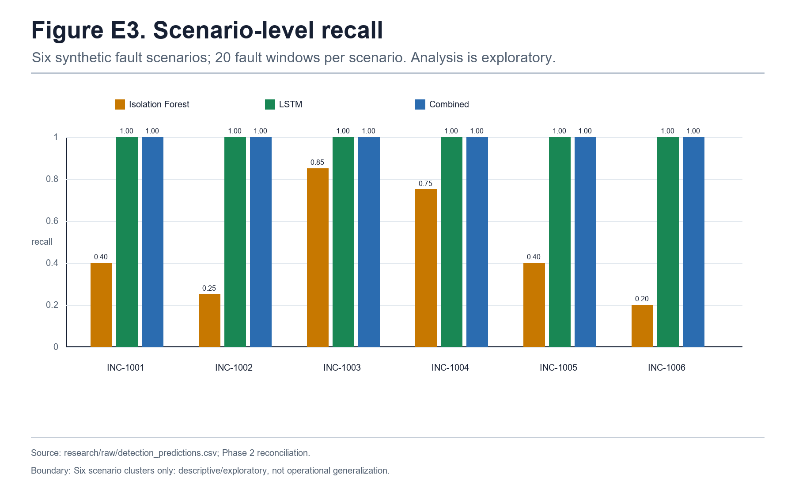

# AegisOps: Evidence-Bounded Anomaly Detection, Diagnosis, and Approval-Gated Recovery Workflows

**Internal supervisor-review draft — author, affiliation, and venue metadata pending confirmation.**

**Evidence status:** This manuscript reports a synthetic anomaly-detection benchmark, a small diagnosis pilot, and a bounded local safety harness. It does not report live-LSTM performance, contract-valid external performance, authenticated dual authorization, production-security assurance, or autonomous recovery.

## Abstract

AegisOps is a source-audited engineering integration for incident monitoring, diagnosis, and approval-gated local recovery. Its design combines deterministic rules, a frozen Long Short-Term Memory (LSTM) autoencoder, configurable diagnostic workflow components, and a scoped approval mechanism. On a defined synthetic benchmark of 320 constructed telemetry windows (200 nominal and 120 fault windows across six scenarios), the frozen LSTM detected 120/120 fault windows and produced 2/200 nominal false positives (precision 0.9836, recall 1.0000, F1 0.9917). The recorded Isolation Forest baseline detected 57/120 fault windows with 4/200 nominal false positives. These are synthetic-window results: windows are clustered within six scenarios, and no operational alarms-per-hour or deployment-performance estimate is reported. A diagnosis pilot contains 42 records from seven configurations over six cases; strict intent-to-treat reporting retains two provider-rate-limit omissions as `UNASSESSABLE`. A deterministic rule baseline achieved 6/6 strict matches in that pilot, so the study does not claim LLM or multi-agent superiority. In a 16-case bounded local harness, the approval implementation contained 11/11 specified attack cases and produced complete SQLite audit trails for 16/16 cases. The audited live telemetry session contains 200 bootstrap-rule-mode records and 200 null LSTM scores; it demonstrates collection, persistence, fallback-rule operation, and logging, not live-LSTM performance. AnoMod archive provenance is present, but contract-valid external evaluation remains blocked and no Experiment D performance result is reported.

## 1. Introduction and Research Questions

Operational incident handling links detection, diagnostic interpretation, authorization, action, and verification. AegisOps is a prototype workflow that makes these stages explicit and auditable. It is not presented as a novel LSTM architecture or as a production-validated autonomous operations platform.

The project asks the following evidence-bounded questions.

- **RQ1 — synthetic detection:** On the defined synthetic cohort, how do Full Rules, an Isolation Forest, a frozen LSTM autoencoder, and their recorded OR combination compare in confusion-derived window metrics?
- **RQ2 — combined design:** What do the recorded synthetic results show about the OR combination, and what does the result not establish about operational utility?
- **RQ3 — diagnosis pilot:** What configuration-specific strict intent-to-treat and completed-case observations arise in a six-case diagnosis pilot, with omissions preserved?
- **RQ4 — local approval boundary:** In the specified local test harness, are the defined approval and audit controls observed to contain the enumerated attack cases and record audit trails?

The contribution is therefore an engineering integration with evidence-bounded evaluations: (1) a frozen synthetic-benchmark model contract; (2) an auditable synthetic comparison with explicit dependence limits; (3) a configuration-specific diagnosis pilot; and (4) a local approval-boundary harness. Claims outside those four scopes are future-work hypotheses.

## 2. Related Work

Isolation Forest is an established unsupervised baseline that isolates unusual feature vectors through random partitioning [6]. When temporal structure is relevant, a windowed representation must be supplied explicitly; this manuscript uses flattened 24-by-5 windows for the recorded Isolation Forest baseline. LSTM encoder-decoder reconstruction is established prior art for multivariate sequence anomaly detection [15], and OmniAnomaly and USAD are related multivariate unsupervised approaches [9, 1]. Time-series anomaly-detection evaluation is sensitive to data construction, thresholding, and aggregation choices; benchmark critiques motivate the explicit synthetic and clustered-window limitations retained here [4, 12].

For microservice root-cause analysis (RCA), MicroRCA is a graph/metric-based approach to localizing performance issues [11]. CloudRCA combines KPIs, logs, topology, and a knowledge-informed hierarchical Bayesian network; it should not be conflated with a generic PageRank or random-walk method [13]. Eadro provides an end-to-end multi-source troubleshooting context [5]. AnoMod provides a dataset and benchmark context for microservice anomaly detection and RCA [8], but its archive presence does not constitute an AegisOps result.

AutoGen and MetaGPT provide general precedents for role-separated LLM multi-agent workflows [16, 3]. They do not establish AegisOps diagnostic efficacy, causal validity, or operational safety. NIST SP 800-53 Rev. 5 supplies governance vocabulary, including dual-authorization controls [14]; it does not certify this implementation. The local AegisOps approval path stores an unauthenticated approval label and therefore must not be described as authenticated dual control.

## 3. Methodology and Defensible Scope

## 4. Architecture, Algorithms, and Data Flow

### 4.1 Implemented components and observed paths

The repository contains telemetry collection, persistence, deterministic rule evaluation, an optional frozen-model inference path, diagnostic workflow code, an approval-ticket store, a restricted local demonstration action, and verification/event persistence. These code paths must be distinguished from observations. Experiment A evaluates the frozen model on synthetic windows. Experiment B records configuration-specific pilot outputs. Experiment C tests a bounded local harness. The audited live session observed collection, persistence, and bootstrap-rule fallback, but not live LSTM scoring. Experiment D is blocked.

**Figure A. Audited application architecture and trust boundaries.** Bootstrap rules were the observed live-session path; the optional live-LSTM path was unavailable and unobserved. Approval is an unauthenticated audit label, and recovery is limited to `clear_demo_service_fault` for the local demonstration service. The diagram is not evidence of remote remediation, authenticated dual control, or production authorization.

### 4.2 Frozen LSTM contract and baselines

The frozen artifact is `models/lstm_autoencoder.pt`; its contract is recorded in `models/lstm_autoencoder.json` and the implementation is traced to `dl/anomaly_detector.py`. It accepts a 24-step, five-feature window (`cpu_pct`, `memory_pct`, `latency_ms`, `error_rate_pct`, `disk_pct`), uses frozen normalization, and compares global reconstruction mean-squared error against the strict threshold `0.7093990445137024`. The checkpoint has 3,733 parameters. This is a synthetic-benchmark contract, not a validated causal representation or a live deployed model.

**Figure B. Frozen synthetic-benchmark LSTM autoencoder contract.** The figure documents the 24-by-5 contract and frozen threshold. It does not demonstrate live inference or causal representation.

The current raw-reconstructable deterministic baseline is **Full Rules**, which includes the recorded error-rate predicate. The Isolation Forest is the non-temporal comparator and uses a flattened 120-feature representation for each 24-by-5 window. Narrow Rules and Resource-Only Rules are historical comparator outputs pending independent reconstruction and are not part of the primary comparison in this manuscript.

The recorded combination is an OR gate,

$$\hat{y}_{combined}=\hat{y}_{full\ rules}\lor\hat{y}_{LSTM}.$$

It is an engineering design. On Experiment A it has the same recorded confusion counts as the LSTM, so the present experiment does not demonstrate additive sensitivity from the combination.

### 4.3 Telemetry, diagnosis, and approval boundaries

The collector persists host/probe-associated telemetry and alert-state events. The intended sampling cadence is five seconds, but the audited live export does not establish timestamp continuity sufficient for a valid streaming LSTM evaluation. The observed session has 200 stored records; all are `bootstrap_rules` mode and all 200 anomaly scores are null.

**Figure C. Telemetry-to-alert flow and audited live-session boundary.** It shows persistence, rule fallback, and the optional inference branch. The audited session has no scored live-LSTM record and is not an independently labeled performance study.

The diagnostic workflow can use deterministic offline behavior or a Groq-backed API path. Configuration varies in Experiment B, and the source-visible live application path does not establish explicit retry, timeout, or rate-limit handling. The workflow diagram is a component and local-demo boundary description, not proof that every component ran in every configuration or in the live session.

**Figure D. Diagnosis, approval, and local-demo recovery workflow.** The recovery action is restricted to the local demonstration service. The approver field is an unauthenticated label; the figure does not establish authenticated authorization or universal component execution.

The local approval implementation binds a ticket to action, target, and incident scope, applies a time-to-live and confirmation phrase, and records audit events. These are implementation properties tested in a finite local harness. They do not demonstrate NIST compliance, dual authorization, replay-proof security in arbitrary environments, or autonomous safe recovery.

## 5. Experimental Setup and Evidence Boundary

### 5.1 Experiment A: synthetic anomaly detection

Experiment A contains 320 constructed synthetic windows: 200 nominal and 120 fault windows across six fault scenarios, with 20 fault windows per scenario. The raw prediction and metric CSVs are controlling evidence. The result is restricted to this cohort. Full Rules also structurally overlap the simulator's error-rate fault predicate; its perfect synthetic recall should not be interpreted as a real-world rate.

### 5.2 Experiment B: diagnosis pilot

Experiment B contains 42 records: seven configurations by six canonical cases. Strict intent-to-treat (ITT) reporting retains two rate-limit omissions as `UNASSESSABLE`: C5/`INC-1002` and C7/`INC-1004`. Completed-case reporting excludes only those omissions from the relevant denominator. Provider wire payloads were not retained; therefore configured/requested provider details do not independently prove provider routing. The six-case rubric has known lexical overlap with the constructed scenarios. B is a pilot, not a causal-effect or generalization study.

### 5.3 Experiment C: local approval-boundary harness

Experiment C contains 16 local-harness evaluations: 11 specified attack cases, two precondition checks, one verification probe, and two positive controls. The harness tests a local application/runtime boundary and SQLite audit behavior. It is not a penetration test, an identity-system evaluation, or a production-security certification.

### 5.4 Live telemetry and Experiment D

The live export is an operational demonstration record: 200 stored telemetry records, all bootstrap-rule mode, and all LSTM scores null. It supports collection, persistence, rule fallback, and logging only.

AnoMod archive provenance and an extraction manifest are present. However, no contract-valid Experiment D predictions, metrics, ratification record, or result report exists. Compatibility and calibration/evaluation-separation blockers remain. This manuscript therefore reports no external performance result.

## 6. Results and Statistical Hypothesis Testing

### 6.1 Experiment A: primary synthetic comparison

Table 1 contains only current raw-reconstructable methods. All values refer to the 320 constructed synthetic windows described above; no alarms-per-hour result is available.

| Method | TP | FP | TN | FN | Recall | Precision | F1 | FPR |
|---|---:|---:|---:|---:|---:|---:|---:|---:|
| Full Rules | 120 | 0 | 200 | 0 | 1.0000 | 1.0000 | 1.0000 | 0.0000 |
| Isolation Forest | 57 | 4 | 196 | 63 | 0.4750 | 0.9344 | 0.6298 | 0.0200 |
| Frozen LSTM | 120 | 2 | 198 | 0 | 1.0000 | 0.9836 | 0.9917 | 0.0100 |
| Combined OR | 120 | 2 | 198 | 0 | 1.0000 | 0.9836 | 0.9917 | 0.0100 |

**Table 1. Experiment A current raw-reconstructable synthetic-window results.** The population is 200 nominal and 120 fault windows across six scenarios. These batch-window quantities are not live or operational-rate estimates.

**Figure E1. Experiment A synthetic detection comparison.** Precision, recall, F1, and FPR derive from the current confusion matrices. No operational false-alarms-per-hour claim is made.

**Figure E2. Experiment A confusion matrices.** Fault windows are the positive class. The displayed counts match Table 1 and remain synthetic-benchmark results.

### 6.2 Hypotheses and statistical qualification for Experiment A

For the paired LSTM-versus-Isolation Forest comparison, the null hypothesis is **H0: the paired methods have equal probabilities of discordant detection outcomes in the defined synthetic cohort.** The alternative is **H1: those probabilities differ.** This is a matched-pair comparison in the sense of McNemar [7], with the continuity-correction provenance discussed by Edwards [2]. On the 120 fault windows, the recorded discordant counts are `b = 63` (LSTM correct and Isolation Forest incorrect) and `c = 0` (the converse). The two-sided exact McNemar p-value is `2.168 x 10^-19`. This is descriptive within the constructed cohort because the windows are clustered within six scenarios; it is not deployment evidence.

For the scenario-level recall comparison, the null hypothesis is **H0: the median paired scenario-level recall difference is zero.** The alternative is **H1: it is non-zero.** Across six scenarios, the recorded exact Wilcoxon signed-rank result is `W = 0` and `p = 0.03125`. This post-hoc exploratory analysis has only six scenario clusters and is not confirmatory evidence of operational superiority.

**Figure E3. Experiment A scenario-level recall.** Each scenario has 20 fault windows. The display and its paired analysis are descriptive/exploratory because there are only six scenario clusters.

### 6.3 Experiment B: diagnosis-pilot observations

The diagnosis pilot is reported as seven configuration-specific, six-case records rather than independent replications. The strict ITT denominator is six for every configuration and retains both `UNASSESSABLE` omissions. For example, the full multi-agent Groq configuration (C6) records 5/6 strict ITT matches (83.33%) and 6/6 lenient matches; the deterministic rule baseline (C1) records 6/6 strict matches in 0.01 ms. C5 and C7 each have one rate-limit omission and must not be silently deleted. The data do not establish that deep-learning context, LLM use, or multi-agent design caused better diagnosis.

**Figure E4. Experiment B diagnosis pilot.** Strict ITT and completed-case values are shown for seven six-case configurations. The two `UNASSESSABLE` omissions remain visible. The figure makes no superiority, cost, token, or API-reliability claim.

### 6.4 Experiment C: bounded local approval harness

The local harness contained 11/11 specified attack cases, with a 95% Wilson interval of [0.741, 1.000], and recorded complete audit trails for 16/16 cases, with a 95% Wilson interval of [0.806, 1.000] [10]. These intervals describe finite local-harness cases only. The result does not establish authenticated approval, universal threat mitigation, production security, or autonomous safe recovery.

**Figure E5. Experiment C bounded local safety harness.** The 16 cases include 11 attack cases, two precondition checks, two positive controls, and one verification probe. This is not a production-security certification.

## 7. Discussion

Within the defined synthetic cohort, the LSTM and Combined OR detector have the same recorded confusion counts, while the Isolation Forest records lower recall. This is a dataset-specific observation. It does not prove that a neural detector generalizes to real systems or that the OR design adds empirical sensitivity. Full Rules also attain perfect recall within a simulation whose error-rate predicate overlaps the rule; this prevents a claim that the LSTM is uniquely effective in the constructed test.

The diagnosis observations are useful for auditing configuration behavior and omissions, but their six cases, rubric overlap, and unavailable provider wire payloads rule out causal or general operational inferences. The deterministic baseline's 6/6 strict result further means that the pilot does not support an LLM or multi-agent superiority statement.

The local approval harness establishes a narrow implementation result: enumerated attempts were handled as specified and audit records were present. The correct engineering interpretation is that the harness exercised scope, confirmation, expiration, action restrictions, and audit recording locally. It is not a claim about identity assurance, dual authorization, remote action, or a real security boundary beyond the tested environment.

## 8. Limitations and Threats to Validity

### 8.1 Live telemetry limitation

The audited telemetry export contains 200 records. Every record is in `bootstrap_rules` mode and every stored LSTM anomaly score is null. Thus the session demonstrates data collection, persistence, fallback-rule behavior, and logging, but neither live-LSTM inference nor independently labeled detection performance.

**Figure E6. Live telemetry evidence summary.** The fault-mode field is workflow-associated rather than independent ground truth. No live ROC, PR curve, accuracy, specificity, FPR, or alarms-per-hour quantity is inferred.

### 8.2 External-evaluation limitation

Experiment D remains blocked. AnoMod archive provenance and extraction information exist, but no contract-valid external predictions, metrics, ratification evidence, or result report is present. Sequence-contract eligibility and calibration/evaluation-separation issues must be resolved under an approved future protocol before external performance can be reported.

**Figure F. Experiment D external-evaluation readiness.** The panel summarizes asset availability and blockers; it is not an external-performance chart.

### 8.3 Reproducibility and rendering limitations

The current worktree is dirty, and the historical SHA-256 manifest is stale for seven entries. The current evidence map identifies controlling sources, but hash checks do not substitute for an experimental rerun. Phase 4 visual validation inspected the PNG/PDF renderings; SVG graphical-rasterization verification was limited to XML parsing rather than an independent SVG rasterizer. Successful rendering alone does not make the manuscript publication-ready.

## 9. Conclusion and Future Work

AegisOps is a source-audited engineering integration with bounded evidence. Its current results show: (1) synthetic-window counts for four current raw-reconstructable detection methods; (2) configuration-specific pilot diagnosis observations that preserve omissions; and (3) a finite local approval-boundary result. The work does not establish an architecture novelty claim, causal representation, live-LSTM performance, external generalization, production security, authenticated dual authorization, or autonomous recovery.

Future work should use a prospectively approved, contract-valid external protocol; independently labeled streaming data for live-LSTM evaluation; larger diagnosis studies with retained provider evidence; authenticated multi-party approval with realistic remote remediation controls; and independent security testing. Historical Narrow/Resource comparator values should be reconstructed from raw observations before any future comparative claim.

## 10. References

1. Audibert, J., Michiardi, P., Guyard, F., Marti, S., & Zuluaga, M. A. (2020). USAD: UnSupervised Anomaly Detection on Multivariate Time Series. *Proceedings of KDD 2020*, 3395-3404. DOI: [10.1145/3394486.3403392](https://doi.org/10.1145/3394486.3403392).
2. Edwards, A. L. (1948). Note on the correction for continuity in testing the significance of the difference between correlated proportions. *Psychometrika*, 13(3), 185-187. DOI: [10.1007/BF02289261](https://doi.org/10.1007/BF02289261).
3. Hong, S., Zhuge, M., Chen, J., et al. (2024). MetaGPT: Meta Programming for A Multi-Agent Collaborative Framework. *ICLR 2024*. arXiv: [2308.00352](https://arxiv.org/abs/2308.00352).
4. Kim, S., Choi, K., Choi, H., Lee, B., & Yoon, S. (2022). Towards a Rigorous Evaluation of Time-Series Anomaly Detection. *AAAI*, 36(7), 7194-7201. DOI: [10.1609/aaai.v36i7.20680](https://doi.org/10.1609/aaai.v36i7.20680).
5. Lee, C., Yang, T., Chen, Z., Su, Y., & Lyu, M. R. (2023). Eadro: An End-to-End Troubleshooting Framework for Microservices on Multi-source Data. *ICSE 2023*, 1750-1762. DOI: [10.1109/ICSE48619.2023.00150](https://doi.org/10.1109/ICSE48619.2023.00150).
6. Liu, F. T., Ting, K. M., & Zhou, Z.-H. (2008). Isolation Forest. *ICDM 2008*, 413-422. DOI: [10.1109/ICDM.2008.17](https://doi.org/10.1109/ICDM.2008.17).
7. McNemar, Q. (1947). Note on the sampling error of the difference between correlated proportions or percentages. *Psychometrika*, 12(2), 153-157. DOI: [10.1007/BF02295996](https://doi.org/10.1007/BF02295996).
8. Ping, K., Bin Mazhar, H., Wang, Y., Song, Y., & Mantyla, M. V. (2026). AnoMod: A Dataset for Anomaly Detection and Root Cause Analysis in Microservice Systems. *Proceedings of MSR '26*, 677-681. DOI: [10.1145/3793302.3793324](https://doi.org/10.1145/3793302.3793324). arXiv: [2601.22881](https://arxiv.org/abs/2601.22881). **Publisher title confirmation remains required before release.**
9. Su, Y., Zhao, Y., Niu, C., Liu, R., Sun, W., & Pei, D. (2019). Robust Anomaly Detection for Multivariate Time Series through Stochastic Recurrent Neural Network. *KDD 2019*, 2828-2837. DOI: [10.1145/3292500.3330672](https://doi.org/10.1145/3292500.3330672).
10. Wilson, E. B. (1927). Probable inference, the law of succession, and statistical inference. *Journal of the American Statistical Association*, 22(158), 209-212. DOI: [10.1080/01621459.1927.10502953](https://doi.org/10.1080/01621459.1927.10502953).
11. Wu, L., Tordsson, J., Elmroth, E., & Kao, O. (2020). MicroRCA: Root Cause Localization of Performance Issues in Microservices. *NOMS 2020*, 1-9. DOI: [10.1109/NOMS47738.2020.9110353](https://doi.org/10.1109/NOMS47738.2020.9110353).
12. Wu, R., & Keogh, E. J. (2021). Current Time Series Anomaly Detection Benchmarks are Flawed and are Creating the Illusion of Progress. *IEEE TKDE*, 35(3), 2421-2429. DOI: [10.1109/TKDE.2021.3112126](https://doi.org/10.1109/TKDE.2021.3112126).
13. Zhang, Y., Guan, Z., Qian, H., et al. (2021). CloudRCA: A Root Cause Analysis Framework for Cloud Computing Platforms. *CIKM 2021*, 4373-4382. DOI: [10.1145/3459637.3481903](https://doi.org/10.1145/3459637.3481903).
14. National Institute of Standards and Technology. (2020). *Security and Privacy Controls for Information Systems and Organizations*, SP 800-53 Rev. 5. DOI: [10.6028/NIST.SP.800-53r5](https://doi.org/10.6028/NIST.SP.800-53r5).
15. Malhotra, P., Ramakrishnan, A., Anand, G., Vig, L., Agarwal, P., & Shroff, G. (2016). LSTM-based Encoder-Decoder for Multi-sensor Anomaly Detection. *ICML Workshop on Anomaly Detection*. arXiv: [1607.00148](https://arxiv.org/abs/1607.00148).
16. Wu, Q., Bansal, G., Zhang, J., et al. (2023). AutoGen: Enabling Next-Gen LLM Applications via Multi-Agent Conversation. arXiv: [2308.08155](https://arxiv.org/abs/2308.08155).
